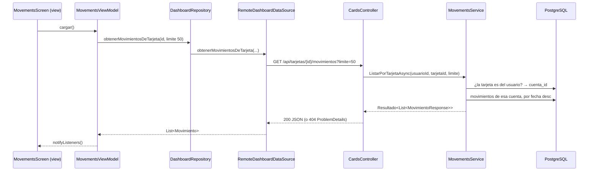

# BancoPanda

MVP de banca móvil del taller: app Flutter + API REST en .NET 10 + PostgreSQL.

- Código: `D:\PROYECTOS DEL TRABAJO\codigo`
  - `bancopanda-api` → backend (rama `feature/dasboard2`)
  - `bancopanda-app` → app Flutter (rama `feature/dashboard2`)
- Enunciado: `D:\Taller_Capacitacion_Mobile_v2.docx`
- Propuesta y diseño: `D:\BancoPanda.pdf`

## Notas

- [[Backend - cuentas, tarjetas y movimientos]] — los 4 endpoints nuevos y por qué están hechos así.
- [[Flutter - feature dashboard]] — cómo la app consume esos endpoints (MVVM).
- [[Datos de prueba (seed SQL)]] — usuarios, tarjetas y movimientos de ejemplo.
- [[Registro de cambios]] — todos los archivos nuevos y modificados, y cómo subirlos al repositorio.
- [[A tener en cuenta]] — límites, detalles para la demo del APK y cuidados con el seed.
- [[Plan - transferencias, efectivo móvil y tarjetas]] — plan por fases (16 oct 2026) explicado para exponer: qué se conecta con qué.
- [[Fase A - base de datos y API]] — lo que se hizo en el API: carpetas, tablas que usa cada endpoint y cómo funciona por dentro.
- [[Fase B - pantallas de la app]] — pantallas nuevas, endpoints que consume cada una y carpetas de la app.
- [[Fase C - datos de prueba, pruebas y documentación]] — seed, tests, README y `.http` del API, cómo correr todo y lo que falta.
- [[Efectivo móvil - pantallas 1 y 2]] — rediseño (17 oct): Mi número / Otro número y pantalla con los dos códigos; qué consume y en qué carpetas está.
- **Exposición:** [[00 - Guion de la exposición]] (carpeta `EXPOSICION DE BANCO PANDA`): repositorio, documentación, arquitectura, explicación técnica, demo y preguntas.
- **Exposición sencilla (solo dashboard):** [[00 - Guion corto]] (carpeta `EXPOSICION SENCILLA - DASHBOARD`): qué consume, cómo funciona cada botón, el código más importante y una chuleta.

## Qué se hizo (13 oct 2026)

Se rehízo el dashboard partiendo de `feature/dashboard2`, sin mezclar `feature/dashboard1` (sus endpoints chocaban con perfil).

| Parte | Resultado |
|---|---|
| Backend | `GET /api/cuentas`, `GET /api/tarjetas`, `GET /api/tarjetas/{id}/movimientos`, `GET /api/movimientos` |
| Base de datos | `Database/seed.sql`: 2 usuarios, 3 cuentas, 4 tarjetas, 34 movimientos |
| App | Dashboard real (ya no dice "en construcción") + pantalla de movimientos |
| Tests | 43 pasan en la app (25 nuevos) |

## Recorrido de una petición

## Decisiones tomadas

- **Movimiento de tarjeta = movimiento de la cuenta de esa tarjeta.** No se agregó `TarjetaId` a `Movimiento`, así que no hubo migración.
- **No se tocó perfil.** `UsersController` quedó igual; los controladores nuevos usan una clase base aparte.
- **El hasheo de contraseñas sigue igual** (BCrypt en el registro). El seed trae el hash ya calculado.
- **Sin comentarios en el código**, como en el resto del repo. La explicación vive en estas notas.

## Pendientes

- El código de la API y de la app aún no está en un commit; los pasos están en [[Registro de cambios]].
- Probar la app en el emulador de Android.
- El resto de límites y pendientes está en [[A tener en cuenta]].
