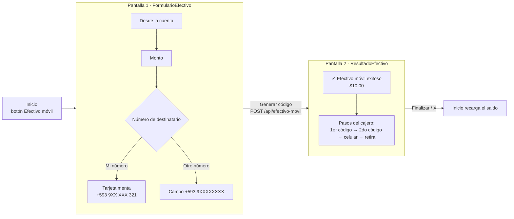
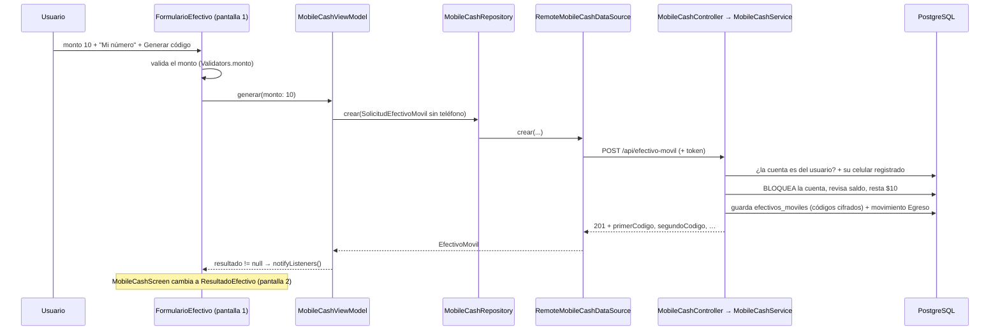

# Efectivo móvil - pantallas 1 y 2

Parte de [[BancoPanda]]. Rediseño del 17 oct 2026 basado en la pantalla de un banco real, con los colores de Banco Panda. Complementa [[Fase A - base de datos y API]] y [[Fase B - pantallas de la app]].

> [!info] Estado
> Hecho y **probado**: el API (con "Mi número", "Otro número" y un celular inválido) y las dos pantallas en la app (tamaño celular). **89 tests pasan** (los 2 de `api_client_test.dart` ya fallaban antes). **No necesitó migración.** Sin commit.

---

## Qué cambió (en una frase)

Ya **no hay que escribir el celular**: se usa el **registrado en la cuenta** ("Mi número") o se puede escribir **otro** ("Otro número"). Al generar, la app pasa a una pantalla con **dos códigos de 4 dígitos** y los pasos para **retirar en el cajero**.

| Antes | Ahora |
|---|---|
| Siempre había que escribir el celular | **Mi número** (automático) u **Otro número** |
| 1 código de 6 dígitos | **2 códigos de 4 dígitos** (primer y segundo código) |
| Pantalla con el código en cajitas + botón copiar | Pantalla tipo banco: **éxito + monto** y **pasos para el cajero** |

---

## Las dos pantallas



### Pantalla 1 — formulario
- **Desde la cuenta**: tarjetas oscuras para elegir (la elegida tiene borde verde).
- **Monto** + "Disponible: $…".
- **Número de destinatario**, dos pestañas:
  - **Mi número** (por defecto): tarjeta menta "Tu teléfono registrado **+593 9XX XXX 321**" con ✓. No se escribe nada.
  - **Otro número**: aparece el campo `+593 9XXXXXXXX`.
  - Si el usuario **no tiene celular registrado**, "Mi número" queda desactivada.
- Aviso: el dinero se descuenta al generar y los códigos vencen en 24 h.
- Botón **Generar código**.

### Pantalla 2 — resultado
- Solo una **X** arriba (no hay flecha de atrás).
- Tarjeta 1: círculo menta con ✓ verde, "**Efectivo móvil exitoso**" y el **monto** grande.
- Tarjeta 2: ícono de cajero y los pasos con **flechas verdes**:
  1. Elige *Transacciones sin tarjeta* y selecciona *Efectivo móvil*
  2. Ingresa el primer código: **1347**
  3. Ingresa el segundo código: **8716**
  4. Ingresa tu número de celular: **09X-XXX-X321**
  5. Retira tu efectivo
- Abajo: "Vence el …" y "Estos códigos se muestran una sola vez".
- Botón verde **Finalizar** → vuelve al inicio y **recarga el saldo**.

Colores: todos de `AppColors` (`primary`, `primaryDark`, `surfaceMint`, `cardGreen`, `surfaceDark`, `textSecondary`). Nada rosado.

---

## Qué consume cada pantalla

| Pantalla | Qué usa | De dónde viene |
|---|---|---|
| **1** | Lista de cuentas y saldos | `GET /api/cuentas` → `DashboardRepository.obtenerCuentas()` |
| **1** | Celular registrado | **No llama al API**: lo saca de la sesión, `AuthViewModel.usuario.telefono` (llegó en el login) |
| **1 → 2** | Generar los códigos | **`POST /api/efectivo-movil`** → `MobileCashRepository.crear()` |
| **2** | Códigos, celular, monto, vencimiento | **No llama al API**: usa la respuesta del POST guardada en `MobileCashViewModel.resultado` |

### El endpoint importante: `POST /api/efectivo-movil`

Lo que manda la app (`SolicitudEfectivoMovil.toJson()`):

```json
// "Mi número": NO se manda telefonoDestino
{ "solicitudId": "…", "cuentaId": "c1000000-…-0001", "monto": 10 }

// "Otro número":
{ "solicitudId": "…", "cuentaId": "c1000000-…-0001", "monto": 5, "telefonoDestino": "+593991234567" }
```

Lo que responde el API (`EfectivoMovil.fromJson()`):

```json
{
  "efectivoMovilId": "…",
  "primerCodigo": "1347",
  "segundoCodigo": "8716",
  "monto": 10,
  "moneda": "USD",
  "telefonoDestino": "+593987654321",
  "fechaCreacion": "2026-10-17T17:03:02Z",
  "fechaExpiracion": "2026-10-18T17:03:02Z",
  "estado": "Pendiente",
  "numeroCuenta": "5000900001",
  "saldoDisponible": 90.00
}
```

---

## Recorrido completo de "Generar código"



---

## Las partes MÁS importantes para que funcione

| Pieza | Archivo | Por qué es clave |
|---|---|---|
| **El cerebro de las pantallas** | `app: features/mobile_cash/viewmodel/mobile_cash_view_model.dart` | Guarda la cuenta elegida, si es "Mi número" (`usarMiNumero`), si está enviando, el error y el **resultado**. Crea **un `solicitudId` por pantalla** para no cobrar dos veces si se reintenta. |
| **El que decide qué pantalla mostrar** | `app: features/mobile_cash/view/mobile_cash_screen.dart` | Si `resultado` es null → pantalla 1; si no → pantalla 2. Bloquea el "atrás" mientras envía (`PopScope`). |
| **El que habla con el API** | `app: features/mobile_cash/data/datasources/remote_mobile_cash_data_source.dart` | Hace el `POST /api/efectivo-movil` con `ApiClient` (que pone el token). |
| **La forma del JSON** | `app: features/mobile_cash/model/solicitud_efectivo_movil.dart` y `efectivo_movil.dart` | `toJson()` **omite** el teléfono en "Mi número"; `fromJson()` lee los **dos códigos**. |
| **Las reglas del banco** | `api: Features/MobileCash/MobileCashService.cs` | Usa el celular registrado si no llega otro, genera los **2 códigos**, los **cifra** (BCrypt), **bloquea** la cuenta, revisa saldo, descuenta y crea el movimiento. |
| **La validación del pedido** | `api: Features/MobileCash/MobileCashDtos.cs` | `TelefonoDestino` opcional pero, si llega, con formato +593. Responde `PrimerCodigo` y `SegundoCodigo`. |

Piezas de apoyo:
- `app: core/utils/celular.dart` → `Celular.oculto()` (+593 9XX XXX 321) y `Celular.ocultoLocal()` (09X-XXX-X321).
- `app: features/auth/viewmodel/auth_view_model.dart` → `usuario.telefono` (el celular registrado).
- `app: features/dashboard/data/repositories/dashboard_repository.dart` → `obtenerCuentas()`.
- `api: Data/BloqueoCuentas.cs` (bloqueo) y `api: Common/ReglasMonto.cs` (monto válido, máx. $5000).

---

## Carpetas que usa cada pantalla

### App (`bancopanda-app/lib/`)

```
lib/
├── core/
│   ├── network/api_client.dart                 ← HTTP + token (las dos)
│   ├── utils/
│   │   ├── celular.dart                        ← ocultar el número (pantallas 1 y 2) ✏️
│   │   ├── validators.dart                     ← monto y celular (pantalla 1)
│   │   ├── input_formatters.dart               ← solo números en monto/celular (pantalla 1)
│   │   ├── formatters.dart                     ← $10.00 y "18 oct 2026, 12:03" (pantallas 1 y 2)
│   │   └── solicitud_id.dart                   ← identificador anti-duplicados (viewmodel)
│   ├── widgets/
│   │   ├── app_button.dart                     ← "Generar código" y "Finalizar"
│   │   ├── app_text_field.dart                 ← campos de monto y celular (pantalla 1)
│   │   └── paso_layout.dart                    ← esqueleto de la pantalla 1
│   └── theme/app_colors.dart                   ← colores Banco Panda (las dos)
└── features/
    ├── auth/viewmodel/auth_view_model.dart     ← celular registrado (pantalla 1)
    ├── dashboard/
    │   ├── data/repositories/dashboard_repository.dart ← cuentas (pantalla 1)
    │   └── view/widgets/cuenta_option.dart     ← tarjetas de cuenta (pantalla 1)
    └── mobile_cash/                            ← TODO lo del efectivo móvil
        ├── model/
        │   ├── solicitud_efectivo_movil.dart   ← lo que se envía ✏️
        │   └── efectivo_movil.dart             ← lo que llega (2 códigos) ✏️
        ├── data/
        │   ├── datasources/mobile_cash_data_source.dart
        │   ├── datasources/remote_mobile_cash_data_source.dart
        │   └── repositories/mobile_cash_repository.dart
        ├── viewmodel/mobile_cash_view_model.dart ← Mi número / Otro número ✏️
        └── view/
            ├── mobile_cash_screen.dart         ← decide pantalla 1 o 2 ✏️
            └── widgets/
                ├── formulario_efectivo.dart    ← PANTALLA 1 ✨
                └── resultado_efectivo.dart     ← PANTALLA 2 ✨
```

### API (`bancopanda-api/BancoPanda.Api/`)

```
BancoPanda.Api/
├── Features/MobileCash/
│   ├── MobileCashController.cs   ← POST /api/efectivo-movil
│   ├── MobileCashDtos.cs         ← teléfono opcional + 2 códigos ✏️
│   └── MobileCashService.cs      ← reglas: celular registrado, 2 códigos, cifrado ✏️
├── Entities/EfectivoMovil.cs     ← tabla efectivos_moviles (sin cambios)
├── Entities/Usuario.cs           ← de aquí sale el celular registrado (Telefono)
├── Data/BloqueoCuentas.cs        ← bloqueo de la cuenta
└── Common/ReglasMonto.cs         ← monto válido
```

---

## Detalles para explicar

- **¿Por qué no hizo falta migración?** La tabla no cambió: los dos códigos se guardan **juntos** en la misma columna `codigo_hash` (cifrados con BCrypt). Solo cambió lo que entra y sale del API.
- **¿Para qué sirve el celular?** En el cajero se pide **celular + los dos códigos**: son varias "llaves". Si alguien ve los códigos pero no sabe el celular, no puede retirar.
- **¿Llega un SMS?** No: los códigos se muestran en la app. Para SMS reales habría que conectar un proveedor (por ejemplo Twilio).
- **¿Y si se toca "Generar código" dos veces o falla la conexión?** El `solicitudId` es el mismo durante toda la pantalla: el API no descuenta dos veces (responde `409` al repetido).

## Tests

- `test/features/mobile_cash/mobile_cash_view_model_test.dart`: "Mi número" no manda teléfono, "Otro número" manda +593…, "Otro número" vacío no envía, sin celular registrado solo "Otro número", mismo id al reintentar, no enviar dos veces, 401.
- `test/core/celular_test.dart`: ocultar el número (+593 9XX XXX 321 y 09X-XXX-X321).
