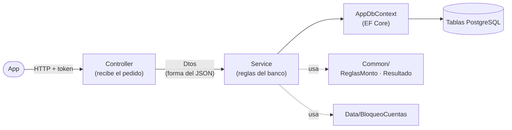
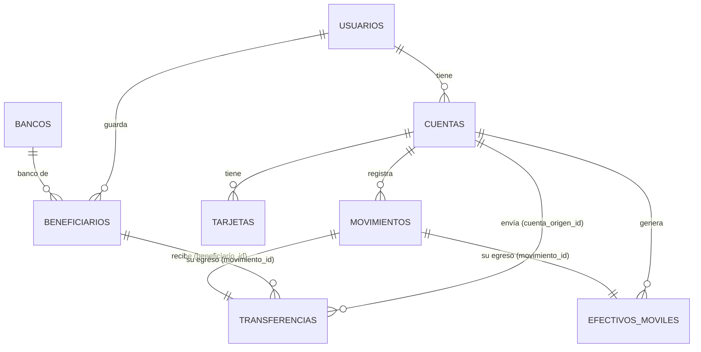
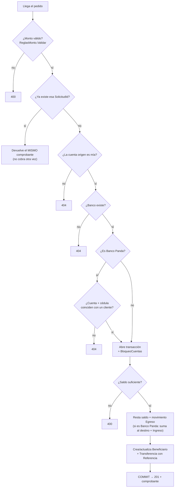

# Fase A - base de datos y API

Parte de [[BancoPanda]]. Lo que se hizo el 16 oct 2026 siguiendo [[Plan - transferencias, efectivo móvil y tarjetas]]. Explica **qué archivo usa a cuál**, **qué tablas consume cada endpoint** y **cómo funciona por dentro**.

> [!info] Estado
> Hecho, probado (24 pruebas contra una base temporal) y aplicado en la base local. **Sin commit todavía.**

---

## Mapa de carpetas del API

Todo está en `bancopanda-api/BancoPanda.Api/`. ✨ = nuevo, ✏️ = modificado.

```
BancoPanda.Api/
├── Entities/                  ← las TABLAS escritas como clases de C#
│   ├── Banco.cs            ✨  bancos para elegir (+ el id fijo de Banco Panda)
│   ├── Beneficiario.cs     ✨  personas a las que el usuario ya transfirió
│   ├── Transferencia.cs    ✨  el comprobante de cada transferencia
│   ├── EfectivoMovil.cs    ✨  retiro sin tarjeta con código
│   ├── Tarjeta.cs          ✏️  UltimosDigitos → NumeroTarjeta (16 dígitos)
│   ├── Cuenta.cs           ✏️  + listas Transferencias y EfectivosMoviles
│   └── Enum.cs             ✏️  + EstadoEfectivoMovil, + categoría EfectivoMovil
├── Data/
│   ├── AppDbContext.cs     ✏️  conecta clases ↔ tablas (tamaños, índices, relaciones, bancos precargados)
│   └── BloqueoCuentas.cs   ✨  bloquea cuentas mientras se mueve dinero
├── Common/                    ← herramientas que usan varias features
│   ├── ReglasMonto.cs      ✨  monto válido (> 0, 2 decimales, máx $5000) + hora de Ecuador
│   ├── ReglasValidacion.cs     (ya existía) regex de celular +593 y "solo letras"
│   ├── Resultado.cs            (ya existía) "salió bien" o "error + código HTTP"
│   └── ApiControllerBase.cs    (ya existía) saca el usuario del token
├── Features/                  ← una carpeta por funcionalidad (Controller + Service + Dtos)
│   ├── Banks/              ✨  GET /api/bancos
│   ├── Beneficiaries/      ✨  GET /api/beneficiarios
│   ├── Transfers/          ✏️  POST /api/transferencias (rehecho)
│   ├── MobileCash/         ✨  POST /api/efectivo-movil
│   ├── Cards/              ✏️  GET /api/tarjetas devuelve número completo + GeneradorTarjeta.cs ✨
│   └── Auth/AuthService.cs ✏️  al registrarse, la tarjeta nueva nace con 16 dígitos
├── Migrations/
│   └── 20261017021348_TransferenciasEfectivoMovilYTarjetas.cs  ✨
└── Program.cs              ✏️  registra los servicios nuevos
Database/seed.sql           ✏️  tarjetas de 16 dígitos + 3 beneficiarios de Andrea
```

### Las 3 capas de cada feature



- **Controller**: la "ventanilla". Revisa el token (`ApiControllerBase.TryGetUsuarioId`) y le pasa el pedido al Service.
- **Dtos**: la forma exacta del JSON que entra (`...Request`, con sus validaciones `[Required]`, `[RegularExpression]`) y que sale (`...Response`).
- **Service**: donde están las reglas del banco. Es el único que toca la base de datos.
- Todo se registra en `Program.cs` con `AddScoped<...Service>()` para que .NET lo cree solo cuando un Controller lo pide.

---

## Tablas nuevas y cómo se relacionan



| Tabla | Columnas importantes | Detalle |
|---|---|---|
| `bancos` | `banco_id`, `nombre`, `activo` | 9 bancos **precargados por la migración** (`HasData` en `AppDbContext`). Banco Panda tiene el id fijo `b0000000-…-0001` (`Banco.BancoPandaId`). |
| `beneficiarios` | `usuario_id`, `banco_id`, `numero_cuenta`, `cedula`, `nombre` | Un usuario no puede repetir el mismo banco + cuenta (índice único). Se crea/actualiza solo al transferir. |
| `transferencias` | `referencia`, `monto`, `fecha`, `solicitud_id`, `cuenta_origen_id`, `beneficiario_id`, `movimiento_id` | `referencia` = número de comprobante. `solicitud_id` evita cobrar dos veces. |
| `efectivos_moviles` | `telefono_destino`, `monto`, `codigo_hash`, `fecha_expiracion`, `estado`, `solicitud_id`, `cuenta_id`, `movimiento_id` | El código se guarda **cifrado** con BCrypt (igual que las contraseñas). |
| `tarjetas` | `numero_tarjeta` (16) | Reemplaza a `ultimos_digitos`. Índice único. |

> [!note] Lo que se añadió al modelo de Gabriela
> - `SolicitudId` en `Transferencia` y `EfectivoMovil` → protección contra cobros dobles.
> - Categoría `EfectivoMovil` en `CategoriaMovimiento` → esos movimientos tienen su propia categoría.

---

## Qué consume cada endpoint

| Endpoint | Archivos que intervienen | Tablas que lee ✅ / escribe ✍️ |
|---|---|---|
| `GET /api/bancos` | `Banks/BanksController` → `BanksService` | ✅ `bancos` |
| `GET /api/beneficiarios` | `Beneficiaries/BeneficiariesController` → `BeneficiariesService` | ✅ `beneficiarios`, `bancos`, `transferencias` (para ordenar por la más reciente) |
| `POST /api/transferencias` | `Transfers/TransfersController` → `TransfersService` + `ReglasMonto` + `BloqueoCuentas` | ✅ `cuentas`, `usuarios`, `bancos` · ✍️ `cuentas` (saldos), `movimientos`, `beneficiarios`, `transferencias` |
| `POST /api/efectivo-movil` | `MobileCash/MobileCashController` → `MobileCashService` + `ReglasMonto` + `BloqueoCuentas` + `ReglasValidacion.Celular` | ✅ `cuentas` · ✍️ `cuentas` (saldo), `movimientos`, `efectivos_moviles` |
| `GET /api/tarjetas` | `Cards/CardsController` → `CardsService` | ✅ `tarjetas`, `cuentas` |
| `POST /api/auth/registro` | `Auth/AuthService` + `Cards/GeneradorTarjeta` | ✍️ `usuarios`, `cuentas`, `movimientos`, `tarjetas` |

> [!warning] Endpoint que se quitó
> `GET /api/transferencias/destinatario` ya no existe: dejaba averiguar el nombre de cualquier cliente probando números de cuenta. Ahora para Banco Panda se exige **número + cédula** y el error es el mismo si falla cualquiera de los dos.

---

## Cómo funciona una transferencia por dentro

Archivo: `Features/Transfers/TransfersService.cs`, método `TransferirAsync`.



Ideas clave para explicar:

- **Transacción ("todo o nada")**: si algo falla a la mitad, no se guarda nada. Nunca queda dinero descontado sin destino.
- **Bloqueo** (`Data/BloqueoCuentas.cs`): usa `SELECT … FOR UPDATE`. Si llegan dos operaciones a la vez sobre la misma cuenta, la segunda espera a que la primera termine y ve el saldo real. Se bloquean siempre en el mismo orden para que dos operaciones no se queden esperándose entre sí.
- **SolicitudId** (anti-duplicados): la app genera un identificador único por intento. Si el pedido llega repetido (por ejemplo, la app reintenta porque el servidor tardó), el API devuelve el comprobante que ya existe. **Probado**: 3 pedidos iguales al mismo tiempo → 1 sola transferencia, 1 solo cobro.
- **Referencia**: fecha de Ecuador (`ReglasMonto.HoraEcuador`, UTC-5) + 6 dígitos al azar. Ej. `20261016190536`.
- **Descripción del movimiento** según el caso:
  - Banco Panda a otra persona → "Transferencia a Carlos Mendoza" / el otro ve "Transferencia recibida de Andrea Barroso".
  - Entre mis cuentas → "Transferencia a cuenta 5000900001" / "Transferencia desde cuenta 5000900002".
  - Otro banco → "Transferencia a Juan Pérez - Banco Pichincha" (solo se descuenta; se simula el envío).

## Cómo funciona el efectivo móvil

Archivo: `Features/MobileCash/MobileCashService.cs`, método `CrearAsync`.

1. Valida monto (`ReglasMonto`). El celular es **opcional**: si no llega se usa el **registrado** del usuario; si llega, debe ser +593 (`ReglasValidacion.Celular`). (Cambio del 17 oct, ver [[Efectivo móvil - pantallas 1 y 2]].)
2. Si esa `SolicitudId` ya existe → **409** "ya se generó" (el código no se puede volver a mostrar porque está cifrado).
3. Revisa que la cuenta sea del usuario, abre transacción y la **bloquea**.
4. Revisa saldo, lo resta y crea un movimiento **Egreso** con categoría `EfectivoMovil`.
5. Genera **dos códigos de 4 dígitos** al azar, guarda solo el **hash** de ambos juntos (BCrypt) y una fecha de vencimiento de **24 h**. Estado: `Pendiente`.
6. Responde con los dos códigos **en texto una sola vez** (`primerCodigo`, `segundoCodigo`).

## Cómo funcionan las tarjetas de 16 dígitos

- `Features/Cards/GeneradorTarjeta.cs`: arma el número con el prefijo de la marca (Visa `4`, Mastercard `51`–`55`), dígitos al azar y un **dígito verificador de Luhn** (la misma fórmula que usan las tarjetas reales para detectar errores de tipeo).
- `AuthService` lo usa al registrar un usuario y revisa que el número no exista ya.
- `GET /api/tarjetas` devuelve `numeroTarjeta` **y también** `ultimosDigitos`, para que la versión anterior de la app siga funcionando mientras se actualiza.

---

## La migración

Archivo: `Migrations/20261017021348_TransferenciasEfectivoMovilYTarjetas.cs`.

1. Se **deshizo** la migración anterior (`AgregarTransferencias`), que nunca se subió a git.
2. Se generó una nueva con `dotnet ef migrations add`.
3. Se **corrigió a mano**: EF Core quería borrar `ultimos_digitos` y crear `numero_tarjeta` vacío (se perdían los datos). Ahora:
   1. agrega `numero_tarjeta`,
   2. lo llena con SQL (`UPDATE tarjetas SET numero_tarjeta = prefijo + dígitos + ultimos_digitos`),
   3. recién ahí borra `ultimos_digitos`.
4. Probada en los dos caminos: base **existente** (convierte las tarjetas conservando los 4 últimos y se puede deshacer) y base **nueva** desde cero + seed dos veces.

Cuando se haga `git push` a la rama de Render, esta migración se aplicará sola en Supabase.

---

## Qué falta después de la Fase A

- La app todavía usa la forma vieja de transferir → se arregla en la **Fase B**.
- README y `BancoPanda.Api.http` aún describen las transferencias viejas → **Fase C**.
- Volver a ejecutar `Database/seed.sql` en pgAdmin para tener las tarjetas de 16 dígitos y los beneficiarios de prueba.
