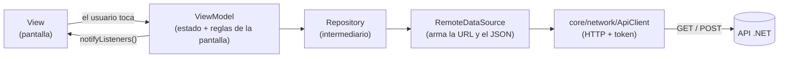
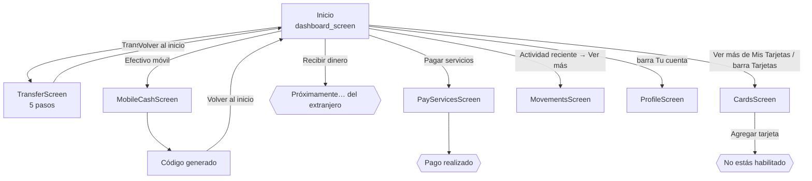
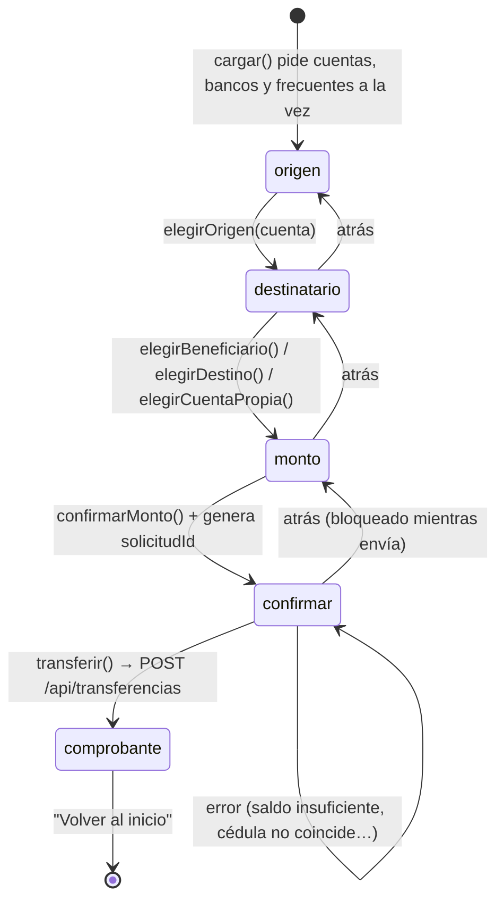

# Fase B - pantallas de la app

Parte de [[BancoPanda]]. Lo que se hizo el 16 oct 2026 en la app Flutter siguiendo [[Plan - transferencias, efectivo móvil y tarjetas]]. Usa el API de [[Fase A - base de datos y API]].

> [!info] Estado
> Hecho y **probado en la app real** (web, tamaño celular, contra el API local): transferir a Banco Panda y a otro banco, efectivo móvil, pagar servicios, recibir dinero, mis tarjetas y el ojito. **85 tests pasan** (los 2 que fallan en `api_client_test.dart` ya fallaban antes). **Sin commit.**

---

## La idea en una frase

Cada botón del inicio abre una pantalla nueva; cada pantalla tiene su **ViewModel** (el cerebro), que le pide los datos a un **Repository**, que usa un **DataSource**, que habla con el **API** por medio de `ApiClient`.



- La **View** solo dibuja y avisa lo que tocó el usuario.
- El **ViewModel** guarda el estado (`cargando`, `error`, el paso actual…) y llama a `notifyListeners()` para que la pantalla se redibuje.
- El **DataSource** es el único que sabe las rutas (`/api/...`) y convierte JSON ↔ modelos (`fromJson` / `toJson`).
- `ApiClient` agrega el **token** (`Authorization: Bearer …`) y convierte los errores del API en mensajes en español (`AppException`).

---

## Endpoints que consume la app

| Endpoint | Para qué | Quién lo llama (DataSource → ViewModel) |
|---|---|---|
| `POST /api/auth/login` | Iniciar sesión | `RemoteAuthDataSource` → `AuthViewModel` (ya existía) |
| `GET /api/cuentas` | Cuentas y saldos | `RemoteDashboardDataSource` → `DashboardViewModel`, **`TransferViewModel`**, **`MobileCashViewModel`** |
| `GET /api/tarjetas` | Tarjetas con número completo y cuenta asociada | `RemoteDashboardDataSource` → `DashboardViewModel`, **`CardsViewModel`** |
| `GET /api/movimientos?limite=` | Actividad reciente (5) y pantalla Movimientos (50) | `RemoteDashboardDataSource` → `DashboardViewModel`, `MovementsViewModel` |
| ✨ `GET /api/bancos` | Lista del desplegable "Banco" | `RemoteTransfersDataSource` → `TransferViewModel` |
| ✨ `GET /api/beneficiarios` | Lista de **frecuentes** | `RemoteTransfersDataSource` → `TransferViewModel` |
| ✨ **`POST /api/transferencias`** | Hacer la transferencia y recibir el comprobante | `RemoteTransfersDataSource` → `TransferViewModel.transferir()` |
| ✨ **`POST /api/efectivo-movil`** | Generar el código de retiro | `RemoteMobileCashDataSource` → `MobileCashViewModel.generar()` |

> [!note] Que ya no usa
> - `GET /api/tarjetas/{id}/movimientos`: las tarjetas del inicio ya no se pueden tocar (los datos completos están en **Mis tarjetas**). El endpoint sigue existiendo en el API.
> - `GET /api/transferencias/destinatario`: se quitó en la Fase A.

### Los dos más importantes (los que mueven dinero)

**`POST /api/transferencias`** — lo arma `SolicitudTransferencia.toJson()`:

```json
{
  "solicitudId": "7c0f…-…",          // generado por la app (core/utils/solicitud_id.dart)
  "cuentaOrigenId": "c1000000-…-0001",
  "bancoId": "b0000000-…-0001",       // Banco Panda u otro
  "numeroCuenta": "5000900003",
  "cedula": "0923456781",
  "nombre": "Carlos Mendoza",         // opcional
  "monto": 12.5
}
```

Responde `201` con el comprobante → `Comprobante.fromJson()`: `referencia`, `fecha`, `monto`, `cuentaOrigen`, `banco`, `cuentaDestino`, `beneficiario`, `saldoDisponible`.

**`POST /api/efectivo-movil`** — lo arma `SolicitudEfectivoMovil.toJson()`:

```json
{
  "solicitudId": "…",
  "cuentaId": "c1000000-…-0001",
  "telefonoDestino": "+593987654321",   // solo con "Otro número"; con "Mi número" no se envía
  "monto": 20
}
```

Responde `201` → `EfectivoMovil.fromJson()`: `primerCodigo` y `segundoCodigo` (4 dígitos cada uno, **solo esta vez**), `fechaExpiracion`, `saldoDisponible`… Detalle en [[Efectivo móvil - pantallas 1 y 2]].

> [!tip] ¿Qué es `solicitudId`?
> Un identificador único (UUID) que la app genera **una vez por intento**. Si el servidor tarda y la app reintenta, manda el **mismo** id y el API no cobra dos veces. Si el usuario cambia el monto, se genera uno nuevo. Archivo: `lib/core/utils/solicitud_id.dart`.

---

## Mapa de carpetas de la app

Todo en `bancopanda-app/lib/`. ✨ = nuevo, ✏️ = modificado, 🚚 = movido.

```
lib/
├── core/                                ← cosas que usan varias pantallas
│   ├── di/providers.dart            ✏️  crea los Repository (+ Transfers y MobileCash)
│   ├── router/app_router.dart       ✏️  rutas nuevas: /transferir, /efectivo-movil, /pagar-servicios, /tarjetas
│   ├── network/api_client.dart          (igual) HTTP + token + errores
│   ├── utils/
│   │   ├── solicitud_id.dart        ✨  genera el UUID anti-duplicados
│   │   ├── validators.dart          ✏️  numeroCuenta (6-20), cedulaBeneficiario, nombreOpcional, monto
│   │   ├── input_formatters.dart    ✏️  numeroCuenta, cedula, monto (coma→punto, 2 decimales)
│   │   └── formatters.dart          ✏️  fechaComprobante ("16 oct 2026, 21:35")
│   └── widgets/
│       ├── detalle_row.dart         🚚  filas "etiqueta → valor" del comprobante y tarjetas
│       ├── paso_layout.dart         🚚  esqueleto de cada paso (título + contenido + botón) y MensajeError
│       └── status_dialog.dart           (igual) diálogo con ícono: "Pago realizado", "Próximamente"…
└── features/
    ├── dashboard/                   ✏️  INICIO
    │   ├── model/tarjeta.dart       ✏️  numeroTarjeta, numeroCuenta, numeroFormateado, ultimosDigitos
    │   ├── model/movimiento.dart    ✏️  categoría "Efectivo móvil"
    │   ├── data/repositories/dashboard_repository.dart ✏️ + obtenerCuentas(), obtenerTarjetas()
    │   ├── view/dashboard_screen.dart  ✏️ conecta los 4 botones y los "Ver más"
    │   └── view/widgets/
    │       ├── balance_card.dart    ✏️  sin montos por cuenta; el ojito oculta los números
    │       ├── quick_actions.dart   ✏️  4 botones con su acción
    │       ├── dashboard_bottom_bar.dart ✏️ Inicio · Tarjetas · Tu cuenta
    │       ├── bank_card.dart       ✏️  puede mostrar el número completo
    │       └── cuenta_option.dart   🚚  tarjeta oscura de una cuenta (origen)
    ├── transfers/                   ✏️  TRANSFERIR
    │   ├── model/       banco · beneficiario · destino · solicitud_transferencia · comprobante
    │   ├── data/        transfers_data_source · remote_transfers_data_source · transfers_repository
    │   ├── viewmodel/transfer_view_model.dart
    │   └── view/        transfer_screen.dart + steps/ (5 pasos) + widgets/ (destino_card, pasos_indicator)
    ├── mobile_cash/                 ✨  EFECTIVO MÓVIL
    │   ├── model/       efectivo_movil · solicitud_efectivo_movil
    │   ├── data/        mobile_cash_data_source · remote_… · mobile_cash_repository
    │   ├── viewmodel/mobile_cash_view_model.dart
    │   └── view/mobile_cash_screen.dart   (formulario + pantalla del código)
    ├── services/                    ✨  PAGAR SERVICIOS (sin API)
    │   └── view/pay_services_screen.dart
    └── cards/                       ✨  MIS TARJETAS
        ├── viewmodel/cards_view_model.dart
        └── view/cards_screen.dart
```

---

## Mapa de pantallas



Al volver de **Transferir** o **Efectivo móvil**, el inicio **siempre recarga** (`_abrirYRecargar` en `dashboard_screen.dart`), así el saldo nunca queda viejo.

---

## Cómo funciona cada pantalla

### 1. Transferir — `features/transfers/`

Un solo `TransferScreen` con 5 pasos. El paso actual vive en `TransferViewModel.paso` y la pantalla dibuja el widget que toca (`steps/…`).



| Paso | Archivo | Qué ve el usuario |
|---|---|---|
| 1 Origen | `steps/origen_step.dart` | Sus cuentas en tarjetas oscuras (`CuentaOption`) con el saldo disponible |
| 2 Destinatario | `steps/destinatario_step.dart` | Pestañas **Otra persona / Mis cuentas**. En "Otra persona": **Frecuentes** (`DestinoCard`) y **Nuevo destinatario** (banco, cuenta, cédula, nombre opcional) |
| 3 Monto | `steps/monto_step.dart` | A quién envía, campo de monto, "Disponible" y "Máximo $5,000.00" |
| 4 Confirmar | `steps/confirmar_step.dart` | Monto grande + Desde, Banco, Cuenta destino, Cédula, Beneficiario. Aviso: "al instante" (Banco Panda) o "según horarios" (otro banco) |
| 5 Comprobante | `steps/comprobante_step.dart` | Check verde, Referencia, fecha, Desde, Banco, Para, Saldo disponible |

Reglas que cuida el ViewModel:
- **Frecuentes** no muestra la propia cuenta de origen.
- **Misma cuenta** en Banco Panda → error sin llamar al API.
- **Mis cuentas** arma el destino con Banco Panda + la cédula y el nombre del usuario.
- **Mientras envía**: no se puede retroceder ni salir (`PopScope`), ni tocar Transferir dos veces.
- Si el API responde **401** (sesión vencida) → cierra la sesión.

### 2. Efectivo móvil — `features/mobile_cash/`

- `MobileCashScreen` tiene dos caras: **pantalla 1** `widgets/formulario_efectivo.dart` (cuenta, monto y **Mi número / Otro número**) y **pantalla 2** `widgets/resultado_efectivo.dart` (éxito + monto y los **pasos del cajero con los dos códigos**). Detalle completo en [[Efectivo móvil - pantallas 1 y 2]].
- `MobileCashViewModel` crea **un `solicitudId` por pantalla**: si falla y el usuario reintenta, el API no descuenta dos veces.
- Validaciones de la app: monto (`Validators.monto`) y, solo con "Otro número", celular (`Validators.celular`, 9 dígitos que empiezan con 9).
- Avisos: "El dinero se descuenta al generar los códigos" y "Estos códigos se muestran una sola vez".

### 3. Pagar servicios — `features/services/`

- Solo visual, **no llama al API ni descuenta dinero**.
- Lista de **3 servicios** (17 oct): Agua potable (Interagua), Luz eléctrica (CNEL EP) e Internet (Netlife). Al tocar uno → `mostrarEstado(...)` "Pago realizado".

### 4. Recibir dinero

- Solo un diálogo desde `dashboard_screen.dart` (`_recibirDinero`): "Próximamente podrás recibir dinero del extranjero".

### 5. Mis tarjetas — `features/cards/`

- `CardsViewModel.cargar()` → `DashboardRepository.obtenerTarjetas()` → `GET /api/tarjetas`.
- Cada tarjeta se dibuja con `BankCard(numeroCompleto: true)` y debajo un `DetalleBox`: Número, Titular, Vence, Tipo, Marca, Estado, Cuenta asociada.
- Botón **Agregar tarjeta** → diálogo "No estás habilitado para tener una nueva tarjeta".

### 6. Inicio — `features/dashboard/`

- **Tarjeta de saldo** (`balance_card.dart`): solo el total; cada cuenta con su ícono. El **ojito** oculta el total **y** los números (`•••• 0001`).
- **Barra de abajo** (`dashboard_bottom_bar.dart`): Inicio · Tarjetas · Tu cuenta. Movimientos se ve desde *Actividad reciente → Ver más*.
- Las tarjetas del inicio **no son clicables**. A **Mis tarjetas** (`/tarjetas`) se entra por **Ver más** o por la barra de abajo.

---

## Tests (carpeta `test/`)

| Archivo | Qué prueba |
|---|---|
| `features/transfers/transfer_view_model_test.dart` | Flujo completo, mismo `solicitudId` al reintentar, id nuevo si cambia el monto, frecuentes, mis cuentas, misma cuenta, errores, 401, no enviar dos veces, retroceder |
| `features/mobile_cash/mobile_cash_view_model_test.dart` | Genera con +593, mismo id al reintentar, no enviar dos veces, 401 |
| `features/cards/cards_view_model_test.dart` | Carga tarjetas y titular, error del backend |
| `core/solicitud_id_test.dart` | UUID v4 válido y distinto cada vez |
| `core/validators_test.dart` | Número de cuenta 6-20, cédula del beneficiario, nombre opcional, monto |
| `helpers/fake_*_data_source.dart` | "API de mentira" para probar sin servidor |

Comando: `flutter test` (en `bancopanda-app`).

---

## Límites para mencionar

- **Pagar servicios** no descuenta dinero (solo visual).
- A **otros bancos** el dinero solo sale de la cuenta (se simula el envío).
- Si un **efectivo móvil vence**, el dinero no se devuelve solo (mejora futura).
- El **número completo de tarjeta** se muestra en la app: en un banco real no se haría (norma PCI).
