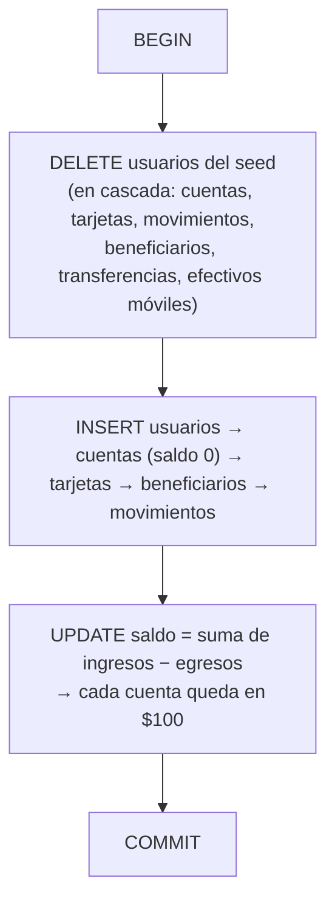
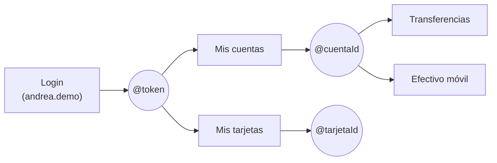

# Fase C - datos de prueba, pruebas y documentación

Parte de [[BancoPanda]]. Cierre del plan [[Plan - transferencias, efectivo móvil y tarjetas]] (16 oct 2026), después de [[Fase A - base de datos y API]] y [[Fase B - pantallas de la app]].

> [!info] Estado
> Datos de prueba, tests, prueba real y documentación: **hechos**. Pendiente: **revisión de seguridad**, **commit** y **despliegue** (se avisa antes de cada uno). **Sin commit.**

---

## Qué cubre la Fase C

| Parte | Dónde | Estado |
|---|---|---|
| Datos de prueba | `bancopanda-api/Database/seed.sql` | ✅ (se adelantó en la Fase A porque las tarjetas cambiaron) |
| Tests de la app | `bancopanda-app/test/` | ✅ (se hicieron junto con la Fase B) |
| Prueba real en la app | navegador, tamaño celular | ✅ (Fase B) |
| README del API | `bancopanda-api/README.md` | ✅ hoy |
| Ejemplos del API | `bancopanda-api/BancoPanda.Api/BancoPanda.Api.http` | ✅ hoy, y probados |

---

## 1. Datos de prueba (`Database/seed.sql`)

Qué crea (contraseña de ambos: `Panda2026`):

| Usuario | Cédula | Cuentas ($100 cada una) | Tarjetas | Extra |
|---|---|---|---|---|
| `andrea.demo` | `0912345678` | `5000900001` ahorros, `5000900002` corriente | Visa `4754 0091 7145 4821`, Mastercard `5317 1607 9096 7730` | 26 movimientos, **3 frecuentes**: Carlos (Banco Panda), María López (Pichincha), Luis Torres (Guayaquil) |
| `carlos.demo` | `0923456781` | `5000900003` ahorros | Visa `4535 5721 1793 1596`, Mastercard inactiva `5129 9221 7403 3068` | 8 movimientos |

Cómo funciona por dentro:

- Se puede correr **las veces que quieras**: siempre deja los datos como nuevos y con fechas recientes.
- **No** toca a los usuarios registrados desde la app.
- Los **bancos no están en el seed**: los crea la migración (`HasData` en `AppDbContext`).
- Los números de tarjeta pasan la **verificación de Luhn** (como las reales) y los Mastercard empiezan con 51-55.
- Necesita que la base tenga **todas las migraciones**: si falla con `column ... does not exist`, primero `dotnet ef database update`.

---

## 2. Tests

### App (`bancopanda-app`, comando `flutter test`)

- **85 pasan**. Fallan **2** en `test/core/api_client_test.dart` que **ya fallaban antes** de este trabajo: esperan la dirección vieja `http://10.0.2.2:5258` y ahora la app arranca apuntando a Render.
- Tests nuevos (detalle en [[Fase B - pantallas de la app]]): transferir, efectivo móvil, mis tarjetas, identificador anti-duplicados, validaciones y formato de fecha.

### API

- El API **no tiene proyecto de tests automáticos** todavía (es un pendiente; la skill `engineering:testing-strategy` sirve para armarlo).
- Se probó **a mano contra una base temporal** (un PostgreSQL desechable en el puerto 55432, para no tocar la base real):
  - Fase A: 24 escenarios (transferencias, efectivo móvil, errores, **3 pedidos iguales al mismo tiempo → 1 solo cobro**).
  - Migración probada en base **nueva** y en base **existente** (convierte tarjetas y se puede deshacer).
  - Fase C: se ejecutó **el archivo `.http` completo** (ver abajo).

---

## 3. README del API (`bancopanda-api/README.md`)

Qué se actualizó:

- **Estructura de carpetas** con las entidades y features nuevas (`Banks`, `Beneficiaries`, `Transfers`, `MobileCash`, `BloqueoCuentas`, `ReglasMonto`).
- **Paso 4** ahora explica que `dotnet ef database update` aplica solo lo que falta (no hay que borrar la base) y cómo ver la lista de migraciones.
- **Datos de prueba**: tabla con usuarios, cuentas y saldos de $100.
- **Tabla de endpoints** completa. Se **corrigió** algo que estaba mal desde antes: el cambio de contraseña es `PUT /api/usuarios/me/contrasena` (no `PUT /me`). Se quitó `/destinatario`.
- Secciones nuevas: **Transferencias** (JSON de ejemplo, Banco Panda vs otros bancos), **Efectivo móvil**, **Reglas del dinero** (monto, transacción + bloqueo, `solicitudId`) y **Despliegue (Render + Supabase)**.
- Dos **problemas comunes** nuevos: "archivo en uso" (hay un `dotnet run` abierto) y el seed que falla por migraciones pendientes.

---

## 4. Ejemplos del API (`BancoPanda.Api.http`)

Es un archivo con peticiones listas para ejecutar desde **VS Code** (extensión REST Client) o **Visual Studio**: se presiona *Send Request* encima de cada una.

Orden de uso:

- `@token` se toma de la respuesta del **Login**; `@cuentaId` de **Mis cuentas**; `@tarjetaId` de **Mis tarjetas**. Por eso hay que ejecutar esas primero.
- `{{$guid}}` crea un `solicitudId` nuevo en cada envío.
- Hay ejemplos con **id fijo** para ver la protección anti-duplicados: envíalos **dos veces** y la transferencia devuelve el mismo comprobante; el efectivo móvil responde `409`.

| Grupo | Peticiones |
|---|---|
| Sesión y perfil | Registro (`maria.prueba`), Login (`andrea.demo`), Ver/Editar perfil, Cambiar contraseña (`204`), Sin token (`401`) |
| Consultas | Cuentas, Tarjetas, Movimientos, Movimientos de tarjeta, tarjeta ajena (`404`), límite inválido (`400`) |
| Transferir | Bancos, Beneficiarios, a Carlos (Banco Panda), a Pichincha, misma solicitud dos veces, cédula equivocada (`404`), monto > $5000 (`400`) |
| Efectivo móvil | Generar código (`201`), repetir (`409`), celular sin +593 (`400`) |

**Probado**: se ejecutaron las **22 peticiones en orden** contra el API con la base temporal y cada una respondió lo que dice su título.

> [!warning] Cambiar contraseña
> El ejemplo cambia la contraseña de `andrea.demo` a `Panda2027`. Para volver a `Panda2026`, ejecuta otra vez `seed.sql`.

---

## 5. Cómo correr todo en local (resumen)

1. **Base**: en pgAdmin, base `bancopanda` del servidor PostgreSQL 18. Si faltan migraciones: `dotnet ef database update` en `bancopanda-api/BancoPanda.Api`.
2. **Datos**: Query Tool → abrir `Database/seed.sql` → F5.
3. **API**: en `bancopanda-api/BancoPanda.Api` → `dotnet run` → http://localhost:5258/openapi/v1.json.
4. **App**: en `bancopanda-app` → `flutter run -d windows` (o `-d chrome`). En el login, engranaje ⚙ → `http://localhost:5258` (emulador Android: `http://10.0.2.2:5258`).
5. Entrar con `andrea.demo` / `Panda2026`.

---

## Lo que falta (en este orden)

1. **Revisión de seguridad** (`/security-review`). Hay que abrir la sesión de Claude **dentro** de la carpeta del repo, porque la skill necesita un repositorio git.
2. **Commit** en una rama nueva de cada repo (API y app).
3. **Antes de subir**: `engineering:deploy-checklist`. Al hacer push a la rama de Render, la migración se aplica sola en Supabase.
4. (Opcional) Cargar `seed.sql` en el **SQL Editor de Supabase** después del despliegue.
5. Pendientes menores del `/code-review`: que el seed no choque si alguien ya registró `andrea.demo`, y un endpoint para volver a ver un comprobante.
