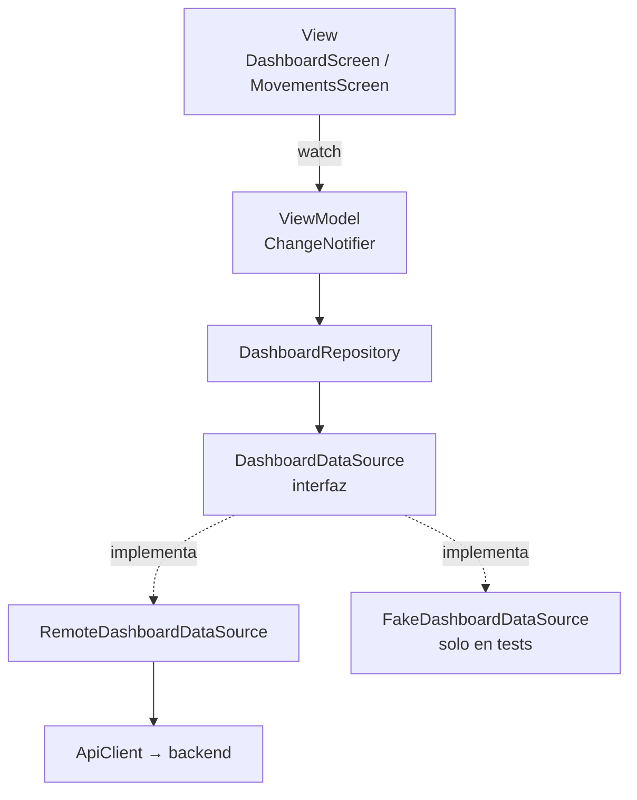

# Flutter - feature dashboard

Parte de [[BancoPanda]]. Proyecto: `bancopanda-app`. Consume los endpoints de [[Backend - cuentas, tarjetas y movimientos]].

## Estructura (feature-first + MVVM)

```
lib/
├── core/
│   ├── network/api_client.dart     ← nuevo método getList
│   ├── utils/formatters.dart       ← nuevo: montos, fechas, vencimiento
│   ├── router/app_router.dart      ← nueva ruta /movimientos
│   └── di/providers.dart           ← registra DashboardRepository
└── features/dashboard/
    ├── model/        Cuenta · Tarjeta · Movimiento · ResumenDashboard
    ├── data/
    │   ├── datasources/   DashboardDataSource (interfaz) · RemoteDashboardDataSource
    │   └── repositories/  DashboardRepository
    ├── viewmodel/    DashboardViewModel · MovementsViewModel
    └── view/
        ├── dashboard_screen.dart · movements_screen.dart
        └── widgets/  balance_card · bank_card · cards_carousel · movimiento_tile ...
```

## Las capas, de abajo hacia arriba



### 1. `ApiClient.getList`

Antes `ApiClient` solo entendía respuestas que fueran un objeto `{...}`; una lista `[...]` la convertía en `{}`. Ahora `_send` devuelve el JSON tal cual y cada método decide:

- `get`, `post`, `put` → lo tratan como objeto (igual que antes).
- `getList` → exige una lista; si llega otra cosa lanza `AppException` en vez de mostrar "no hay datos" por error.

### 2. Modelos

Cada uno tiene `fromJson`. Detalles que importan:

- Los enums llegan como texto (`"Egreso"`) y se convierten con `values.byName(valor.toLowerCase())`.
- `CategoriaMovimiento.fromJson` cae en `otros` si el backend agrega una categoría que la app no conoce: una categoría nueva no debe romper la lista.
- `fecha` se pasa a hora local con `.toLocal()` (el backend la manda en UTC).
- `saldo` y `monto` usan `(json['saldo'] as num).toDouble()`, porque `100` llega como `int` y `100.5` como `double`.

### 3. Data source

`DashboardDataSource` es una **interfaz**: dice qué se puede pedir, no cómo. `RemoteDashboardDataSource` lo hace por HTTP. En los tests se usa un `FakeDashboardDataSource` que responde sin red. Por eso el ViewModel se puede probar sin levantar el backend.

### 4. Repository

`obtenerResumen` pide cuentas, tarjetas y movimientos **en paralelo**:

```dart
final cuentas = _dataSource.obtenerCuentas();
final tarjetas = _dataSource.obtenerTarjetas();
final movimientos = _dataSource.obtenerMovimientos(limite: limiteMovimientos);
await Future.wait([cuentas, tarjetas, movimientos]);
```

Las tres llamadas salen a la vez y `Future.wait` espera a todas. Si una falla, relanza ese error tal cual (un `AppException`) y el ViewModel lo muestra. El dashboard tarda lo que tarde la más lenta, no la suma de las tres.

### 5. ViewModels

Los dos siguen el mismo ciclo que `ProfileViewModel`:

```dart
cargando = true; error = null; notifyListeners();
try {
  resumen = await _repository.obtenerResumen(...);
} on AppException catch (e) {
  error = e.message;
  if (e.statusCode == 401) await _auth.logout();
} finally {
  cargando = false;
  if (_activo) notifyListeners();
}
```

- `cargando`, `error` y los datos son los **tres estados** que pide el taller (carga, error, vacío/datos).
- Un `401` significa que el token venció: se cierra sesión y el router manda al login.
- `_activo` evita avisar a una pantalla que ya se cerró (por ejemplo, si se cierra sesión mientras llega la respuesta).
- Si falla un refresco, **se conserva lo que ya estaba en pantalla** y solo aparece el aviso con "Reintentar".

`MovementsViewModel` recibe una `Tarjeta?` opcional: con tarjeta llama al endpoint de esa tarjeta; sin tarjeta, al de todos los movimientos. Una sola pantalla sirve para ambos casos.

### 6. Vistas

- `DashboardScreen` crea su ViewModel con `ChangeNotifierProvider(create: ...)..cargar()`. El ViewModel **nace y muere con la pantalla**: al cerrar sesión se destruye y el siguiente usuario empieza sin datos del anterior.
- Tocar una tarjeta → `context.push(AppRoutes.movements, extra: tarjeta)`.
- "Ver más" de Actividad reciente y la pestaña "Movimientos" → la misma pantalla, sin tarjeta.
- "Tu cuenta" → perfil (ahí siguen el modo oscuro y cerrar sesión).
- El ojo oculta el saldo total, el de cada cuenta y el de cada tarjeta a la vez, porque el estado `saldoVisible` está en el ViewModel.
- Deslizar hacia abajo recarga (`RefreshIndicator`).

## Por qué el ViewModel del dashboard no está en `providers.dart`

`AuthViewModel` y `ProfileViewModel` son globales porque viven toda la app. El del dashboard guarda datos de **un** usuario; si fuera global habría que acordarse de vaciarlo al cerrar sesión. Creándolo junto a la pantalla, eso pasa solo. Lo que sí es global es `DashboardRepository`, que no guarda estado.

## Tests

```bash
flutter test
```

| Archivo | Qué comprueba |
|---|---|
| `dashboard_view_model_test.dart` | Carga, estados, error, 401 → logout, ojo, cierre de pantalla a mitad de carga |
| `movements_view_model_test.dart` | Con tarjeta / sin tarjeta, 404, 401 |
| `remote_dashboard_data_source_test.dart` | Rutas exactas y lectura del JSON real del backend |
| `formatters_test.dart` | `$12,456.80`, `Hoy, 09:05`, `05/27` |
| `api_client_test.dart` | `getList` con lista, sin lista y con error |

## Probarlo a mano

1. Levantar la API y cargar [[Datos de prueba (seed SQL)]].
2. `flutter run`. En el emulador de Android la dirección por defecto (`http://10.0.2.2:5258`) ya sirve; en web o celular se cambia desde el engranaje del login.
3. Entrar con `andrea.barroso@bancopanda.test`.
