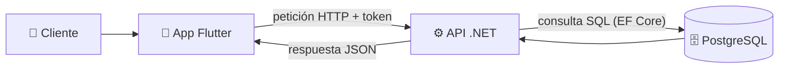
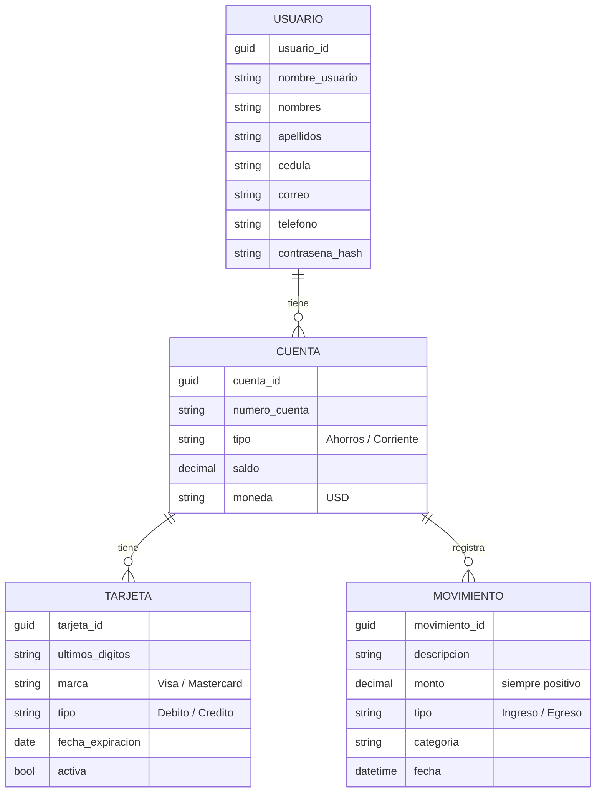

# Cómo funciona Banco Panda

← [[00 - Índice Banco Panda]]

## La idea en una frase

Banco Panda es una **app de banco móvil**: el cliente se registra, inicia sesión y ve en una sola pantalla su dinero, sus tarjetas y sus últimos movimientos.

## Las dos piezas

Piensa en un restaurante:

- La **app (Flutter)** es el **mesero**: está frente al cliente, toma los pedidos y le muestra los platos bonitos.
- La **API (.NET)** es la **cocina**: recibe los pedidos, busca los ingredientes en la **despensa (PostgreSQL)** y devuelve el plato.
- El **token JWT** es el **número de mesa**: la cocina solo entrega comida a quien tiene un número válido, y solo la de *esa* mesa.

## Qué datos guarda el banco

Hay 4 tablas, y se relacionan como una familia:

- Un **usuario** puede tener varias **cuentas** (ahorros o corriente).
- Cada **cuenta** tiene su **saldo** y puede tener varias **tarjetas**.
- Una tarjeta **no tiene saldo propio**: muestra el saldo de la cuenta a la que pertenece.
- Los **movimientos** pertenecen a una cuenta. El monto siempre es positivo; el campo `tipo` dice si **suma** (Ingreso) o **resta** (Egreso).

## El recorrido de un cliente

### 1. Registro
El cliente llena sus datos (usuario, cédula, nombres, correo, celular +593, contraseña) y acepta términos.
La API, en un solo paso, crea automáticamente:
- su **usuario** (la contraseña se guarda cifrada con BCrypt, nunca en texto plano),
- una **cuenta de ahorros** con número `5000XXXXXX`,
- un **bono de bienvenida de $100** (saldo inicial + un movimiento "Bono de bienvenida"),
- una **tarjeta Visa Débito** que vence en 4 años.

Y le devuelve la sesión iniciada (no tiene que volver a loguearse).

### 2. Inicio de sesión
Con **nombre de usuario** y contraseña. Si son correctos, la API entrega un **token que dura 60 minutos**.
La app guarda ese token de forma segura en el teléfono (`flutter_secure_storage`), así al reabrir la app la sesión sigue activa hasta que expire.

### 3. Dashboard (pantalla de inicio)
La app pide a la vez **cuentas, tarjetas y últimos 5 movimientos**, y muestra:
- el **saludo** con el primer nombre,
- el **saldo total** (suma de todas las cuentas), con un ojo para ocultarlo,
- **accesos rápidos** (Transferir, Efectivo móvil, Pagar servicios, Recibir dinero — todavía "Próximamente"),
- el **carrusel de tarjetas**,
- la **actividad reciente**.

Detalle completo en [[03 - App - Dashboard paso a paso]].

### 4. Movimientos
Tocando una tarjeta o "Ver más" se ven hasta **50 movimientos** (de esa tarjeta o de todas las cuentas).

### 5. Perfil
El cliente puede ver y editar sus datos y cambiar su contraseña (pidiendo la actual).

### 6. Cierre de sesión automático
Si el token vence o es inválido, la API responde **401** y la app cierra la sesión y lo lleva al login.

## Seguridad en pocas palabras

- Todo (menos registro y login) exige el token.
- La API **nunca** confía en un ID que mande la app: saca el ID del usuario **del token**. Por eso un cliente no puede ver cuentas o tarjetas de otro (si lo intenta, recibe `404`).
- Contraseñas cifradas con BCrypt.
- Las claves (conexión a BD, clave del JWT) no están en el repositorio: se guardan con *User Secrets*.

## Cómo levantarlo en local (resumen)

1. Crear la BD `bancopanda` en PostgreSQL.
2. Configurar secretos: `ConnectionStrings:Default` y `Jwt:Clave` (32+ caracteres).
3. `dotnet ef database update` → crea las tablas.
4. `dotnet run` → API en `http://localhost:5258`.
5. (Opcional) cargar `Database/seed.sql` → crea usuarios de prueba con varias cuentas, tarjetas y movimientos (ver el README de la API).
6. En el emulador Android la app llama a `http://10.0.2.2:5258` (así ve el `localhost` de tu PC). La dirección se puede cambiar desde la pantalla de **Configuración del servidor** en el login.
