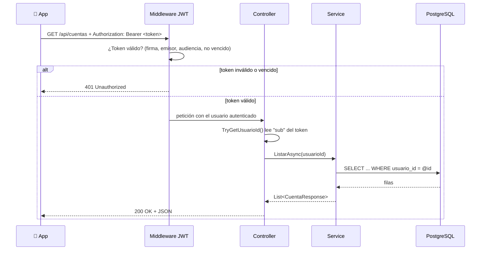

# API Banco Panda — Endpoints

← [[00 - Índice Banco Panda]] · Ver también: [[04 - Dashboard - Qué endpoint alimenta cada parte]]

Código: `D:\PROYECTOS DEL TRABAJO\codigo\bancopanda-api\BancoPanda.Api\`
URL local: `http://localhost:5258` (desde el emulador: `http://10.0.2.2:5258`)

## Cómo está organizada la API

Está organizada **por funcionalidad** (*feature-first*). Cada carpeta en `Features/` tiene siempre las mismas 3 piezas:

| Archivo | Rol | Analogía |
|---|---|---|
| `XxxController.cs` | Recibe la petición HTTP y define la ruta | Recepcionista |
| `XxxService.cs` | Reglas de negocio y consultas a la BD | El que hace el trabajo |
| `XxxDtos.cs` | Forma de los datos que entran y salen | Formulario / plantilla |

Piezas compartidas:

- `Program.cs` → arranca todo: conecta PostgreSQL (con nombres `snake_case`), configura JWT, registra los servicios, convierte los enums a texto en el JSON (`"Egreso"`, `"Visa"`), y activa OpenAPI y CORS en desarrollo.
- `Common/ApiControllerBase.cs` → base de los controladores:
  - `TryGetUsuarioId(out id)`: lee el ID del usuario **desde el token** (claim `sub`).
  - `SesionInvalida()`: responde `401`.
  - `ARespuesta(resultado)`: convierte un `Resultado<T>` en `200 OK` o en un error *ProblemDetails*.
- `Common/Resultado.cs` → objeto "éxito o error" que devuelven los servicios (en vez de lanzar excepciones).
- `Data/AppDbContext.cs` → mapa de las tablas con EF Core (longitudes, índices únicos, borrado en cascada).

### El recorrido de una petición



### Reglas que aplican a todos los endpoints

- Todos, **menos** `/api/auth/*`, llevan `[Authorize]` → piden `Authorization: Bearer <token>`.
- Solo devuelven datos **del usuario del token**. Nunca se recibe un `usuarioId` desde la app.
- Errores en formato **ProblemDetails**: el mensaje va en `detail`; los errores de validación en `errors`. La app lee primero `errors`, luego `detail` (ver `ApiClient._errorMessage`).
- Los nombres de campos son iguales en BD (`cuenta_id`), C# (`CuentaId`) y JSON (`cuentaId`).

## Tabla resumen

| # | Método | Ruta | ¿Token? | ¿Lo usa el Dashboard? |
|---|---|---|---|---|
| 1 | POST | `/api/auth/registro` | No | Indirecto (crea la sesión) |
| 2 | POST | `/api/auth/login` | No | Indirecto (crea la sesión) |
| 3 | GET | `/api/usuarios/me` | Sí | No (usa los datos guardados de la sesión) |
| 4 | PUT | `/api/usuarios/me` | Sí | No (Perfil) |
| 5 | GET | `/api/cuentas` | Sí | ✅ **Sí** |
| 6 | GET | `/api/tarjetas` | Sí | ✅ **Sí** |
| 7 | GET | `/api/movimientos?limite=N` | Sí | ✅ **Sí** (`limite=5`) |
| 8 | GET | `/api/tarjetas/{tarjetaId}/movimientos?limite=N` | Sí | ✅ Al tocar una tarjeta (`limite=50`) |

---

## 🔐 Auth — `Features/Auth/`

### 1. `POST /api/auth/registro`

**Qué hace:** crea un cliente nuevo y le deja la sesión iniciada.

**Body (`RegistroRequest`):**
```json
{
  "nombreUsuario": "andrea.b",
  "cedula": "0912345678",
  "nombres": "Andrea",
  "apellidos": "Barroso",
  "correo": "andrea@correo.com",
  "telefono": "+593987654321",
  "contrasena": "Clave1234",
  "aceptaTerminos": true
}
```

**Validaciones (en el DTO):**
- `nombreUsuario`: 4–20 caracteres, empieza con letra, solo letras/números/`.`/`_`.
- `cedula`: exactamente 10 dígitos.
- `nombres` / `apellidos`: 2–60, solo letras (con tildes y ñ).
- `correo`: formato válido, máx. 150.
- `telefono`: `+5939` + 8 dígitos (celular de Ecuador).
- `contrasena`: 8–72 caracteres, con letras **y** números.
- `aceptaTerminos`: debe ser `true`.

**Paso a paso (`AuthService.RegistrarAsync`):**
1. Normaliza: usuario y correo a minúsculas, quita espacios.
2. Revisa que no existan ya el **usuario**, el **correo** ni la **cédula** → si existe, `409 Conflict` con un mensaje claro.
3. Crea el `Usuario` con la contraseña cifrada (`BCrypt.HashPassword`).
4. Crea una `Cuenta` de **Ahorros** con número aleatorio único `5000` + 6 dígitos y **saldo $100**.
5. Agrega el movimiento **"Bono de bienvenida"** (+$100, Ingreso, categoría Otros).
6. Agrega una **tarjeta Visa Débito** con 4 últimos dígitos aleatorios, vence en 4 años.
7. Guarda todo junto (`SaveChangesAsync`). Si otro registro ganó la carrera por el mismo dato único, atrapa el error de PostgreSQL y responde `409`.
8. Genera el token y responde **`201 Created`** con `AuthResponse`.

**Respuesta (`AuthResponse`):**
```json
{
  "token": "eyJhbGciOi...",
  "expiraEn": "2026-10-15T18:30:00Z",
  "usuario": {
    "usuarioId": "…", "nombreUsuario": "andrea.b",
    "nombres": "Andrea", "apellidos": "Barroso",
    "cedula": "0912345678", "correo": "andrea@correo.com",
    "telefono": "+593987654321"
  }
}
```

**Códigos:** `201` ok · `400` validación · `409` dato repetido.

### 2. `POST /api/auth/login`

**Qué hace:** inicia sesión con **nombre de usuario** (no con correo).

**Body:** `{ "nombreUsuario": "andrea.b", "contrasena": "Clave1234" }`

**Paso a paso:**
1. Pasa el usuario a minúsculas y lo busca.
2. Si no existe **o** la contraseña no coincide (`BCrypt.Verify`) → `401` con *"Usuario o contraseña incorrectos"* (mismo mensaje para ambos casos, así no se revela si el usuario existe).
3. Si todo está bien → `200` con el mismo `AuthResponse` del registro.

**El token (`TokenService`):**
- Firmado con **HMAC-SHA256** usando `Jwt:Clave`.
- Emisor `BancoPanda.Api`, audiencia `BancoPanda.App`.
- Dura **60 minutos** (`Jwt:MinutosExpiracion`); tolerancia de reloj de 30 s.
- Claims: `sub` = UsuarioId, `email`, `jti` (ID único del token).
- No hay *refresh token*: al vencer, hay que volver a iniciar sesión.

---

## 👤 Usuarios — `Features/Users/`

### 3. `GET /api/usuarios/me`
Devuelve los datos del usuario del token (`UsuarioResponse`, mismo formato que `usuario` en el login).
`404` si el usuario ya no existe.

### 4. `PUT /api/usuarios/me`
Actualiza nombres, apellidos, correo y celular; opcionalmente la contraseña.

**Body (`ActualizarPerfilRequest`):**
```json
{
  "nombres": "Andrea", "apellidos": "Barroso",
  "correo": "andrea@correo.com", "telefono": "+593987654321",
  "contrasenaActual": "Clave1234",
  "contrasenaNueva": "NuevaClave99"
}
```
**Reglas:**
- El correo no puede ser de **otro** usuario → `409`.
- Si viene `contrasenaNueva`, **exige** `contrasenaActual` y que sea correcta → si no, `400`.
- `nombreUsuario` y `cedula` **no** se pueden cambiar.

> Nota técnica: `UsersController` hereda de `ControllerBase` y repite sus propios `ARespuesta` / `SesionInvalida` / `TryGetUsuarioId`, en vez de heredar de `ApiControllerBase` como los demás. Funciona igual, pero es código duplicado.

---

## 🏦 Cuentas — `Features/Accounts/`

### 5. `GET /api/cuentas` ⭐ Dashboard

**Qué hace:** lista las cuentas del usuario con su saldo.

**Consulta (`AccountsService.ListarAsync`):**
```csharp
db.Cuentas
  .Where(c => c.UsuarioId == usuarioId)   // solo las mías
  .OrderBy(c => c.FechaApertura)          // la más antigua primero
  .Select(c => new CuentaResponse(...))   // solo los campos necesarios
```

**Respuesta:**
```json
[
  {
    "cuentaId": "3f1c…",
    "numeroCuenta": "5000123456",
    "tipo": "Ahorros",
    "saldo": 100.00,
    "moneda": "USD"
  }
]
```

---

## 💳 Tarjetas — `Features/Cards/`

### 6. `GET /api/tarjetas` ⭐ Dashboard

**Qué hace:** lista las tarjetas del usuario **con el saldo de la cuenta** a la que pertenecen.

**Consulta (`CardsService.ListarAsync`):**
```csharp
db.Tarjetas
  .Where(t => t.Cuenta.UsuarioId == usuarioId) // tarjetas de mis cuentas
  .OrderByDescending(t => t.Activa)            // activas primero
  .ThenBy(t => t.Cuenta.FechaApertura)         // luego por antigüedad de la cuenta
  .Select(t => new TarjetaResponse(..., t.Cuenta.Saldo, t.Cuenta.Moneda))
```

**Respuesta:**
```json
[
  {
    "tarjetaId": "a9b2…",
    "ultimosDigitos": "4821",
    "marca": "Visa",
    "tipo": "Debito",
    "fechaExpiracion": "2030-05-01",
    "activa": true,
    "cuentaId": "3f1c…",
    "saldo": 100.00,
    "moneda": "USD"
  }
]
```

> La API manda `saldo`, pero desde el cambio del 15-10-2026 la tarjeta del Dashboard ya **no lo muestra**: arriba a la derecha solo sale "Visa Débito".

### 8. `GET /api/tarjetas/{tarjetaId}/movimientos?limite=20`

**Qué hace:** movimientos de la **cuenta** a la que pertenece esa tarjeta, del más nuevo al más viejo.

**Paso a paso (`MovementsService.ListarPorTarjetaAsync`):**
1. Busca la tarjeta con ese ID **y** que pertenezca al usuario del token → obtiene su `cuentaId`.
2. Si no la encuentra (no existe o es de otra persona) → **`404` "Tarjeta no encontrada"**.
3. Trae los movimientos de esa cuenta ordenados por fecha descendente, hasta `limite`.

> Como los movimientos cuelgan de la cuenta, dos tarjetas de la misma cuenta muestran los **mismos** movimientos.

---

## 📋 Movimientos — `Features/Movements/`

### 7. `GET /api/movimientos?limite=20` ⭐ Dashboard

**Qué hace:** últimos movimientos de **todas** las cuentas del usuario mezclados, del más nuevo al más viejo.

**Parámetro `limite`** (`MovimientosRequest`): opcional, por defecto **20**, mínimo **1**, máximo **50**. Fuera de rango → `400` "El límite debe estar entre 1 y 50".

**Respuesta:**
```json
[
  {
    "movimientoId": "c0d4…",
    "descripcion": "McDonalds",
    "monto": 84.20,
    "tipo": "Egreso",
    "categoria": "Comida",
    "fecha": "2026-10-15T17:32:00Z",
    "cuentaId": "3f1c…"
  }
]
```

- `monto` siempre positivo; `tipo` dice si suma o resta.
- `categoria`: `Sueldo`, `Transferencia`, `Comida`, `Transporte`, `Compras`, `Servicios`, `Otros`.
- `fecha` en UTC; la app la pasa a hora local.

---

## Códigos de respuesta que puedes ver

| Código | Cuándo |
|---|---|
| 200 | Todo bien |
| 201 | Registro creado |
| 400 | Validación fallida (campos, `limite`, contraseña actual incorrecta) |
| 401 | Sin token, token vencido/inválido, o login incorrecto |
| 404 | Tarjeta o usuario no encontrado (o no es tuyo) |
| 409 | Usuario, correo o cédula repetidos |
| 500 | Error inesperado del servidor |

## Probar los endpoints

- Archivo `BancoPanda.Api/BancoPanda.Api.http` (VS Code con REST Client, o Visual Studio).
- Especificación OpenAPI: `http://localhost:5258/openapi/v1.json`.
