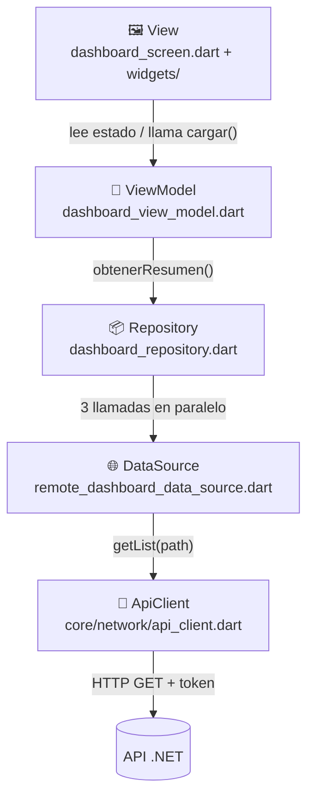
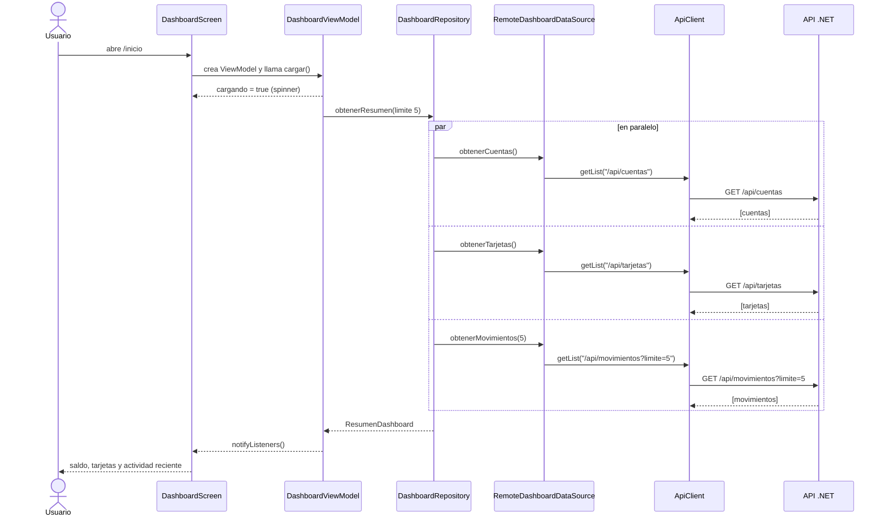

# App Banco Panda — El Dashboard paso a paso

← [[00 - Índice Banco Panda]] · Endpoints: [[02 - API - Endpoints]] · Mapa visual: [[04 - Dashboard - Qué endpoint alimenta cada parte]]

Código: `D:\PROYECTOS DEL TRABAJO\codigo\bancopanda-app\lib\features\dashboard\`

## Arquitectura en capas (MVVM + Repository)

La app separa responsabilidades. Cada capa solo habla con la de al lado:



| Capa | Archivo | Qué hace | Analogía |
|---|---|---|---|
| **View** | `view/dashboard_screen.dart`, `view/widgets/*` | Solo dibuja; no sabe de HTTP | La vitrina |
| **ViewModel** | `viewmodel/dashboard_view_model.dart` | Guarda el estado (cargando, error, datos, saldo visible) | El encargado de la tienda |
| **Repository** | `data/repositories/dashboard_repository.dart` | Junta los datos en un `ResumenDashboard` | El que arma el pedido |
| **DataSource** | `data/datasources/remote_dashboard_data_source.dart` | Sabe las rutas de la API y convierte JSON a modelos | El que va al almacén |
| **ApiClient** | `core/network/api_client.dart` | Hace el HTTP, pone el token, traduce errores | El camión de reparto |
| **Model** | `model/*.dart` | Clases de datos (`Cuenta`, `Tarjeta`, `Movimiento`, `ResumenDashboard`) | Las cajas con el producto |

---

## Antes del Dashboard: el arranque de la app

### Paso 0.1 — `main.dart` → `core/di/providers.dart`
Al abrir la app, `createProviders()` arma todo una sola vez:
1. Crea el almacenamiento seguro (`SecureKeyValueStorage`, sobre `flutter_secure_storage`).
2. Carga `AppSettings` → la URL del servidor (por defecto `http://10.0.2.2:5258`, o la que guardaste en Configuración).
3. Crea **un solo** `ApiClient` compartido por toda la app.
4. Crea `AuthViewModel` y llama `restoreSession()`: si hay una sesión guardada y **no ha vencido**, pone el token en el `ApiClient`.
5. Crea el `DashboardRepository` y lo publica con `Provider` para que cualquier pantalla lo pueda leer.

### Paso 0.2 — El router decide a dónde ir (`core/router/app_router.dart`)
- Sin sesión → `/login`.
- Con sesión → `/inicio` (el Dashboard), o `/bienvenida` justo después de loguearse/registrarse.
- El router **escucha** al `AuthViewModel`: si la sesión se cierra (por ejemplo por un 401), automáticamente manda al login.

---

## El Dashboard, paso a paso

### Paso 1 — Se crea la pantalla y su ViewModel
`DashboardScreen` (ruta `/inicio`):

```dart
ChangeNotifierProvider(
  create: (context) => DashboardViewModel(
    repository: context.read<DashboardRepository>(),
    auth: context.read<AuthViewModel>(),
  )..cargar(),            // ← apenas se crea, empieza a cargar
  child: const _DashboardView(),
);
```
El ViewModel vive mientras la pantalla esté abierta y se destruye al salir.

### Paso 2 — `DashboardViewModel.cargar()`
```dart
cargando = true; error = null; notifyListeners();   // la vista muestra el spinner
try {
  resumen = await _repository.obtenerResumen(limiteMovimientos: 5);
} on AppException catch (e) {
  error = e.message;
  if (e.statusCode == 401) await _auth.logout();    // token vencido → al login
} on Object {
  error = 'Ocurrió un error inesperado';
} finally {
  cargando = false;
  if (_activo) notifyListeners();                   // solo si la pantalla sigue viva
}
```
Estado que guarda:
- `resumen` → los datos (o `null` si aún no llegan).
- `cargando` → para el spinner.
- `error` → mensaje para mostrar con botón "Reintentar".
- `saldoVisible` → el ojito; `alternarSaldo()` lo cambia.
- `_activo` → evita avisar a una pantalla que ya se cerró.

### Paso 3 — `DashboardRepository.obtenerResumen()` — 3 peticiones a la vez
```dart
final cuentas     = _dataSource.obtenerCuentas();
final tarjetas    = _dataSource.obtenerTarjetas();
final movimientos = _dataSource.obtenerMovimientos(limite: 5);
await Future.wait([cuentas, tarjetas, movimientos]);   // en paralelo, no una tras otra
return ResumenDashboard(cuentas: await cuentas, tarjetas: await tarjetas, movimientos: await movimientos);
```
Lanza las 3 peticiones **al mismo tiempo**, así el Dashboard tarda lo que tarde la más lenta, no la suma de las tres. Si **cualquiera** falla, falla todo el resumen y se muestra el error.

### Paso 4 — `RemoteDashboardDataSource` — los endpoints que consume

| Método Dart | Endpoint | Modelo |
|---|---|---|
| `obtenerCuentas()` | `GET /api/cuentas` | `List<Cuenta>` |
| `obtenerTarjetas()` | `GET /api/tarjetas` | `List<Tarjeta>` |
| `obtenerMovimientos(limite: 5)` | `GET /api/movimientos?limite=5` | `List<Movimiento>` |
| `obtenerMovimientosDeTarjeta(id, limite: 50)` | `GET /api/tarjetas/{id}/movimientos?limite=50` | `List<Movimiento>` (pantalla Movimientos) |

Todas usan el mismo helper `_lista(path, fromJson)`: pide la lista y convierte cada elemento JSON con el `fromJson` del modelo.

### Paso 5 — `ApiClient` hace la petición HTTP
1. Arma la URL: `serverUrl + path` → `http://10.0.2.2:5258/api/cuentas`.
2. Pone cabeceras: `Content-Type`, `Accept` y **`Authorization: Bearer <token>`**.
3. Espera máximo **10 segundos**.
4. Traduce los problemas a mensajes en español (`AppException`):
   - Timeout → *"El servidor tardó demasiado en responder"*.
   - Sin conexión → *"No se pudo conectar con el servidor. Revisa la dirección en Configuración."*.
   - Respuesta 4xx/5xx → toma el mensaje de `errors` o `detail` del ProblemDetails; si no hay, uno genérico (401 → *"Tu sesión no es válida…"*).
5. Si la respuesta no es una lista → *"El servidor envió una respuesta inesperada"*.

### Paso 6 — JSON → modelos (`model/`)
- `Cuenta.fromJson`: `"Ahorros"` → `TipoCuenta.ahorros` (etiqueta "Cuenta de ahorro").
- `Tarjeta.fromJson`: marca (`Visa`/`Mastercard`), tipo (`Debito`/`Credito`), `fechaExpiracion`, `activa`.
  - `nombre` → `"Visa Débito"`; `numeroOculto` → `"•••• 4821"`.
- `Movimiento.fromJson`: `fecha` pasa a hora local; `esIngreso` dice si suma. Si llega una categoría desconocida, usa `otros` (no se rompe).
- `ResumenDashboard`:
  - `saldoTotal` = **suma de los saldos de todas las cuentas** (se calcula en la app, la API no lo envía).
  - `moneda` = la de la primera cuenta, o `USD` si no hay.

### Paso 7 — La vista se dibuja (`_DashboardView`)
Usa `context.watch<DashboardViewModel>()`: cada `notifyListeners()` vuelve a dibujar la pantalla.

Orden de arriba a abajo:
1. **`DashboardHeader`** → logo + "Hola, *primer nombre*" + campana (Próximamente). El nombre **no viene de un endpoint del dashboard**: sale del usuario guardado en la sesión (`AuthViewModel.usuario.primerNombre`).
2. **`LoadError`** → solo si hay `error`; botón "Reintentar" llama `cargar()` otra vez.
3. Si hay `resumen` → **`_DashboardContent`**; si no y está cargando → spinner.

Dentro de `_DashboardContent`:

| Widget | Muestra | De dónde salen los datos |
|---|---|---|
| `BalanceCard` | "Saldo Total" + monto + ojito; debajo cada cuenta (tipo y número). Si hay **más de una cuenta**, muestra el saldo de cada una; si hay una sola, un ícono de billetera | `resumen.saldoTotal`, `resumen.cuentas` ← `/api/cuentas` |
| `QuickActions` | Transferir, Efectivo móvil, Pagar servicios, Recibir dinero | Fijo en código; todos "Próximamente" |
| `SectionHeader` "Mis Tarjetas" | Título + "Ver más" (Próximamente) | — |
| `CardsCarousel` → `BankCard` | Tarjetas en carrusel horizontal: "BancoPanda", tipo ("Visa Débito"), chip, `•••• 4821`, vencimiento `MM/AA`, titular, marca. Colores alternos (oscuro / verde). Inactivas al 60 % de opacidad con "Inactiva" | `resumen.tarjetas` ← `/api/tarjetas`; titular = primer nombre + primer apellido de la sesión |
| `SectionHeader` "Actividad reciente" | Título + "Ver más" → pantalla Movimientos | — |
| `MovimientoTile` (×5) | Ícono por categoría, descripción, "Hoy, 12:32 · Comida", monto `+$` verde o `-$` | `resumen.movimientos` ← `/api/movimientos?limite=5` |

Abajo: **`DashboardBottomBar`** → Inicio (actual) · Tarjetas (Próximamente) · Movimientos (`/movimientos`) · Tu cuenta (`/perfil`).

### Paso 8 — Interacciones

| Acción del usuario | Qué pasa |
|---|---|
| Deslizar hacia abajo | `RefreshIndicator` → `vm.cargar()` → vuelve a llamar los 3 endpoints |
| Tocar el ojito | `vm.alternarSaldo()` → oculta/muestra saldos como `••••••` (solo en la app, no llama a la API) |
| Tocar una tarjeta | `context.push('/movimientos', extra: tarjeta)` → `MovementsScreen` con esa tarjeta |
| "Ver más" en Actividad reciente / "Movimientos" abajo | `MovementsScreen` sin tarjeta → todos los movimientos |
| "Tu cuenta" | Pantalla de perfil |
| Token vencido (401) | `_auth.logout()` → borra la sesión → el router manda al login |

### Paso 9 — Pantalla de Movimientos (`movements_screen.dart` + `movements_view_model.dart`)
Mismo patrón que el Dashboard, pero con **límite 50**:
- **Con tarjeta** → muestra un resumen de la tarjeta (`CardSummary`) y llama `GET /api/tarjetas/{id}/movimientos?limite=50`.
- **Sin tarjeta** → llama `GET /api/movimientos?limite=50`.
- Mensajes vacíos: "Aún no tienes movimientos" / "Esta tarjeta aún no tiene movimientos".

---

## Diagrama completo: abrir el Dashboard



## Cosas a tener en cuenta (observaciones del código)

- Lo que todavía es **"Próximamente"**: campana, los 4 accesos rápidos, "Ver más" de Mis Tarjetas y la pestaña Tarjetas de la barra inferior.
- El **saldo total lo calcula la app** sumando cuentas; no hay un endpoint de "resumen".
- El saludo y el titular salen de la **sesión guardada**, no de `/api/usuarios/me`. Si el usuario cambia su nombre en Perfil, la app actualiza la sesión (`AuthViewModel.actualizarUsuario`) y el Dashboard lo refleja.
- `BalanceCard` muestra el **número de cuenta completo** (`5000123456`); en el diseño de Figma aparece enmascarado como `5000XXXXXX`.
- Si **una** de las 3 peticiones falla, no se muestra nada parcial: aparece el error con "Reintentar".
- El token dura 60 min y no se renueva solo: al vencer, el siguiente refresco del Dashboard cierra la sesión.

### Cambios hechos el 15-10-2026
- `dashboard_header.dart`: se quitó el subtítulo "Te damos la bienvenida a Banco Panda" debajo del saludo.
- `bank_card.dart`: arriba a la derecha de la tarjeta ya no sale el saldo, solo el tipo ("Visa Débito"). Se quitó el parámetro `saldoVisible` de `BankCard` y `CardsCarousel`, que ya no se usaba.
