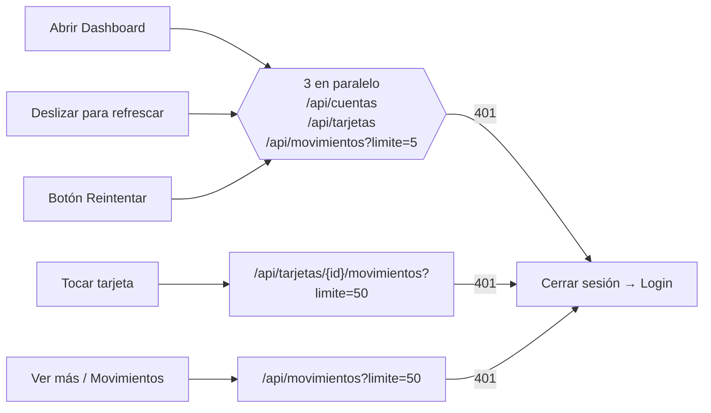

# Dashboard — Qué endpoint alimenta cada parte

← [[00 - Índice Banco Panda]] · Detalle: [[02 - API - Endpoints]] · [[03 - App - Dashboard paso a paso]]

## Mapa de la pantalla

```
┌─────────────────────────────────────┐
│ 🐼 Hola, Andrea                  🔔 │ ← Sesión guardada (login/registro)       · DashboardHeader
├─────────────────────────────────────┤
│ Saldo Total                      👁 │
│ $100.00 USD                         │ ← suma de GET /api/cuentas              · BalanceCard
│ Cuenta de ahorro                    │
│ 5000123456                       💼 │ ← GET /api/cuentas
├─────────────────────────────────────┤
│ [⇄]     [⬇]      [📋]      [📦]     │ ← fijo en la app (Próximamente)         · QuickActions
├─────────────────────────────────────┤
│ Mis Tarjetas              Ver más > │
│ ┌──────────────────────┐ ┌───────   │
│ │ BancoPanda Visa Débito│ │ Banco    │ ← GET /api/tarjetas                     · CardsCarousel / BankCard
│ │ ▭  •••• 4821          │ │          │   (titular = nombre de la sesión)
│ │ 05/27 Andrea Barroso VISA│         │
│ └──────────────────────┘ └───────   │
├─────────────────────────────────────┤
│ Actividad reciente        Ver más > │
│ 🍔 McDonalds  Hoy, 12:32   -$84.20  │ ← GET /api/movimientos?limite=5         · MovimientoTile
│ 👕 Deprati    Hoy, 14:12   -$84.20  │
├─────────────────────────────────────┤
│ Inicio  Tarjetas  Movimientos  Tu cuenta │                                     · DashboardBottomBar
└─────────────────────────────────────┘
```

## Tabla rápida

| Parte de la pantalla | Endpoint | Campos JSON usados |
|---|---|---|
| Saludo "Hola, Andrea" | *(ninguno; sesión de* `POST /api/auth/login` *o* `/registro`*)* | `usuario.nombres` (primer nombre) |
| Saldo Total | `GET /api/cuentas` | suma de `saldo`, `moneda` de la primera |
| Lista de cuentas en la tarjeta de saldo | `GET /api/cuentas` | `tipo`, `numeroCuenta`, `saldo` (si hay 2+) |
| Tarjetas del carrusel | `GET /api/tarjetas` | `marca`, `tipo`, `ultimosDigitos`, `fechaExpiracion`, `activa` |
| Titular de la tarjeta | *(sesión)* | `usuario.nombres` + `usuario.apellidos` (primeros) |
| Actividad reciente | `GET /api/movimientos?limite=5` | `descripcion`, `monto`, `tipo`, `categoria`, `fecha` |
| Al tocar una tarjeta | `GET /api/tarjetas/{tarjetaId}/movimientos?limite=50` | igual que movimientos |
| "Ver más" / pestaña Movimientos | `GET /api/movimientos?limite=50` | igual que movimientos |

## Cuándo se llaman



El ojito 👁 **no** llama a la API: solo cambia `saldoVisible` en el ViewModel.
