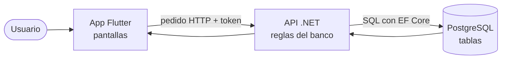
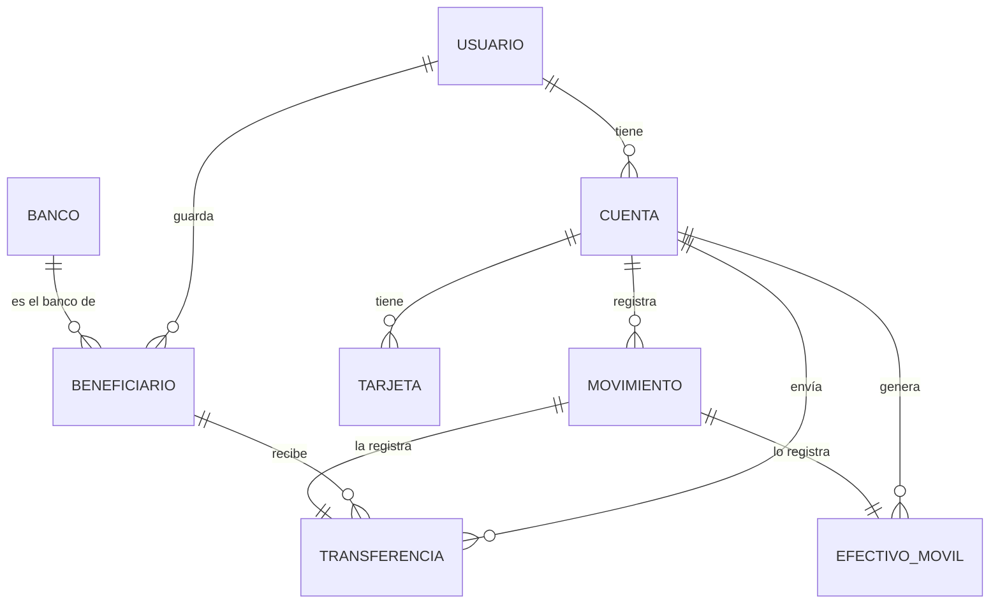
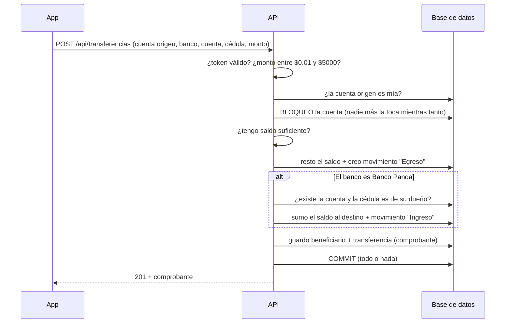
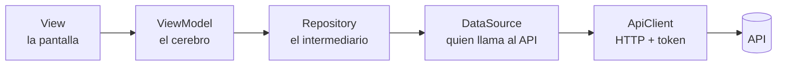
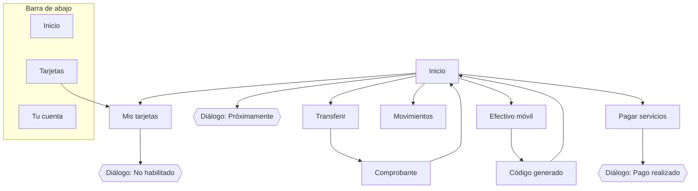
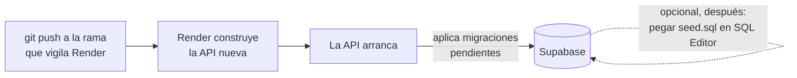

# Plan - transferencias, efectivo móvil y tarjetas

Parte de [[BancoPanda]]. Plan del 16 oct 2026 para lo que pidió Gabriela por correo. **Todavía no hay código de esto**: aquí está qué se va a hacer, en qué orden y qué se conecta con qué, para poder exponerlo.

> [!summary] En una frase
> Primero se prepara **dónde se guardan los datos** (base de datos + API), luego se hacen **las pantallas** que usan esos datos (app), y al final se **prueba y documenta** todo.

---

## Las 3 piezas del sistema

Como un restaurante:

| Pieza | En el restaurante | En BancoPanda | Tecnología |
|---|---|---|---|
| **App** | El mesero y la carta: lo que ve el cliente | Pantallas del celular | Flutter (Dart) |
| **API** | La cocina: recibe pedidos y aplica las reglas | `bancopanda-api` | .NET 10 (C#) |
| **Base de datos** | La despensa: guarda todo | Tablas en PostgreSQL | pgAdmin (local) / Supabase (producción) |

**Regla de oro:** la app **nunca** habla directo con la base de datos. Siempre le pide a la API, y la API decide si se puede.

---

## Decisiones ya tomadas

| Pregunta | Decisión |
|---|---|
| Si transfiero a **Banco Panda** | El dinero **llega** a la cuenta destino (se verifica cuenta + cédula del dueño). A otros bancos solo se **descuenta** (se simula el envío). |
| Campo "descripción" de la transferencia | **Se quita** (se sigue el modelo de Gabriela). |
| Barra de abajo | **Inicio · Tarjetas · Tu cuenta** (Movimientos se ve desde *Actividad reciente → Ver más*). |
| Tarjeta de saldo de arriba | Se quitan **solo los montos de cada cuenta**; el ojito también oculta los números de cuenta. |
| Monto máximo por transferencia | $5.000 |
| Saldo de las cuentas de prueba | $100 cada una |

---

## Fase A — Base de datos y API

### Palabras que hay que saber

- **Entidad** = una clase de C# que representa una **tabla**. `Banco.cs` → tabla `bancos`.
- **Migración** = una "receta de cambio" para la base de datos (crear tabla, agregar columna). Se guardan en `Migrations/` y la base anota cuáles ya aplicó.
- **Enum** = una **lista cerrada de opciones**. `EstadoEfectivoMovil { Pendiente, Cobrado, Expirado }` significa que un efectivo móvil solo puede estar en uno de esos 3 estados.
- **Endpoint** = una "ventanilla" de la API: una dirección como `POST /api/transferencias` a la que la app le hace un pedido.

### Tablas: qué se conecta con qué

Se lee así: *un usuario tiene muchas cuentas*, *una cuenta envía muchas transferencias*, *cada transferencia va a un beneficiario*, *cada transferencia tiene su movimiento* (la línea que aparece en "Actividad reciente").

| Tabla | ¿Nueva? | Para qué sirve | Ejemplo |
|---|---|---|---|
| `bancos` | Nueva | Lista de bancos para elegir | Guayaquil, Pichincha, Bolivariano, Produbanco, Pacífico, Amazonas, Internacional, Austro, **Banco Panda** |
| `beneficiarios` | Nueva | Personas a las que ya le transferí (para "frecuentes") | Juan Pérez · Pichincha · cuenta 2201… · cédula 09… |
| `transferencias` | Se rehace | El comprobante de cada transferencia | Referencia `2026…`, $25.50, a Juan Pérez |
| `efectivos_moviles` | Nueva | Retiros sin tarjeta con código | $20 para +593 99…, código vence en 24 h |
| `tarjetas` | Cambia | Ahora guarda los **16 dígitos** (`NumeroTarjeta`) en vez de solo los últimos 4 | `4521 8830 1294 4821` |
| `cuentas` | Cambia | Se le agregan las listas de transferencias y efectivos móviles | — |
| `movimientos` | Igual | Cada transferencia o efectivo móvil crea un movimiento de **Egreso** | "Transferencia a Juan Pérez -$25.50" |

### Pasos con la migración

La migración `AgregarTransferencias` que hicimos antes **todavía no se subió** a git ni a Render, así que en vez de poner una migración encima de otra, se rehace limpia:

1. `dotnet ef database update AgregarNombreUsuario` → la base local "vuelve atrás" un paso (borra la tabla `transferencias` de prueba).
2. `dotnet ef migrations remove` → se borra esa migración del código.
3. Se escriben las entidades nuevas.
4. `dotnet ef migrations add <Nombre>` → EF Core genera **una sola** migración con todo.
5. `dotnet ef database update` → se aplica a la base local.

> [!warning] Tarjetas que ya existen
> En Supabase ya hay tarjetas con solo 4 dígitos. La migración las **convierte** a 16 dígitos conservando esos 4 últimos, así nadie pierde su tarjeta.

### Ventanillas (endpoints)

| Método | Ruta | Qué hace | Qué pantalla lo usa |
|---|---|---|---|
| GET | `/api/bancos` | Lista de bancos | Transferir (paso 2) |
| GET | `/api/beneficiarios` | Mis beneficiarios frecuentes | Transferir (paso 2) |
| POST | `/api/transferencias` | Hace la transferencia y devuelve el comprobante | Transferir (confirmar) |
| POST | `/api/efectivo-movil` | Crea el efectivo móvil y devuelve el **código** | Efectivo móvil |
| GET | `/api/tarjetas` | Ahora devuelve el número completo | Inicio y Mis tarjetas |

### Qué pasa por dentro cuando transfiero

**"Todo o nada"** (transacción): si algo falla a la mitad, no se descuenta nada. Nunca queda dinero "perdido".

**¿Por qué bloquear la cuenta?** Si llegan dos transferencias al mismo tiempo, las dos podrían ver "tengo $100" y gastar $100 cada una. Con el bloqueo, la segunda espera a que termine la primera y ve el saldo real.

### Efectivo móvil

1. El usuario elige cuenta, monto y celular (+593).
2. La API descuenta el dinero y genera un **código de 6 dígitos**.
3. El código se guarda **cifrado** (`CodigoHash`), igual que las contraseñas: ni quien vea la base puede leerlo.
4. La app lo muestra **una sola vez**, con su fecha de vencimiento (24 h). Estado inicial: `Pendiente`.

### Dos arreglos que entran aquí

Los encontró la revisión de código (`/code-review`) y son de dinero, así que se arreglan ahora:

- **Transferencia duplicada:** si el servidor tarda, la app da error pero el servidor sí la hizo; al reintentar se cobraba dos veces. Se arregla con un identificador único por intento.
- **Salir mientras se envía:** no se podrá ir atrás mientras la transferencia está en camino.

---

## Fase B — App (pantallas)

### Cómo viaja un pedido dentro de la app (MVVM)

Cada funcionalidad vive en su carpeta `lib/features/<nombre>/` con esas mismas capas. Así, si cambia la API, solo se toca el DataSource; si cambia el diseño, solo la View.

### Qué hace cada botón

| Botón / lugar | Abre | ¿Usa la API? | Qué ve el usuario |
|---|---|---|---|
| **Transferir** | Flujo de 4 pasos + comprobante | Sí | Origen → **banco, cuenta, cédula** (o un frecuente) → monto → confirmar → comprobante |
| **Efectivo móvil** | Pantalla nueva | Sí | Cuenta, monto y celular → pantalla con el **código** grande y botón copiar |
| **Pagar servicios** | Pantalla nueva | No | Agua, Luz e Internet (se redujo de 6 a 3 el 17 oct) → diálogo **"Pago realizado"** (no descuenta dinero) |
| **Recibir dinero** | Diálogo | No | "Próximamente podrás recibir dinero del extranjero" |
| Tocar tarjeta o **Ver más** de Mis Tarjetas | Pantalla "Mis tarjetas" | Sí | Número completo, titular, vence, tipo, marca, estado, cuenta asociada + botón **Agregar tarjeta** → "No estás habilitado para tener una nueva tarjeta" |
| **Ver más** de Actividad reciente | Pantalla Movimientos | Sí | Los últimos 50 movimientos |
| **Ojito** del saldo | — | No | Oculta saldos **y** números de cuenta (`•••• 0001`) |

### Mapa de pantallas

---

## Fase C — Datos de prueba, pruebas y documentación

- **seed.sql:** tarjetas con 16 dígitos y algunos beneficiarios frecuentes para `andrea.demo`. Ver [[Datos de prueba (seed SQL)]].
- **Tests:** pequeños programas que revisan solos que el código haga lo correcto (por ejemplo: "si el monto es mayor al saldo, debe dar error"). Se agregan tests de los ViewModels y validaciones nuevas.
- **Prueba real:** se levanta la API y la app y se recorre cada botón, igual que antes con transferencias.
- **Documentación:** README de la API y ejemplos del archivo `.http`.

---

## Cómo llega a producción (Render + Supabase)

- **Render** es quien despliega la API; **Supabase** solo guarda la base.
- Las migraciones se aplican **solas** al arrancar (el `Dockerfile` tiene `Database__AplicarMigraciones=true`).
- El seed **no** es automático. Si se quieren las cuentas demo en Supabase, se pega `seed.sql` en el **SQL Editor** de Supabase **después** de que Render termine.

---

## Preguntas que pueden hacer en la exposición

- **¿Por qué la app no se conecta directo a la base de datos?** Porque cualquiera podría modificar saldos desde el celular. La API es la que revisa las reglas.
- **¿Qué es el token?** Una "pulsera de entrada" que da el login y dura 60 minutos. Con ella la API sabe quién eres en cada pedido.
- **¿Por qué el código del efectivo móvil se guarda cifrado?** Para que, aunque alguien vea la base de datos, no pueda cobrar el dinero.
- **¿Qué pasa si dos transferencias llegan a la vez?** La cuenta se bloquea; la segunda espera y ve el saldo real. Se probó con 3 transferencias simultáneas: solo pasaron las que alcanzaba el saldo.
- **¿Por qué usar un enum para el estado?** Para que el estado solo pueda ser uno de los permitidos y no un texto cualquiera mal escrito.

> [!warning] Para mencionar honestamente
> - En un banco real **nunca** se guarda el número completo de la tarjeta en texto (lo prohíbe la norma PCI). Aquí se hace porque es un proyecto académico.
> - "Pagar servicios" es solo visual: no descuenta dinero.
> - Si un efectivo móvil vence, el dinero **no se devuelve** automáticamente (quedaría para una mejora futura).
