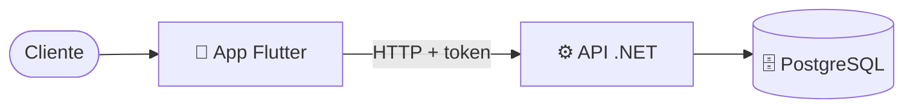

# 00 - Guion de la exposición

Exposición del proyecto **BancoPanda** ante la jefa. Esta carpeta tiene todo lo necesario, en el orden en que se presenta.

> [!tip] Duración sugerida: 20–25 minutos
> 1 min de introducción, ~4 por cada tema, 5–7 de demo y el resto para preguntas.

---

## Orden y qué decir

| # | Tema | Nota | Tiempo | Idea principal en una frase |
|---|---|---|---|---|
| 0 | Introducción | (abajo) | 1 min | "BancoPanda es una app de banca móvil con su propia API y base de datos." |
| 1 | Repositorio | [[01 - Repositorio]] | 3 min | "El código está en GitHub, en dos repositorios: la API y la app." |
| 2 | Documentación | [[02 - Documentación]] | 3 min | "Cada repo tiene su README para instalarlo y usarlo, más ejemplos de la API listos para probar." |
| 3 | Arquitectura | [[03 - Arquitectura]] | 5 min | "La app usa *feature-first* + MVVM; la API está organizada igual, por funcionalidad." |
| 4 | Explicación técnica | [[04 - Explicación técnica - Dashboard]] | 6 min | "Mi parte es el inicio: qué datos pide, de dónde salen y cómo funciona cada botón." |
| 5 | Demo en vivo | [[05 - Demo en vivo]] | 5–7 min | "Lo vemos funcionando." |
| — | Preguntas | [[06 - Preguntas que te pueden hacer]] | — | Respuestas cortas preparadas |

---

## Introducción (para decir al inicio)

> "BancoPanda es un MVP de banca móvil. Tiene tres partes: la **app** en Flutter, que es lo que ve el cliente; la **API** en .NET, que aplica las reglas del banco; y la **base de datos** PostgreSQL, donde se guarda todo. Mi parte fue el **dashboard**: el inicio con el saldo, las tarjetas y los movimientos, y los botones de **Transferir**, **Efectivo móvil**, **Pagar servicios** y **Recibir dinero**."

---

## Antes de la exposición (checklist)

- [ ] Hacer **commit y push** de los últimos cambios (efectivo móvil con dos códigos, pagar servicios con 3 servicios, READMEs). Ver [[01 - Repositorio]].
- [ ] Tener la **API corriendo** (`dotnet run`) o confirmar que la de **Render** responde (la primera llamada puede tardar ~1 min si estaba dormida).
- [ ] Ejecutar `Database/seed.sql` para que `andrea.demo` y `carlos.demo` tengan $100 en cada cuenta.
- [ ] Abrir la app y dejarla en el **login**, con el servidor configurado.
- [ ] Tener abiertos en el editor los archivos que se van a mostrar (lista en [[04 - Explicación técnica - Dashboard]]).
- [ ] Repasar [[06 - Preguntas que te pueden hacer]].

## Más detalle (notas de trabajo)

Si piden profundizar, están las notas de cada fase en la carpeta `BancoPanda/`: [[Plan - transferencias, efectivo móvil y tarjetas]], [[Fase A - base de datos y API]], [[Fase B - pantallas de la app]], [[Fase C - datos de prueba, pruebas y documentación]] y [[Efectivo móvil - pantallas 1 y 2]].
