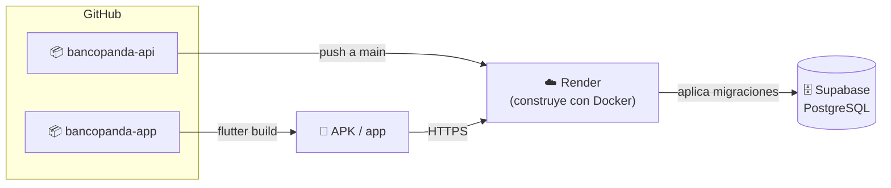

# 01 - Repositorio

Vuelve al [[00 - Guion de la exposición]].

> [!info] ¿Qué es "el repositorio"?
> Es el lugar donde vive el **código con todo su historial de cambios** (cada *commit*). Se maneja con **git** y está publicado en **GitHub**, así el equipo puede verlo, descargarlo (*clonar*) y trabajar en paralelo con *ramas*.

---

## Son DOS repositorios en GitHub

| Repositorio | Qué contiene | Enlace | Rama principal del trabajo |
|---|---|---|---|
| **bancopanda-api** | Backend .NET 10 + migraciones de la base + datos de prueba | https://github.com/allanyanx/bancopanda-api | `main` |
| **bancopanda-app** | App Flutter (Android, Windows, web) | https://github.com/allanyanx/bancopanda-app | `finalfinal` |

¿Por qué separados? Porque son dos programas distintos que se despliegan por separado: la API corre en un servidor (Render) y la app se instala en el celular. Se comunican solo por HTTP.



---

## Qué hay en cada uno

### bancopanda-api
```
bancopanda-api/
├── BancoPanda.Api/        ← el código de la API (Features, Entities, Data, Migrations…)
├── Database/seed.sql      ← datos de prueba
├── Dockerfile             ← cómo se construye para Render
└── README.md              ← instalación, endpoints, reglas y despliegue
```

### bancopanda-app
```
bancopanda-app/
├── lib/                   ← el código de la app (core + features)
├── test/                  ← tests automáticos
├── assets/images/         ← logo y avatar
├── android/ ios/ web/ windows/ …  ← proyectos de cada plataforma
├── pubspec.yaml           ← paquetes, ícono y splash
└── README.md              ← cómo correrla y su arquitectura
```

---

## Ramas e historial

- **Ramas** = líneas de trabajo paralelas. Se usaron ramas por funcionalidad (`feature/profile`, `feature/dashboard1`, `feature/dashboard2`, `develop`…) y luego se unieron (*merge*, incluso con *Pull Request*, por ejemplo "Merge pull request #1 … profile/perfil/final").
- Últimos commits importantes (16 oct 2026):
  - API `main`: **"superclase"** → transferencias, efectivo móvil, bancos, beneficiarios, tarjetas de 16 dígitos y la migración `TransferenciasEfectivoMovilYTarjetas` (33 archivos).
  - App `finalfinal`: **"supercomiteo masivo de 4 funciones"** → Transferir, Efectivo móvil, Pagar servicios, Mis tarjetas y tests (62 archivos).

> [!warning] Pendiente antes de exponer
> Los cambios del **17 oct** todavía **no están en un commit**:
> - API: efectivo móvil con **celular opcional** y **dos códigos** + README y `.http`.
> - App: efectivo móvil (pantallas 1 y 2), pagar servicios con **3 servicios**, README nuevo.
>
> Hay que hacer commit y push en los dos repos. Además, en la app conviene llevar `finalfinal` a `main` (con un *Pull Request*) para que lo vea quien abra el repo.

> [!note] Despliegue automático
> Como el `Dockerfile` tiene `Database__AplicarMigraciones=true`, cada vez que Render despliega la API **aplica sola las migraciones** en Supabase. Las claves (conexión a la base y clave JWT) **no están en GitHub**: viven en *user-secrets* (local) y en variables de entorno de Render.

---

## Cómo clonarlo (por si lo piden)

```bash
git clone https://github.com/allanyanx/bancopanda-api.git
git clone https://github.com/allanyanx/bancopanda-app.git
```

Los pasos completos están en el README de cada uno → [[02 - Documentación]].
