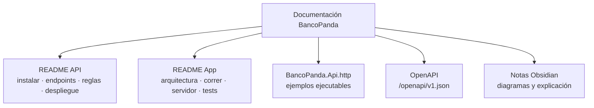

# 02 - Documentación

Vuelve al [[00 - Guion de la exposición]].

> [!info] Idea
> La documentación responde tres preguntas: **¿cómo lo instalo y lo corro?**, **¿qué hace y cómo se usa?** y **¿cómo está hecho?** Cada repositorio tiene la suya.

---

## Qué documentación existe

| Documento | Dónde | Qué explica | Para quién |
|---|---|---|---|
| **README de la API** | `bancopanda-api/README.md` | Requisitos, crear la base, secretos, migraciones, correr la API, datos de prueba, **tabla de endpoints**, reglas del dinero, despliegue en Render + Supabase, problemas comunes | Desarrolladores backend |
| **README de la app** | `bancopanda-app/README.md` | Funcionalidades, **arquitectura feature-first + MVVM**, carpetas, paquetes, cómo correrla, cómo elegir el servidor, usuarios de prueba, tests, colores | Desarrolladores de la app |
| **Ejemplos de la API** | `bancopanda-api/BancoPanda.Api/BancoPanda.Api.http` | 23 peticiones listas para ejecutar desde VS Code o Visual Studio (login, cuentas, transferencias, efectivo móvil, errores esperados) | Cualquiera que quiera probar la API |
| **OpenAPI** (automática) | `http://localhost:5258/openapi/v1.json` | Lista generada por .NET de todos los endpoints y sus JSON | Herramientas y testers |
| **Datos de prueba** | `bancopanda-api/Database/seed.sql` | Usuarios, cuentas, tarjetas, movimientos y beneficiarios de ejemplo (comentado) | Para demos y pruebas |
| **Tests** | `bancopanda-app/test/` | 89 tests que también "documentan" cómo debe comportarse cada pantalla | Desarrolladores |
| **Notas técnicas** | Obsidian, carpeta `BancoPanda/` | Plan, fases A/B/C, efectivo móvil: qué consume cada parte, diagramas | Equipo / exposición |

---

## Lo más mostrable en la exposición

1. **README de la API → tabla de endpoints**: en una sola tabla se ve todo lo que ofrece el backend.
2. **README de la app → sección Arquitectura**: la tabla View / ViewModel / Repository / DataSource / Model.
3. **`BancoPanda.Api.http`**: ejecutar en vivo *Login* → *Mis cuentas* → *Transferir a Carlos* y mostrar la respuesta JSON.

---

## Endpoints documentados (resumen)

| Método | Ruta | Para qué |
|---|---|---|
| POST | `/api/auth/registro` · `/api/auth/login` | Crear cuenta e iniciar sesión (token JWT) |
| GET / PUT | `/api/usuarios/me` · `/api/usuarios/me/contrasena` | Perfil y cambio de contraseña |
| GET | `/api/cuentas` | Cuentas y saldos |
| GET | `/api/tarjetas` | Tarjetas (número completo y cuenta asociada) |
| GET | `/api/movimientos?limite=` | Últimos movimientos |
| GET | `/api/bancos` · `/api/beneficiarios` | Bancos para transferir y frecuentes |
| POST | `/api/transferencias` | Transferir |
| POST | `/api/efectivo-movil` | Generar los dos códigos de retiro |

Todos (menos `auth`) piden el token y **solo devuelven datos del usuario del token**. Los errores salen en formato estándar *ProblemDetails* (`detail` con el mensaje en español).
