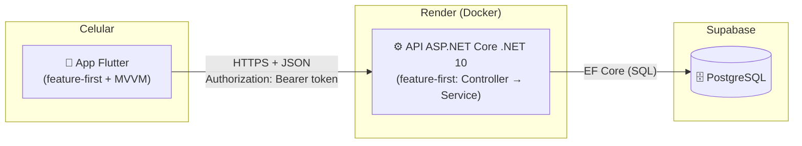
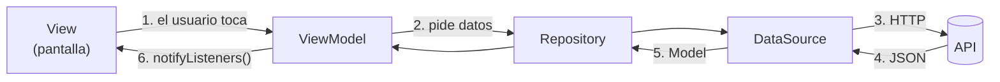
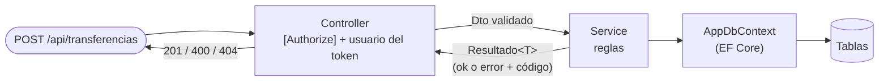
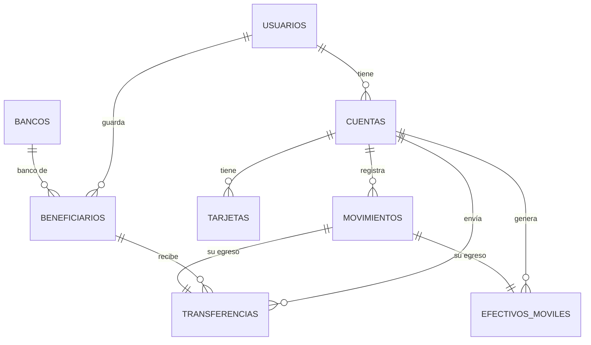

# 03 - Arquitectura

Vuelve al [[00 - Guion de la exposición]].

> [!info] Idea para decir
> "La app está organizada **por funcionalidad** (*feature-first*) y dentro de cada funcionalidad usa el patrón **MVVM**. La API sigue la misma idea: una carpeta por funcionalidad, con su Controller, su Service y sus Dtos."

---

## 1. Vista general



| Capa | Tecnología | Para qué |
|---|---|---|
| **App** | Flutter 3.47 (Dart) | Una sola base de código para Android, Windows y web |
| | `provider` | Conectar ViewModels con pantallas (MVVM) |
| | `go_router` | Navegación y proteger rutas si no hay sesión |
| | `http` | Llamar a la API |
| | `flutter_secure_storage` | Guardar el token de forma cifrada |
| | `intl`, `google_fonts` | Formato de dinero y fuente Poppins |
| **API** | ASP.NET Core / .NET 10 (C#) | Endpoints REST |
| | Entity Framework Core + Npgsql | Hablar con PostgreSQL usando clases C# y **migraciones** |
| | JWT Bearer | Sesión con token (dura 60 min) |
| | BCrypt | Cifrar contraseñas y códigos de efectivo móvil |
| **Base de datos** | PostgreSQL 18 (local) / Supabase (producción) | Guardar usuarios, cuentas, movimientos… |
| **Despliegue** | Docker en Render | La API se publica sola al hacer push a `main` |

---

## 2. Feature-first (organización por funcionalidad)

En vez de agrupar por **tipo de archivo** (todas las pantallas juntas, todos los modelos juntos), se agrupa por **funcionalidad**: todo lo de "Transferir" está en una sola carpeta.

```
lib/features/
├── auth/          ← login, registro, bienvenida
├── dashboard/     ← inicio y movimientos      (mi parte)
├── transfers/     ← transferir                 (mi parte)
├── mobile_cash/   ← efectivo móvil             (mi parte)
├── services/      ← pagar servicios            (mi parte)
├── cards/         ← mis tarjetas               (mi parte)
├── profile/       ← perfil y seguridad
└── settings/      ← configurar servidor
```

**Ventajas para explicar:**
- Si hay que cambiar "Transferir", todo está en `features/transfers/`.
- Varias personas pueden trabajar en paralelo sin pisarse (una en `profile`, otra en `dashboard`).
- Lo que comparten todas va en `lib/core/` (cliente HTTP, tema, rutas, validaciones, widgets comunes).

---

## 3. MVVM (Model – View – ViewModel)

Dentro de cada funcionalidad:

| Letra | Carpeta | Qué es | Ejemplo real (Transferir) |
|---|---|---|---|
| **Model** | `model/` | Los datos y cómo se leen/escriben en JSON | `comprobante.dart`, `banco.dart`, `solicitud_transferencia.dart` |
| **View** | `view/` | La pantalla. Solo dibuja y avisa lo que toca el usuario | `transfer_screen.dart` y `steps/` (5 pasos) |
| **ViewModel** | `viewmodel/` | El "cerebro": estado (`cargando`, `error`, paso actual) y acciones | `transfer_view_model.dart` |
| + Repository | `data/repositories/` | Intermediario: el ViewModel no sabe de HTTP | `transfers_repository.dart` |
| + DataSource | `data/datasources/` | El único que conoce las rutas `/api/...` | `remote_transfers_data_source.dart` |



**¿Cómo se conectan View y ViewModel?** Con `provider`:
- La pantalla crea su ViewModel con `ChangeNotifierProvider(create: ...)`.
- Lo "escucha" con `context.watch<TransferViewModel>()`: cada vez que el ViewModel llama `notifyListeners()`, la pantalla se redibuja sola.

**Ventajas para explicar:**
- La pantalla no tiene lógica → es fácil cambiar el diseño.
- El ViewModel no tiene widgets → se puede **probar con tests** sin abrir la app (por eso hay 89 tests con "API de mentira" en `test/helpers/`).

---

## 4. Arquitectura de la API

También por funcionalidad (`Features/`), cada una con 3 piezas:

```
BancoPanda.Api/
├── Features/Transfers/
│   ├── TransfersController.cs   ← la "ventanilla": recibe el pedido HTTP y revisa el token
│   ├── TransfersService.cs      ← las reglas del banco (saldo, bloqueo, movimientos)
│   └── TransfersDtos.cs         ← forma del JSON que entra y sale (+ validaciones)
├── Entities/                    ← las tablas como clases (Usuario, Cuenta, Transferencia…)
├── Data/AppDbContext.cs         ← conecta las clases con PostgreSQL (EF Core)
├── Migrations/                  ← historial de cambios de la base
└── Common/                      ← Resultado<T>, validaciones y reglas compartidas
```



- **Code-first + migraciones**: las tablas se escriben como clases C# y EF Core genera la "receta" (migración) para crearlas o cambiarlas. Nunca se toca la base a mano.
- **`Resultado<T>`**: los Services no lanzan excepciones por errores de negocio; devuelven "salió bien" o "error + código HTTP", y el Controller lo convierte en respuesta.

---

## 5. Seguridad (en una lista)

- **Contraseñas** cifradas con BCrypt (nunca se guardan en texto).
- **Token JWT** en cada pedido; la API solo devuelve datos **del dueño del token**.
- **Claves** (base de datos, JWT) fuera de GitHub: *user-secrets* y variables de Render.
- **Dinero**: transacción "todo o nada" + bloqueo de cuentas + `solicitudId` para no cobrar dos veces.
- **Códigos de efectivo móvil** guardados cifrados y mostrados una sola vez.

---

## 6. Modelo de datos (tablas)


