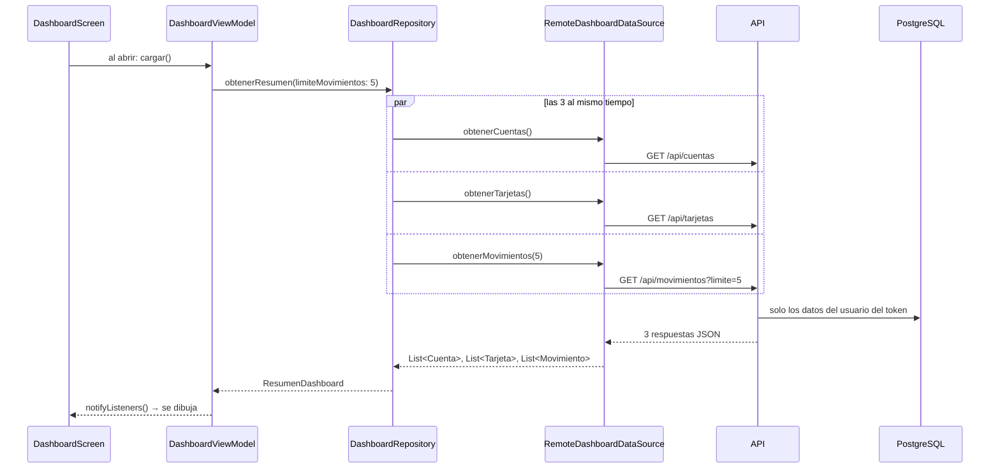
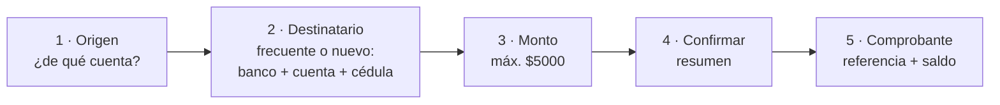
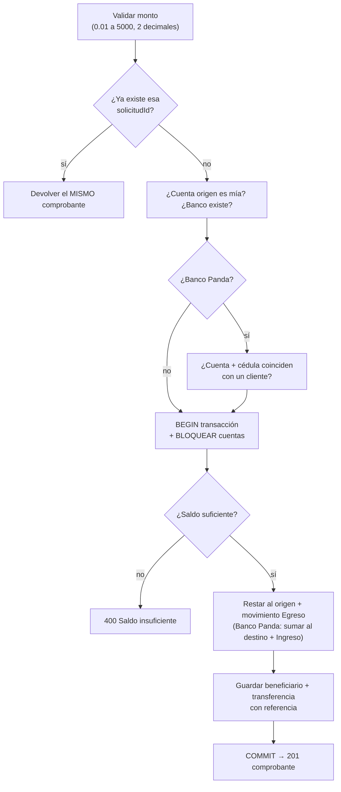

# 04 - Explicación técnica - Dashboard

Vuelve al [[00 - Guion de la exposición]]. Arquitectura general en [[03 - Arquitectura]].

> [!info] Qué es "explicación técnica"
> Contar **cómo funciona por dentro** tu parte: qué datos pide, a qué endpoint, en qué archivo está el código y qué hace ese código. Aquí está todo **el inicio (dashboard)** y **cada botón**.

> [!tip] Archivos para tener abiertos en el editor
> **App:** `features/dashboard/view/dashboard_screen.dart` · `features/dashboard/data/repositories/dashboard_repository.dart` · `features/transfers/viewmodel/transfer_view_model.dart` · `features/mobile_cash/viewmodel/mobile_cash_view_model.dart` · `features/services/view/pay_services_screen.dart`
> **API:** `Features/Transfers/TransfersService.cs` · `Features/MobileCash/MobileCashService.cs` · `Data/BloqueoCuentas.cs`

---

## 1. Qué ve el usuario en el inicio

```
┌──────────────────────────────┐
│ 🐼 Hola, Andrea          🔔 │  ← nombre del usuario de la sesión
│ ┌──────────────────────────┐ │
│ │ Saldo Total          👁  │ │  ← GET /api/cuentas (suma de saldos)
│ │ $200.00 USD              │ │
│ │ Cuenta de ahorro  0001   │ │
│ │ Cuenta corriente  0002   │ │
│ └──────────────────────────┘ │
│ [Transferir][Efectivo][Pagar][Recibir] │  ← 4 accesos rápidos
│ Mis Tarjetas        Ver más >│  ← GET /api/tarjetas
│ [ VISA •••• 4821 ][ MC ••• ] │
│ Actividad reciente  Ver más >│  ← GET /api/movimientos?limite=5
│ McDonalds          -$4.50    │
├──────────────────────────────┤
│  Inicio · Tarjetas · Tu cuenta │
└──────────────────────────────┘
```

---

## 2. ¿De dónde sale el dinero que se ve? (carga del inicio)

### El recorrido



### El código clave

**`features/dashboard/data/repositories/dashboard_repository.dart`** — pide las 3 cosas **en paralelo** (no una tras otra), así el inicio carga más rápido:

```dart
final cuentas = _dataSource.obtenerCuentas();
final tarjetas = _dataSource.obtenerTarjetas();
final movimientos = _dataSource.obtenerMovimientos(limite: limiteMovimientos);
await Future.wait([cuentas, tarjetas, movimientos]);
```

**`features/dashboard/model/resumen_dashboard.dart`** — el **saldo total** no viene del API: la app **suma** los saldos de las cuentas:

```dart
double get saldoTotal =>
    cuentas.fold(0, (total, cuenta) => total + cuenta.saldo);
```

**`features/dashboard/viewmodel/dashboard_view_model.dart`** — el cerebro del inicio: avisa "cargando", guarda el resultado o el error, y si la sesión venció (401) cierra la sesión:

```dart
Future<void> cargar() async {
  cargando = true;
  notifyListeners();
  try {
    resumen = await _repository.obtenerResumen(limiteMovimientos: movimientosRecientes);
  } on AppException catch (e) {
    error = e.message;
    if (e.statusCode == 401) await _auth.logout();
  } finally {
    cargando = false;
    notifyListeners();
  }
}
```

**En el API** — `Features/Accounts/AccountsService.cs`: solo las cuentas **del usuario del token**:

```csharp
db.Cuentas
  .Where(c => c.UsuarioId == usuarioId)
  .OrderBy(c => c.FechaApertura)
  .Select(c => new CuentaResponse(c.CuentaId, c.NumeroCuenta, c.Tipo, c.Saldo, c.Moneda))
```

> [!note] ¿Cómo sabe el API quién soy?
> La app manda el **token** en cada pedido (`core/network/api_client.dart` → `Authorization: Bearer …`). El API lo lee con `TryGetUsuarioId` (`Common/ApiControllerBase.cs`) y **filtra todo por ese usuario**. No hay forma de pedir datos de otra persona.

### El ojito 👁

- `DashboardViewModel.alternarSaldo()` cambia `saldoVisible` y avisa a la pantalla.
- `view/widgets/balance_card.dart` muestra `••••••` en vez del total y `•••• 0001` en vez del número de cuenta.
- No llama al API: es solo visual.

### Actividad reciente → "Ver más"

- El inicio muestra **5** movimientos; **Ver más** abre `MovementsScreen` (`/movimientos`) que pide **50** (`GET /api/movimientos?limite=50`).
- En el API (`Features/Movements/MovementsService.cs`): `OrderByDescending(m => m.Fecha).Take(limite)` → del más nuevo al más viejo.
- Cada movimiento tiene **tipo** (Ingreso → verde con +, Egreso → con −) y **categoría** (ícono): `view/widgets/movimiento_tile.dart`.

### Mis Tarjetas → "Ver más"

- Las tarjetas del inicio salen de `GET /api/tarjetas` (solo se ven los últimos 4 dígitos).
- **Ver más** (o "Tarjetas" en la barra) abre `features/cards/view/cards_screen.dart`: número completo, titular, vencimiento, tipo, marca, estado y cuenta asociada. **Agregar tarjeta** → diálogo "No estás habilitado".

---

## 3. Los 4 botones

Están en `view/widgets/quick_actions.dart` y se conectan en `dashboard_screen.dart`:

```dart
QuickActions(
  onTransferir: () => _abrirYRecargar(context, AppRoutes.transfer),
  onEfectivoMovil: () => _abrirYRecargar(context, AppRoutes.mobileCash),
  onPagarServicios: () => context.push(AppRoutes.payServices),
  onRecibirDinero: () => _recibirDinero(context),
)
```

`_abrirYRecargar` abre la pantalla y, **al volver, recarga el inicio** para que el saldo esté actualizado:

```dart
Future<void> _abrirYRecargar(BuildContext context, String ruta) async {
  final vm = context.read<DashboardViewModel>();
  await context.push<bool>(ruta);   // espera a que el usuario vuelva
  await vm.cargar();                // vuelve a pedir cuentas, tarjetas y movimientos
}
```

| Botón | ¿Llama al API? | Endpoints | Carpeta |
|---|---|---|---|
| **Transferir** | Sí | `GET /api/cuentas`, `GET /api/bancos`, `GET /api/beneficiarios`, **`POST /api/transferencias`** | `features/transfers/` |
| **Efectivo móvil** | Sí | `GET /api/cuentas`, **`POST /api/efectivo-movil`** | `features/mobile_cash/` |
| **Pagar servicios** | No | — | `features/services/` |
| **Recibir dinero** | No | — | (diálogo en `dashboard_screen.dart`) |

---

## 4. Transferir — `features/transfers/`

### Qué hace el usuario (5 pasos)



### Qué datos obtiene

| Momento | Qué pide | Endpoint | Para qué |
|---|---|---|---|
| Al abrir | Cuentas | `GET /api/cuentas` | Elegir la de origen y ver su saldo |
| Al abrir | Bancos | `GET /api/bancos` | Lista del desplegable (Banco Panda primero) |
| Al abrir | Frecuentes | `GET /api/beneficiarios` | Atajos a personas a las que ya transfirió |
| Al confirmar | **Transferencia** | **`POST /api/transferencias`** | Mover el dinero y recibir el comprobante |

### Dónde está el código

| Qué | Archivo |
|---|---|
| Pantalla y los 5 pasos | `view/transfer_screen.dart` + `view/steps/` (`origen_step`, `destinatario_step`, `monto_step`, `confirmar_step`, `comprobante_step`) |
| **Cerebro del flujo** | `viewmodel/transfer_view_model.dart` |
| Llamadas al API | `data/datasources/remote_transfers_data_source.dart` |
| Datos | `model/` (`banco`, `beneficiario`, `destino`, `solicitud_transferencia`, `comprobante`) |
| **Reglas en el API** | `bancopanda-api/…/Features/Transfers/TransfersService.cs` |

### En la app: `TransferViewModel.transferir()`

```dart
final resultado = await _enviar(() => _repository.transferir(
  SolicitudTransferencia(
    solicitudId: solicitudId,      // id único del intento (anti-duplicados)
    cuentaOrigenId: origen.cuentaId,
    destino: destino,              // banco + cuenta + cédula (+ nombre)
    monto: monto,
  ),
));
if (resultado == null) return false;   // error → se queda en "Confirmar" mostrando el mensaje
comprobante = resultado;
_irA(PasoTransferencia.comprobante);  // éxito → pantalla del comprobante
```

- `solicitudId` se crea al confirmar el monto (`confirmarMonto`). Si la red falla y el usuario reintenta, se manda **el mismo** → el API no cobra dos veces.
- Mientras envía, **no se puede ir atrás** (`PopScope` en `transfer_screen.dart`).

### En el API: cómo se mueve el dinero (`TransfersService.TransferirAsync`)



El corazón del código:

```csharp
await using var transaccion = await db.Database.BeginTransactionAsync(ct);

var cuentas = await db.BloquearCuentasAsync(            // SELECT … FOR UPDATE
    destino is null ? [origen.CuentaId] : [origen.CuentaId, destino.CuentaId], ct);
var cuentaOrigen = cuentas[origen.CuentaId];

if (cuentaOrigen.Saldo < monto)
    return Resultado<ComprobanteResponse>.Fallo("Saldo insuficiente para realizar la transferencia");

cuentaOrigen.Saldo -= monto;                            // sale el dinero
db.Movimientos.Add(egreso);                             // aparece en "Actividad reciente"

if (destino is not null)                                // solo si es Banco Panda
{
    cuentas[destino.CuentaId].Saldo += monto;           // llega el dinero
    db.Movimientos.Add(/* Ingreso: "Transferencia recibida de …" */);
}
// … beneficiario + transferencia …
await db.SaveChangesAsync(ct);
await transaccion.CommitAsync(ct);                      // todo o nada
```

Tres ideas para decir:
1. **Transacción ("todo o nada")**: si algo falla a la mitad, no se guarda nada.
2. **Bloqueo** (`Data/BloqueoCuentas.cs`): si llegan dos transferencias a la vez, la segunda espera y ve el saldo real → nadie gasta más de lo que tiene. *Probado con 3 pedidos simultáneos.*
3. **Banco Panda vs otros bancos**: en Banco Panda el dinero llega a la otra cuenta (se valida cuenta + cédula); a otros bancos solo se descuenta (se simula el envío).

---

## 5. Efectivo móvil — `features/mobile_cash/`

### Qué hace el usuario

- **Pantalla 1** (`view/widgets/formulario_efectivo.dart`): elige cuenta, escribe el **monto** y elige **Mi número** (el celular registrado, ya puesto) u **Otro número**.
- **Pantalla 2** (`view/widgets/resultado_efectivo.dart`): "Efectivo móvil exitoso" + los pasos del cajero con el **primer código**, el **segundo código** y el celular oculto (09X-XXX-X321). Botón **Finalizar**.
- `view/mobile_cash_screen.dart` decide cuál mostrar: si todavía no hay resultado → pantalla 1; si ya hay → pantalla 2.

### Qué datos obtiene

| Momento | Qué | De dónde |
|---|---|---|
| Al abrir | Cuentas y saldos | `GET /api/cuentas` |
| Al abrir | Celular registrado | **De la sesión** (`AuthViewModel.usuario.telefono`), no llama al API |
| Generar código | Los dos códigos | **`POST /api/efectivo-movil`** |

### En la app: `MobileCashViewModel.generar()`

```dart
resultado = await _repository.crear(SolicitudEfectivoMovil(
  solicitudId: _solicitudId,            // uno por pantalla: no se cobra dos veces
  cuentaId: cuenta.cuentaId,
  monto: monto,
  telefonoDestino: usarMiNumero ? null : Celular.completo(celular!),  // null = "Mi número"
));
```

Cuando `resultado` deja de ser null, `notifyListeners()` hace que la pantalla cambie sola a la pantalla 2.

### En el API: `MobileCashService.CrearAsync`

```csharp
// "Mi número" (no llega teléfono) usa el celular registrado; "Otro número" usa el que llega.
var telefono = string.IsNullOrWhiteSpace(request.TelefonoDestino)
    ? origen.Telefono
    : request.TelefonoDestino.Trim();

var cuenta = (await db.BloquearCuentasAsync([origen.CuentaId], ct))[origen.CuentaId];
if (cuenta.Saldo < monto) return /* Saldo insuficiente */;

var primerCodigo = RandomNumberGenerator.GetInt32(0, 10_000).ToString("D4");
var segundoCodigo = RandomNumberGenerator.GetInt32(0, 10_000).ToString("D4");
cuenta.Saldo -= monto;
// se guarda SOLO el hash: BCrypt.HashPassword(primerCodigo + segundoCodigo)
```

- El dinero se **descuenta al generar** y queda un movimiento "Efectivo móvil para +593…".
- Los códigos se guardan **cifrados** (como las contraseñas) y se muestran **una sola vez**. Vencen en **24 h**.
- En el cajero se pide **celular + 2 códigos**: varias "llaves" para que nadie más retire.

---

## 6. Pagar servicios — `features/services/view/pay_services_screen.dart`

- Muestra **3 servicios**: **Agua potable** (Interagua), **Luz eléctrica** (CNEL EP) e **Internet** (Netlife).
- **No llama al API ni descuenta dinero**: es una pantalla **visual** (prototipo de la funcionalidad).
- Toda la lógica está en un solo archivo:

```dart
static const _servicios = [
  (icono: Icons.water_drop_outlined, nombre: 'Agua potable', empresa: 'Interagua'),
  (icono: Icons.lightbulb_outline,   nombre: 'Luz eléctrica', empresa: 'CNEL EP'),
  (icono: Icons.wifi,                nombre: 'Internet',      empresa: 'Netlife'),
];
// al tocar uno:
onTap: () => mostrarEstado(context,
  icono: Icons.check_rounded,
  titulo: 'Pago realizado',
  mensaje: 'Tu pago de ${servicio.nombre} (${servicio.empresa}) se realizó con éxito.'),
```

- `mostrarEstado` es un diálogo reutilizable de la app (`core/widgets/status_dialog.dart`).
- **Siguiente paso** (si lo preguntan): crear `POST /api/servicios/pagos` en el API que descuente el saldo y registre un movimiento con categoría `Servicios`, igual que transferencias.

---

## 7. Recibir dinero

- Solo un diálogo: **"Próximamente podrás recibir dinero del extranjero"** (`_recibirDinero` en `dashboard_screen.dart`, usando el mismo `mostrarEstado`).

---

## 8. Resumen para cerrar

| Parte | Endpoint principal | Código clave (app) | Código clave (API) |
|---|---|---|---|
| Saldo y cuentas | `GET /api/cuentas` | `dashboard_repository.dart` · `resumen_dashboard.dart` | `AccountsService.cs` |
| Movimientos | `GET /api/movimientos` | `dashboard_view_model.dart` · `movements_view_model.dart` | `MovementsService.cs` |
| Tarjetas | `GET /api/tarjetas` | `cards_view_model.dart` | `CardsService.cs` |
| Transferir | `POST /api/transferencias` | `transfer_view_model.dart` | `TransfersService.cs` + `BloqueoCuentas.cs` |
| Efectivo móvil | `POST /api/efectivo-movil` | `mobile_cash_view_model.dart` | `MobileCashService.cs` |
| Pagar servicios | — (visual) | `pay_services_screen.dart` | — |
