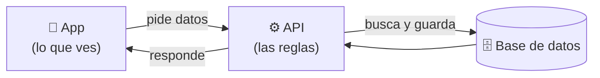

# 00 - Guion corto

Versión **sencilla** de la exposición, centrada solo en **el dashboard (el inicio) y sus botones**. La versión completa está en [[00 - Guion de la exposición]].

> [!tip] Duración: ~10 minutos
> 1. Qué es el dashboard → [[01 - Qué consume el dashboard]] (3 min)
> 2. Cómo funciona cada botón → [[02 - Cómo funciona cada botón]] (4 min)
> 3. El código más importante → [[03 - El código más importante]] (3 min)
> 4. Chuleta para no olvidarte nada → [[04 - Chuleta]]

---

## La idea de todo en 3 frases

1. **El dashboard es la pantalla de inicio**: muestra el saldo, las tarjetas y los últimos movimientos del usuario.
2. **La app no inventa los datos**: se los **pide a la API** (el servidor), y la API los saca de la **base de datos**.
3. **Cada botón** abre una pantalla que pide o envía datos a la API: Transferir y Efectivo móvil **mueven dinero**; Pagar servicios y Recibir dinero son **visuales** por ahora.

---

## Para empezar la exposición (dilo así)

> "Mi parte fue el **dashboard**, la pantalla de inicio de BancoPanda. Les voy a mostrar **qué datos pide**, **de dónde salen** y **cómo funcionan sus botones**: Transferir, Efectivo móvil, Pagar servicios y Recibir dinero."
