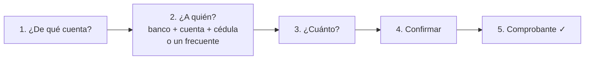

# 02 - Cómo funciona cada botón

Vuelve al [[00 - Guion corto]].

| Botón | ¿Mueve dinero? | Qué le pide a la API | Carpeta |
|---|---|---|---|
| 🔁 **Transferir** | ✅ Sí | cuentas, bancos, frecuentes y **la transferencia** | `features/transfers/` |
| 📲 **Efectivo móvil** | ✅ Sí | cuentas y **los códigos de retiro** | `features/mobile_cash/` |
| 🧾 **Pagar servicios** | ❌ No (visual) | nada | `features/services/` |
| 🌎 **Recibir dinero** | ❌ No | nada | (un mensaje en el inicio) |

> [!tip] Al volver de Transferir o Efectivo móvil
> El inicio **se recarga solo**, así el saldo nuevo aparece enseguida.

---

## 🔁 Transferir

**Qué hace el usuario** (5 pasos):

**Qué le pide a la API:**
- Al abrir: `GET /api/cuentas` (sus cuentas), `GET /api/bancos` (lista de bancos) y `GET /api/beneficiarios` (frecuentes).
- Al confirmar: **`POST /api/transferencias`** con: de qué cuenta, banco, número de cuenta, cédula y monto.

**Qué hace la API cuando llega la transferencia:**
1. Revisa que la cuenta sea del usuario y que el monto sea válido (máximo $5000).
2. **Bloquea** la cuenta para que nadie más la use en ese momento.
3. Revisa que **haya saldo suficiente**.
4. **Resta** el dinero y crea el movimiento "Transferencia a …".
5. Si el destino es **Banco Panda**, **suma** el dinero a la otra cuenta. Si es otro banco, solo se descuenta (se simula el envío).
6. Guarda todo junto ("todo o nada") y responde con el **comprobante**.

---

## 📲 Efectivo móvil

**Qué hace el usuario:**
- **Pantalla 1**: elige la cuenta, escribe el **monto** y elige **Mi número** (su celular, ya puesto) u **Otro número**.
- **Pantalla 2**: ve "Efectivo móvil exitoso" y **dos códigos de 4 dígitos** para usarlos en el cajero junto con el celular.

**Qué le pide a la API:**
- Al abrir: `GET /api/cuentas`.
- Al tocar "Generar código": **`POST /api/efectivo-movil`** con la cuenta y el monto (y el celular solo si es "Otro número").

**Qué hace la API:**
1. Si no llegó celular, usa el **celular registrado** del usuario.
2. Bloquea la cuenta, revisa el saldo y **resta** el dinero.
3. Crea **dos códigos al azar** y los guarda **cifrados** (nadie puede leerlos en la base).
4. Responde con los códigos (se muestran **una sola vez**; vencen en 24 h).

---

## 🧾 Pagar servicios

- Muestra 3 servicios: **Agua potable**, **Luz eléctrica** e **Internet**.
- Al tocar uno aparece **"Pago realizado"**.
- **No llama a la API ni descuenta dinero**: es una pantalla de muestra. El siguiente paso sería conectarla a la API como Transferir.

## 🌎 Recibir dinero

- Muestra el mensaje **"Próximamente podrás recibir dinero del extranjero"**. No hace nada más.
