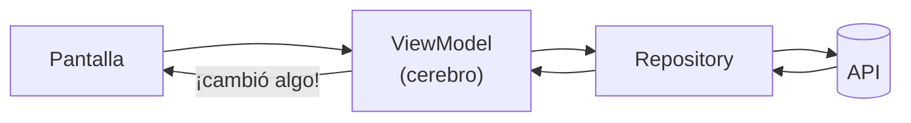

# 03 - El código más importante

Vuelve al [[00 - Guion corto]].

> [!info] Cómo está organizado (MVVM, en simple)
> - **View** = la pantalla (lo que se ve).
> - **ViewModel** = el cerebro de la pantalla (guarda los datos y avisa cuando cambian).
> - **Repository / DataSource** = los que le piden los datos a la API.
>
> La pantalla **nunca** habla directo con la API: siempre pasa por el ViewModel.



Son **5 partes**. Con estas se explica todo el dashboard.

---

## 1️⃣ Pedir los datos del inicio (los 3 a la vez)

📄 `features/dashboard/data/repositories/dashboard_repository.dart`

```dart
final cuentas = _dataSource.obtenerCuentas();        // GET /api/cuentas
final tarjetas = _dataSource.obtenerTarjetas();      // GET /api/tarjetas
final movimientos = _dataSource.obtenerMovimientos(limite: 5);  // GET /api/movimientos
await Future.wait([cuentas, tarjetas, movimientos]); // espera a que lleguen los 3
```

**Cómo explicarlo:** "Aquí la app pide las cuentas, las tarjetas y los movimientos **al mismo tiempo** y espera a que lleguen los tres."

---

## 2️⃣ Sumar el saldo total

📄 `features/dashboard/model/resumen_dashboard.dart`

```dart
double get saldoTotal =>
    cuentas.fold(0, (total, cuenta) => total + cuenta.saldo);
```

**Cómo explicarlo:** "Empieza en 0 y le va sumando el saldo de cada cuenta. Así sale el **Saldo Total**."

---

## 3️⃣ El cerebro del inicio

📄 `features/dashboard/viewmodel/dashboard_view_model.dart`

```dart
Future<void> cargar() async {
  cargando = true;               // muestra la ruedita de carga
  notifyListeners();             // avisa a la pantalla
  try {
    resumen = await _repository.obtenerResumen(limiteMovimientos: 5);  // pide los datos
  } on AppException catch (e) {
    error = e.message;           // si falla, guarda el mensaje de error
  } finally {
    cargando = false;            // quita la ruedita
    notifyListeners();           // avisa a la pantalla: ¡ya hay datos!
  }
}
```

**Cómo explicarlo:** "Cuando se abre el inicio, el ViewModel pone 'cargando', pide los datos y, cuando llegan, **avisa a la pantalla** con `notifyListeners()` para que se dibuje."

---

## 4️⃣ Los botones y la recarga

📄 `features/dashboard/view/dashboard_screen.dart`

```dart
QuickActions(
  onTransferir:     () => _abrirYRecargar(context, AppRoutes.transfer),
  onEfectivoMovil:  () => _abrirYRecargar(context, AppRoutes.mobileCash),
  onPagarServicios: () => context.push(AppRoutes.payServices),
  onRecibirDinero:  () => _recibirDinero(context),
)
```

```dart
Future<void> _abrirYRecargar(BuildContext context, String ruta) async {
  final vm = context.read<DashboardViewModel>();  // el cerebro del inicio
  await context.push<bool>(ruta);   // abre la pantalla y espera a que el usuario vuelva
  await vm.cargar();                // al volver, pide los datos otra vez
}
```

**Cómo explicarlo:** "Cada botón abre su pantalla. Los que mueven dinero, al volver, **recargan el inicio** para que se vea el saldo nuevo."

---

## 5️⃣ La transferencia en la API (lo más importante)

📄 `bancopanda-api/…/Features/Transfers/TransfersService.cs`

```csharp
var cuentas = await db.BloquearCuentasAsync(...);   // 🔒 bloquea las cuentas

if (cuentaOrigen.Saldo < monto)                      // ¿alcanza el dinero?
    return Fallo("Saldo insuficiente para realizar la transferencia");

cuentaOrigen.Saldo -= monto;                         // ➖ sale el dinero
cuentas[destino.CuentaId].Saldo += monto;            // ➕ llega el dinero (si es Banco Panda)

await db.SaveChangesAsync(ct);                       // 💾 guarda
await transaccion.CommitAsync(ct);                   // ✅ todo o nada
```

**Cómo explicarlo:**
- "Primero **bloquea** las cuentas: si llegan dos transferencias a la vez, una espera a la otra."
- "Revisa que **alcance el saldo**."
- "**Resta** de una cuenta y **suma** a la otra."
- "Guarda todo junto: si algo falla, **no se guarda nada**. Así nunca se pierde dinero."

> [!tip] Efectivo móvil funciona igual
> 📄 `Features/MobileCash/MobileCashService.cs`: bloquea, revisa saldo, resta, y en vez de sumar a otra cuenta **crea dos códigos** y los guarda **cifrados**.
