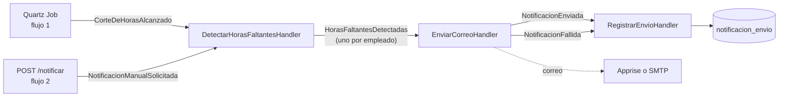

# Cómo funciona (visión general)

Parte de [[00 - Índice Notificaciones]].

## El problema

Cada colaborador debe registrar sus horas (8 h por día laborable, 6 h si es pasante). La empresa cierra las horas **dos veces al mes**:

- **Quincena:** del 1 al 15.
- **Fin de mes:** del 16 al último día.

Si alguien no completó sus horas, hay que mandarle un correo recordándole cuántas le faltan.

## Las dos formas de disparar el aviso

| Flujo | Quién lo dispara | Cuándo | Origen guardado |
|---|---|---|---|
| **Flujo 1** | El backend solo (Quartz) | En la `FechaCorte` de `appsettings.json` | `Automatico` |
| **Flujo 2** | El Líder Técnico (botón 🔔) | Cualquier día | `Manual` |
| Flujo 3 *(futuro)* | Contabilidad programa cortes en una pantalla | Cada hora se revisa la tabla | `Automatico` |

## La idea clave: arquitectura orientada a eventos

En vez de que un método haga todo de corrido ("calcular → enviar → guardar"), cada paso es una **pieza independiente** que reacciona a un **evento**:

Cada flecha pasa por el **bus de eventos** ([[02 - Bus de eventos y Outbox]]):

1. El evento se guarda primero en la tabla `evento_outbox` (así no se pierde si se cae el servidor).
2. Un servicio en segundo plano (`EventDispatcher`) lo saca y se lo entrega al handler que corresponde.

## ¿Por qué así y no directo?

- **Respuesta rápida al usuario (RNF-001):** el endpoint del líder solo publica el evento y responde; el envío ocurre después.
- **No se pierde nada (RNF-002/003):** si el backend se reinicia a mitad, los eventos pendientes se retoman.
- **Sin duplicados (RNF-004):** antes de enviar se revisa el historial (`notificacion_envio`).
- **Flujos reutilizables:** el flujo 1 y el 2 comparten detector, envío y registro. Solo cambia el evento de entrada.
- **Sin RabbitMQ:** todo vive dentro del mismo backend. Si un día se necesita un broker externo, se cambia la implementación de `IEventBus` y los handlers siguen igual.

## Recorrido mínimo (flujo 1)

1. Llega la fecha de corte → Quartz ejecuta `RevisarHorasFaltantesJob`.
2. El job publica `CorteDeHorasAlcanzado(inicio, fin, fechaCorte)`.
3. `DetectarHorasFaltantesHandler` calcula a **todos** los empleados activos y publica `HorasFaltantesDetectadas` para cada uno que debe horas.
4. `EnviarCorreoHandler` revisa que no se le haya avisado ya en ese corte, arma el HTML y lo manda.
5. `RegistrarEnvioHandler` guarda `Enviado` o `Fallido` en `notificacion_envio`.

Detalle completo: [[04 - Flujo 1 - Corte automático con Quartz]] y [[05 - Flujo 2 - Aviso manual del líder]].
