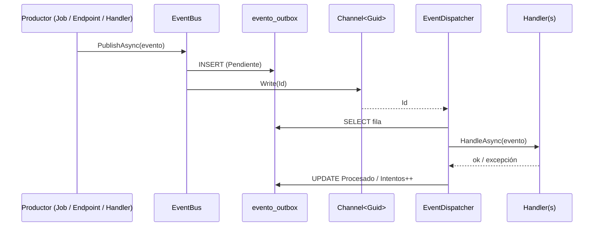

# Bus de eventos y Outbox

Parte de [[00 - Índice Notificaciones]]. Dueña según el reparto: **Milena** (mensajería e integración).

Archivos: `tmr-backend/Infrastructure/Messaging/` y `Infrastructure/Extensions/MessagingExtensions.cs`.

## Piezas

| Archivo | Qué es |
|---|---|
| `IEvent.cs` → `IEvento` | Interfaz vacía que "marca" una clase como evento. Todos los eventos la implementan. |
| `IEventBus.cs` | Contrato con un solo método: `PublishAsync<T>(T evento)`. |
| `IEventHandler.cs` → `IEventHandler<T>` | Contrato de quien escucha: `HandleAsync(T evento, ct)`. |
| `EventBus.cs` | Implementación: guarda en Outbox y avisa por el canal. |
| `EventDispatcher.cs` | `BackgroundService` que entrega los eventos a sus handlers. |
| `EventoOutbox.cs` | Entidad de la tabla `notificacion.evento_outbox`. |
| `EstadoEvento.cs` | `Pendiente = 1`, `Procesado = 2`, `Fallido = 3`. |
| `MessagingExtensions.cs` | `AddMessaging()`: registra todo lo anterior en DI. |

## `EventBus.PublishAsync` paso a paso

```csharp
var fila = new EventoOutbox {
    Id = Guid.NewGuid(),
    TipoEvento = tipoReal.Name,                            // "CorteDeHorasAlcanzado"
    Payload = JsonSerializer.Serialize(evento, tipoReal),  // datos en JSON
    Estado = EstadoEvento.Pendiente, ...
};
_db.Set<EventoOutbox>().Add(fila);
await _db.SaveChangesAsync(ct);          // 1. Persistir (ya no se pierde)
await _canal.Writer.WriteAsync(fila.Id); // 2. Avisar al dispatcher (solo el Id)
```

- **Consume:** `ApplicationDbContext` (Postgres) y `Channel<Guid>` (cola en memoria).
- Es **scoped** porque usa el DbContext de la petición.
- Usa `evento.GetType()` y no `T`, para que funcione aunque alguien publique una variable de tipo `IEvento`.

## `EventDispatcher` paso a paso

Vive todo el tiempo que el backend esté encendido.

1. **Al arrancar** → `ReencolarPendientesAsync`: busca en `evento_outbox` todo lo que quedó `Pendiente` (por ejemplo, si el servidor se cayó) y lo vuelve a meter al canal, en orden de creación. → cumple **RF-009**.
2. **Escucha el canal** con `await foreach (var id in _canal.Reader.ReadAllAsync())`. No consume CPU mientras espera.
3. Por cada Id → `ProcesarAsync(id)`:
   1. Crea un **scope nuevo** (DbContext y handlers propios para ese evento).
   2. Lee la fila. Si no existe o ya no está `Pendiente`, no hace nada (idempotencia).
   3. Con el diccionario `nombre → Type` reconstruye el objeto desde el JSON.
   4. Pide al contenedor DI todos los `IEventHandler<ThatType>` y llama `HandleAsync` en cada uno (por reflexión).
   5. Si todos terminan bien → `Procesado` + `FechaProcesado`.
   6. Si alguno lanza excepción → `Intentos++`, guarda `UltimoError` y:
      - menos de **5** intentos → lo reprograma en **30 segundos** (`Task.Delay` + volver a escribir en el canal);
      - 5 intentos → `Fallido` (queda para revisión manual).
4. Un error inesperado se loguea y el dispatcher **sigue** con el siguiente.



## `AddMessaging()` registra

1. `Channel<Guid>` **singleton**, sin límite, con un solo lector.
2. Diccionario `IReadOnlyDictionary<string, Type>`: todas las clases del ensamblado que implementan `IEvento`, por nombre. Así el dispatcher sabe convertir `"HorasFaltantesDetectadas"` → clase.
3. `IEventBus` → `EventBus` (**scoped**).
4. `EventDispatcher` como `HostedService`.

> [!warning] Ojo con los handlers que lanzan excepción
> Si un handler falla, **todo el evento** se reintenta. Por eso `EnviarCorreoHandler` **no relanza** los errores de envío: si lo hiciera, se reintentaría el envío y se registraría dos veces. Ver [[07 - Envío del correo (EnviarCorreoHandler)]].

> [!note] Cadena de eventos
> Un handler puede publicar otro evento (el detector publica `HorasFaltantesDetectadas`, el envío publica `NotificacionEnviada`). Cada uno pasa de nuevo por Outbox → canal → dispatcher, así que cada etapa tiene su propia fila y sus propios reintentos.
