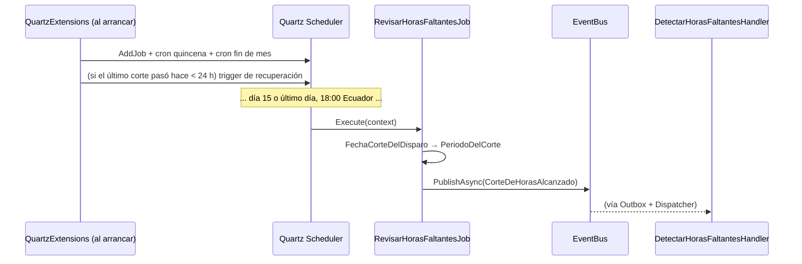

# Flujo 1 - Corte automático con Quartz

Parte de [[00 - Índice Notificaciones]]. **Es parte de mi trabajo** → ver también [[14 - Mi parte (Harold)]].

Archivos:
- `tmr-backend/Infrastructure/Extensions/QuartzExtensions.cs`
- `tmr-backend/Features/Notificaciones/Infrastructure/Jobs/RevisarHorasFaltantesJob.cs`

> [!success] Cambio del 15/10/2026: cortes recurrentes
> Antes había **un solo** trigger con la fecha de `appsettings.json` (`StartAt` + `WithRepeatCount(0)`): después de ese corte había que editar el archivo y reiniciar. Ahora hay **dos triggers cron** que se repiten cada mes, y el período se calcula a partir de la fecha del corte. Ver [[#Historial del cambio]].

## ¿Qué es Quartz?

**Quartz.NET** (paquete `Quartz.Extensions.Hosting` 4.4.0) es un **programador de tareas**: le dices "ejecuta este *job* en esta fecha" o "con este cron", y lo hace dentro del backend.

- **Job** = la tarea (`RevisarHorasFaltantesJob`).
- **Trigger** = cuándo se ejecuta (aquí: dos cron + uno de recuperación).
- **JobStore** = dónde se guarda la programación. Aquí es **en memoria**: al reiniciar, se vuelve a programar desde el código.

## Cuándo se dispara

| Trigger | Cron (UTC) | Equivale a |
|---|---|---|
| `corte-quincena` | `0 0 23 15 * ?` | día **15** de cada mes, **18:00 Ecuador** |
| `corte-fin-de-mes` | `0 0 23 L * ?` | **último día** de cada mes (`L`), **18:00 Ecuador** |
| `corte-recuperado-yyyyMMddHHmm` | una vez, al arrancar | solo si el último corte pasó hace **< 24 h** |

- Los cron están en **UTC** porque Ecuador es siempre UTC−5 (sin horario de verano) y la imagen **Alpine** del contenedor no trae la base de zonas horarias (`America/Guayaquil` fallaría). Así **no hay que tocar Dokploy ni el `containerfile`**.
- `L` contempla meses de 28, 29, 30 y 31 días.

## Paso a paso



### 1. Configuración

Solo se usa `NotificacionHoras:Habilitado` (`true` = programar los cortes).
`InicioPeriodo`, `FinPeriodo` y `FechaCorte` **ya no se usan** (se pueden quitar de `appsettings.json` y de `NotificacionHorasOptions` cuando Milena lo vea conveniente; dejarlas no rompe nada).

### 2. Al arrancar: `AddNotificacionesQuartz(configuration)`

1. Lee `NotificacionHoras` → `opciones.Habilitado`.
2. Calcula `ultimoCorte = RevisarHorasFaltantesJob.UltimoCorte(ahora)`.
3. Si está habilitado y `ahora − ultimoCorte < 24 h` → `corteARecuperar = ultimoCorte`.
4. Registra el job (`StoreDurably`).
5. Si está habilitado → los **dos triggers cron** con `InTimeZone(TimeZoneInfo.Utc)` y misfire `FireAndProceed`.
6. Si hay `corteARecuperar` → trigger `StartNow()` de una vez, con la fecha del corte en el `JobDataMap` (clave `fechaCorte`).
7. `RegistroCorteAlArrancar` escribe en el log:
   - `Cortes de horas programados: día 15 y último día de cada mes a las 18:00 (Ecuador). Próximo corte: ...`
   - y, si aplica, `El corte ... pasó hace menos de 24 h; se ejecuta ahora por si el backend estaba apagado`
   - o `Cortes de horas NO programados: NotificacionHoras:Habilitado = false`.

> [!question] ¿Por qué el trigger de recuperación?
> Con el JobStore en memoria, si el backend está **apagado** a las 18:00 del corte, Quartz no se entera de que se lo perdió. Al arrancar, si el corte fue hace menos de 24 h, se ejecuta una vez. Si en realidad sí se había procesado, el control de duplicados (`NotificadosEnCorteAsync` + `DebeEnviar`) evita reenviar.

### 3. Al dispararse: `RevisarHorasFaltantesJob`

```csharp
public async ValueTask Execute(IJobExecutionContext context, CancellationToken ct)
{
    if (!_opciones.Habilitado) { log; return; }
    await PublicarCorteAsync(FechaCorteDelDisparo(context), ct);
}
```

| Función | Qué hace |
|---|---|
| `FechaCorteDelDisparo(context)` | Si el trigger trae `fechaCorte` en el `JobDataMap` (recuperación) la usa; si no, `ScheduledFireTimeUtc` (la hora **programada**, no "ahora") |
| `PublicarCorteAsync(fechaCorte)` | Calcula el período y publica `CorteDeHorasAlcanzado(inicio, fin, fechaCorte en −05:00)` |
| `PeriodoDelCorte(fechaCorte)` *(pura)* | Pasa la fecha a hora Ecuador y usa `CalculadorHorasFaltantes.PeriodoEnCurso` → 1–15 o 16–último día |
| `UltimoCorte(ahora)` *(pura)* | El corte más reciente ≤ ahora (fin del mes anterior, 15 o fin de este mes) |
| `ProximoCorte(ahora)` *(pura)* | El siguiente corte > ahora (solo para el log) |

> [!important] Por qué `ScheduledFireTimeUtc` y no `DateTime.Now`
> La `FechaCorte` del evento identifica el corte en `notificacion_envio` (índice único y `NotificadosEnCorteAsync`). Si usáramos "ahora", un mismo corte ejecutado dos veces tendría dos fechas distintas y se **duplicarían** los correos. La hora programada es siempre `…T23:00:00Z`.

### 4. Lo que sigue (otros handlers)

1. `DetectarHorasFaltantesHandler.HandleAsync(CorteDeHorasAlcanzado)` → calcula a todos, descarta a los ya notificados en ese corte y a los sin correo, publica `HorasFaltantesDetectadas` (Automático).
2. `EnviarCorreoHandler` → [[07 - Envío del correo (EnviarCorreoHandler)]]
3. `RegistrarEnvioHandler` → [[11 - Base de datos]]

## Limitaciones que siguen

- **JobStore en memoria**: si el backend estuvo apagado **más de 24 h** durante un corte, ese corte se pierde. La solución completa es el JobStore en Postgres (tablas `QRTZ_*`).
- **Varias réplicas en Dokploy**: con Quartz en memoria cada réplica dispara el corte. El control de duplicados lo mitiga, pero lo correcto sería `UseClustering()` con JobStore persistente. Revisar cuántas réplicas tiene el backend.
- El corte se dispara aunque el 15 o el último día caigan en fin de semana o feriado (igual que antes). Mover cortes es lo que resolverá el **flujo 3**.
- **Probar en local con cuidado**: `appsettings.Development.json` hereda `Habilitado = true`. Si arrancas el backend menos de 24 h después de un corte, se dispara la recuperación y se mandan correos (en dev van a MailDev por Apprise).

## Historial del cambio

**15/10/2026** — Solo se tocaron archivos de mi parte:
- `QuartzExtensions.cs`: trigger único → 2 cron + recuperación; se eliminó `ValidarCorte`.
- `RevisarHorasFaltantesJob.cs`: el período sale de la fecha del corte; nuevas funciones puras.
- `RevisarHorasFaltantesJobTests.cs`: 2 tests → 18 (períodos, febrero bisiesto, último/próximo corte, cron).
- Resultado: 75/75 tests de Notificaciones en verde.
- Commit **`b2092f6`** "fix: problema con el trigger arreglado" en `feature/notificaciones-limpia` (rama de Allan), encima de su `cc97a02`. Ya está subido a GitHub.
