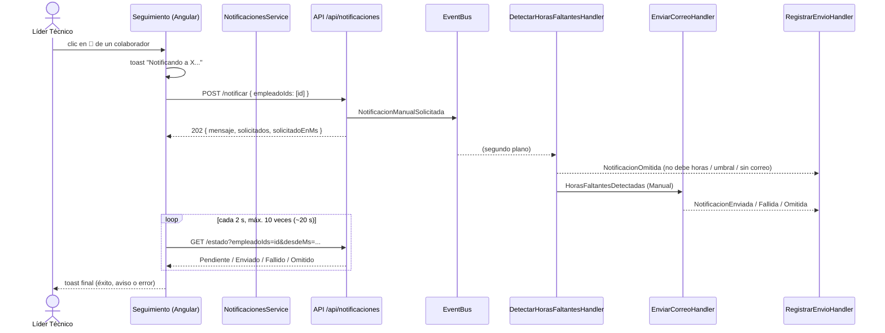

# Flujo 2 - Aviso manual del líder

Parte de [[00 - Índice Notificaciones]]. Dueño según el reparto: **Jonathan**. Allan agregó el **resultado real** (estado `Omitido`, `GET /estado` y el toast) el 15/10/2026.

## Paso a paso completo



### Frontend (Seguimiento)

`seguimiento.ts → notificarColaborador(colaborador)`:

1. Si ya se está notificando a ese colaborador, no hace nada (`notificandoIds`, un `signal<Set>`). Se puede avisar a **varios a la vez**.
2. Abre un **toast** arriba a la derecha (no bloquea la pantalla): "Notificando a X", con los pasos "Solicitud enviada" → "Procesando y enviando el correo".
3. `notificar({ empleadoIds: [id] })` → espera el **202** con `solicitadoEnMs`.
4. `esperarResultadoNotificacion(id, solicitadoEnMs)`: consulta `getEstado` cada **2 s**, hasta **10 veces**, y para en cuanto el estado deja de ser `Pendiente`.
5. Toast final según el estado:
   - `Enviado` → ✅ "Notificación enviada"
   - `Omitido` → ⚠️ "Notificación no enviada: \<motivo\>"
   - `Fallido` → ❌ "No se pudo enviar… intenta en unos minutos"
   - sin respuesta (null) → ⚠️ "Envío en proceso, sigue en cola"

Más detalle en [[10 - Frontend]].

### Backend — `POST /api/notificaciones/notificar`

1. `RequireAuthorization("NOTIFICACIONES_EJECUTAR")`.
2. Si la lista está vacía → `400`.
3. `(inicio, fin) = PeriodoEnCurso(HoyEcuador())`.
4. Guarda `solicitadoEn = UtcNow` **antes** de publicar.
5. Publica `NotificacionManualSolicitada(ids, inicio, fin, userId)`.
6. Responde **`202 Accepted`**:
   ```json
   { "mensaje": "Solicitud recibida. Los correos se procesan en segundo plano.",
     "solicitados": 1, "solicitadoEnMs": 1760598000000 }
   ```

### Backend — `GET /api/notificaciones/estado?empleadoIds=..&desdeMs=..`

1. Valida que haya entre 1 y **200** ids.
2. Busca en `notificacion_envio` las filas **manuales**, del **mismo usuario** (`IdUsuarioEjecutor`), con `FechaEnvio >= desdeMs` y de esos empleados.
3. Para cada id devuelve la fila más reciente, o `Pendiente` si todavía no hay ninguna.
4. Respuesta: `{ completo: bool, empleados: [{ idEmpleado, estado, detalle }] }`. `detalle` trae el motivo (`Omitido`) o el error (`Fallido`).

### Backend — detección (`HandleAsync(NotificacionManualSolicitada)`)

1. Quita los ids repetidos.
2. `finPeriodo = FinManualEfectivo(fin, hoy)` → **hasta ayer**.
3. `CalcularAsync(inicio, finPeriodo, ids)` → los que deben horas.
4. Los ids pedidos que **no** aparecen → `NotificacionOmitida("No tiene horas pendientes en el período")`.
5. Por cada empleado que debe horas:
   - dentro del umbral → `Omitida("Ya recibió un aviso manual hace menos de N h")`
   - sin correo → `Omitida("No tiene correo registrado")`
   - si no → `HorasFaltantesDetectadas(..., Origen = Manual)`.

### Envío y registro

`EnviarCorreoHandler` vuelve a revisar el umbral. Si ya no corresponde, también publica `NotificacionOmitida`. Si corresponde, envía con el texto "Tu líder técnico te recuerda…". Ver [[07 - Envío del correo (EnviarCorreoHandler)]].

`RegistrarEnvioHandler` guarda la fila (`Enviado`, `Fallido` u `Omitido`), y esa fila es la que lee `GET /estado`.

## Reglas importantes

- **El aviso manual y el automático no se bloquean entre sí.**
- **Umbral:** `NotificacionHoras:UmbralNotificacionManual` = 24 h en base y **0** en dev.
- Solo cuentan como "último aviso" las filas `Enviado`. Un `Omitido` o un `Fallido` no reinician el umbral.
- `Omitido` es **solo para avisos manuales**: no afecta al índice único de los automáticos.

## `GET /api/notificaciones/pendientes`

Lista de quién debe horas en el período en curso (hasta ayer), con `ultimoAvisoManual`. El front ya tiene la interfaz correcta (`PendientesResponse` con `empleados[]`), pero **todavía no lo usa** ninguna pantalla.
