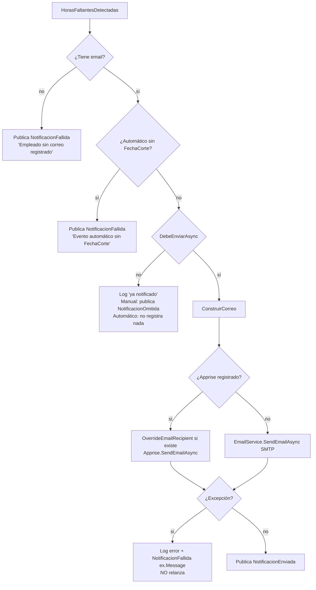

# Envío del correo (EnviarCorreoHandler)

Parte de [[00 - Índice Notificaciones]]. **Es mi parte** → resumen en [[14 - Mi parte (Harold)]].

Archivo: `tmr-backend/Features/Notificaciones/Application/Handlers/EnviarCorreoHandler.cs`

## Qué recibe y qué consume

- **Escucha:** `HorasFaltantesDetectadas` (un evento = un empleado).
- **Publica:** `NotificacionEnviada`, `NotificacionFallida` o (solo manual, desde el 15/10) `NotificacionOmitida`.
- **Dependencias (constructor):**

| Dependencia | Para qué |
|---|---|
| `ApplicationDbContext` | Leer `NotificacionEnvio` (regla anti-duplicados) |
| `IEmailService` | Envío por **SMTP con MailKit** (alternativa) |
| `IAppriseNotificationService?` | Envío por **Apprise** (opcional, `null` si `Apprise:Enabled = false`) |
| `IEventBus` | Publicar el resultado |
| `IOptions<NotificacionHorasOptions>` | `UmbralNotificacionManual` |
| `IConfiguration` | `EmailSettings:FrontendUrl` para el enlace del correo |
| `ILogger` | Logs |

## `HandleAsync` paso a paso



1. `ahora = DateTimeOffset.UtcNow`: es la fecha que se guarda como `FechaEnvio`.
2. **Validaciones defensivas:** sin email, o automático sin `FechaCorte` → `NotificacionFallida`.
3. **`DebeEnviarAsync`** → si devuelve `false`: no es un fallo, es un duplicado evitado.
   - **Manual:** publica `NotificacionOmitida("Ya recibió un aviso manual hace menos de N h")`, para que el líder lo vea en el toast.
   - **Automático:** termina sin registrar nada.
4. **`ConstruirCorreo`** → `(asunto, html)`.
5. **Envío:** Apprise si está registrado; si no, SMTP. Con Apprise, si existe `EmailSettings:OverrideEmailRecipient`, cambia el destinatario y antepone `[PRUEBA para: real@...]` al asunto, igual que hace `EmailService`.
6. **Error:** se captura, se loguea y se publica `NotificacionFallida(error = ex.Message)`. **No se relanza** a propósito: si se relanzara, el `EventDispatcher` reintentaría el evento completo (otro correo y registros dobles).
7. **Éxito:** se publica `NotificacionEnviada`.

## Regla anti-duplicados

### `DebeEnviarAsync` (con BD)

Busca en `NotificacionEnvio` las filas del **mismo empleado**, **mismo origen** y con estado **`Enviado`**:

- **Automático:** ¿existe alguna con `FechaCorte == evento.FechaCorte` (en UTC)? → `yaEnviadoEnCorte`.
  - `ToUniversalTime()` es obligatorio porque Npgsql solo acepta `DateTimeOffset` en UTC para `timestamptz`.
- **Manual:** toma la `FechaEnvio` más reciente → `ultimoEnvioManual`.

Luego llama a la función pura `DebeEnviar(...)`.

### `DebeEnviar` (pura, sin BD, `internal static`, testeable)

```csharp
return origen switch
{
    Automatico => !yaEnviadoEnCorte,
    Manual     => ultimoEnvioManual is null
                  || ahora - ultimoEnvioManual >= TimeSpan.FromHours(umbralHorasManual),
    _          => false
};
```

| Caso | Resultado |
|---|---|
| Automático, nunca avisado en este corte | ✅ envía |
| Automático, ya hay un `Enviado` en este corte | ❌ omite (**RF-007**) |
| Manual, nunca avisado manualmente | ✅ envía |
| Manual, último aviso hace 30 h (umbral 24) | ✅ envía (**RF-008**) |
| Manual, último aviso hace 3 h (umbral 24) | ❌ omite |
| Manual, umbral 0 | ✅ siempre envía |

> [!note] Independencia
> Solo se comparan filas del **mismo origen**: un manual no bloquea al automático, ni al revés.

> [!info] Solo cuentan los `Enviado`
> Un intento `Fallido` no bloquea: el siguiente intento puede volver a enviar.

## La plantilla — `ConstruirCorreo`

- `nombre`: `WebUtility.HtmlEncode(evento.Nombre)` → evita inyectar HTML con un nombre raro.
- `horas`: formato `0.##` con cultura `es-EC` (ej. `12,5`).
- Fechas: `dd/MM/yyyy`.
- `enlace`: `{EmailSettings:FrontendUrl}/time-report/actividades` (por defecto `http://localhost:3000`).
- **Asunto:** `Recordatorio: tienes {horas} horas pendientes de registrar ({dd/MM} - {dd/MM})`.
- **Mensaje según el origen:**
  - Manual → "Tu líder técnico te recuerda que tienes horas pendientes..."
  - Automático → "Se realizó el **{DescribirCorte}** y detectamos que tienes horas pendientes..."
- **Cuerpo:** logo (`cid:logo_isc`), título "ISC Time Report", caja con saludo, mensaje y horas en rojo, botón azul **"Registrar mis horas"** y pie "correo automático".

### `DescribirCorte`

| Período | Texto |
|---|---|
| empieza el día 1 y termina el 15 | "cierre de quincena" |
| el día siguiente al fin es día 1 (último día del mes) | "cierre de fin de mes" |
| otro | "cierre del período" |

### `PublicarFallidaAsync`

Atajo que publica `NotificacionFallida` con los datos del evento, la fecha y el texto del error.

## Los dos canales de envío

| | Apprise | SMTP (`EmailService`) |
|---|---|---|
| Se usa cuando | `Apprise:Enabled = true` **y** `Apprise:ApiUrl` con valor | en cualquier otro caso |
| Cómo | HTTP POST al servidor Apprise | MailKit se conecta al servidor SMTP |
| Logo `cid:logo_isc` | ⚠️ **no se adjunta** → imagen rota | ✅ se adjunta `Resources/logo-isc.png` |
| `OverrideEmailRecipient` | ✅ lo aplica el handler (desde el 15/10) | ✅ lo aplica `EmailService` |
| Config | sección `Apprise` | sección `EmailSettings` |

Detalle de Apprise: [[08 - Apprise]].

### `EmailService` (SMTP) en breve

`Infrastructure/Shared/EmailService.cs`:

1. Lee `EmailSettings` (`SmtpServer`, `Port`, `SenderName`, `SenderEmail`, `Username`, `Password`).
2. Si existe `OverrideEmailRecipient`, cambia el destinatario (modo pruebas).
3. Arma un `MimeMessage` con el HTML y adjunta el logo como recurso embebido (`ContentId = "logo_isc"`).
4. Puerto 465 → `SslOnConnect`; 587 → `StartTls`; otro → `Auto`.
5. Se conecta, se autentica si hay usuario y contraseña, envía y se desconecta. Si algo falla, **relanza** la excepción, y `EnviarCorreoHandler` la convierte en `NotificacionFallida`.
