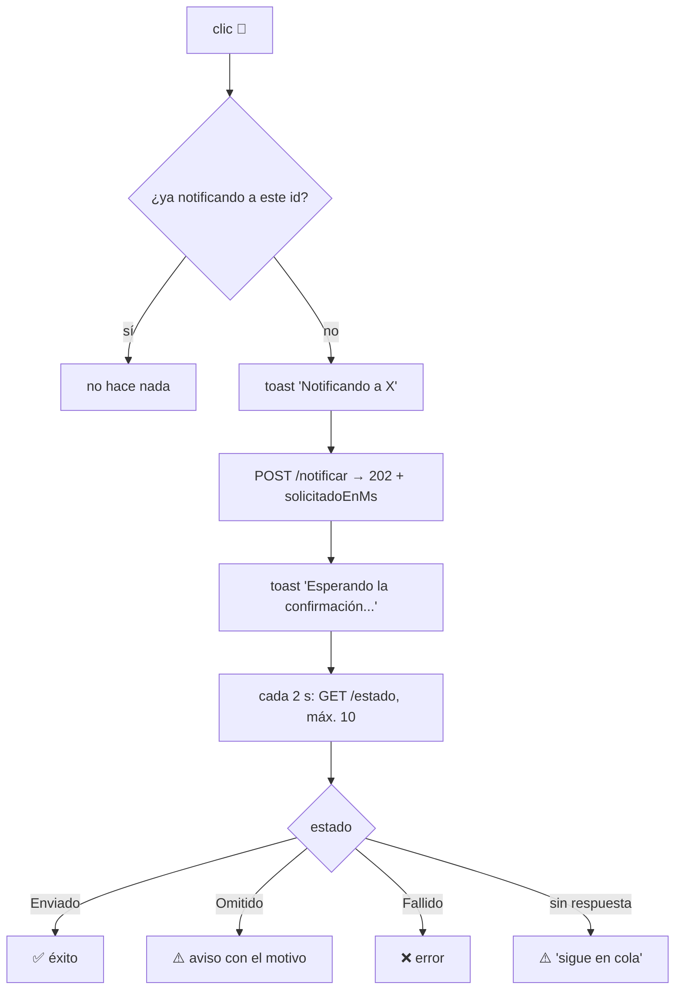

# Frontend

Parte de [[00 - Índice Notificaciones]].

Angular, carpeta `tmr-frontend/src/app`. La rama con los cambios del aviso manual es `feature/notificaciones` (último commit de Allan: `2541160 feat: toast de seguimiento para el aviso manual de horas`, 15/10/2026).

## Mapa rápido

| Lugar en la app | Archivo | Llama a | Para qué |
|---|---|---|---|
| Time Report → **Seguimiento** (botón 🔔) | `features/time-report/seguimiento/seguimiento.ts` | `POST /api/notificaciones/notificar` + `GET /api/notificaciones/estado` | Flujo 2: aviso manual con su resultado real |
| **Dashboard ejecutivo** (botón de correo en el detalle) | `features/dashboard/componentes/dashboard-ejecutivo/...component.ts` | `POST /api/dashboard/notificar-faltantes-email` | Correo directo (camino viejo) |
| **Dashboard por proyecto** | `features/dashboard/componentes/dashboard-page/...component.ts` | `POST /api/dashboard/notificar-faltantes-email` | Correo directo (camino viejo) |
| **Campana** del navbar | `core/layout/navbar/navbar.ts` + `.html` | `GET /api/dashboard/mis-horas-incompletas?rango=mes` | Aviso visual al propio usuario |

## `NotificacionesService` (`shared/services/notificaciones.service.ts`)

```ts
private apiUrl = `${environment.apiUrl}/notificaciones`;

getPendientes(): Observable<PendientesResponse>                     // GET  /pendientes (sin uso aún)
notificar(req: NotificarRequest): Observable<NotificarResponse>       // POST /notificar  → 202
getEstado(ids: number[], desdeMs: number): Observable<EstadoNotificacionResponse> // GET /estado
```

Interfaces (todas coinciden con el back):

| Interfaz | Campos |
|---|---|
| `NotificarRequest` | `empleadoIds: number[]` |
| `NotificarResponse` | `mensaje`, `solicitados`, `solicitadoEnMs` |
| `EstadoEnvio` | `'Pendiente' \| 'Enviado' \| 'Fallido' \| 'Omitido'` |
| `EstadoEmpleado` | `idEmpleado`, `estado`, `detalle` |
| `EstadoNotificacionResponse` | `completo`, `empleados[]` |
| `PendientesResponse` | `inicioPeriodo`, `finPeriodo`, `empleados: EmpleadoPendiente[]` *(corregida)* |

`getEstado` arma la query repitiendo el parámetro: `?desdeMs=...&empleadoIds=1&empleadoIds=2`.

## Seguimiento — aviso manual con toast



- `notificandoIds = signal<ReadonlySet<number>>` → evita el doble clic y permite notificar a **varios** colaboradores a la vez.
- `estaNotificando(colaborador)` → el HTML lo usa para mostrar el botón ocupado.
- `toastService.iniciar / avanzar / exito / aviso / error` → toast arriba a la derecha que **no bloquea** la pantalla (antes era un popup modal).
- `esperarResultadoNotificacion(id, desdeMs)` → polling de **2 s × 10 (~20 s)**. Si la consulta falla, devuelve `null` y se muestra "sigue en cola".

> [!warning] Pendientes del front
> - El botón 🔔 se muestra a todos. Sin `NOTIFICACIONES_EJECUTAR` el POST da 403 y el toast dice "No se pudo registrar la solicitud".
> - Si el backend tarda más de ~20 s (por ejemplo, el SMTP lento o reintentos del dispatcher), el líder ve "sigue en cola" aunque luego se envíe.

## Dashboard — `DashboardService.enviarNotificacionEmail(...)`

```ts
POST `${apiUrl}/dashboard/notificar-faltantes-email`
{ idEmpleado, nombreCompleto, proyecto, horasFaltantes }
```

- `dashboard-ejecutivo → enviarCorreo(fila)`: `enviandoCorreo[clave]` y `resultadoCorreo[clave] = 'ok' | 'error'` por fila (`idEmpleado-idProyecto`).
- `dashboard-page → enviarAlertaEmailServer(colab)`: `enviandoAlerta`, `exitoAlerta` (4 s) y `errorAlerta`.

Este camino **no** pasa por el módulo. Ver [[13 - Otros avisos fuera del módulo]].

## Campana del navbar

- `ngOnInit` → `consultarHorasIncompletas()`. Al **abrir** la campana vuelve a consultar.
- Punto rojo si `tieneFaltantes`. El desplegable dice "Tienes **X horas** pendientes..." o "¡Estás al día con tus horas!".
- Sin tiempo real (ni WebSocket ni polling).

## Lo que NO es de este módulo

`features/clientes/.../notificacion` y `features/colaboradores/.../notificacion` son **toasts de la UI** (2,5 s), sin relación con las horas faltantes.
