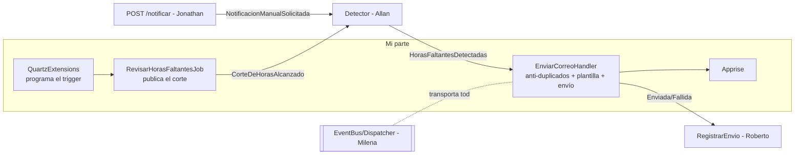

# Mi parte (Harold) — Envío y flujo 1

Parte de [[00 - Índice Notificaciones]].

Según `Reparto_Trabajo_Notificaciones.docx`:

> **4. Envío y flujo 1 – Harold**: plantilla del correo, `EnviarCorreoHandler` (duplicados y umbral), `QuartzExtensions` y `RevisarHorasFaltantesJob`.
> Dueño de: `EnviarCorreoHandler.cs`, `QuartzExtensions.cs`, `Infrastructure/Jobs/`.

Además, la integración con **Apprise** se conecta dentro de mi handler.

## Dónde encaja mi parte

- **Recibo de otros:** `HorasFaltantesDetectadas` (Allan), el bus (Milena), la tabla `notificacion_envio` (Roberto).
- **Entrego a otros:** `CorteDeHorasAlcanzado` (lo consume Allan) y `NotificacionEnviada`/`NotificacionFallida` (las consume Roberto).

## 1. `QuartzExtensions.AddNotificacionesQuartz`

**Qué hace:** al arrancar, programa el job con **dos cron que se repiten cada mes** (día 15 y último día, 18:00 Ecuador) y, si el último corte pasó hace menos de 24 h, un disparo de **recuperación**. *(Antes del 15/10/2026 era un solo trigger con la fecha de `appsettings`.)*

**Consume:** `IConfiguration` (`NotificacionHoras:Habilitado`), paquete Quartz, funciones de calendario del job.

**Funciones:**
- `AddNotificacionesQuartz(services, configuration)`: registra el job (`StoreDurably`), los triggers `corte-quincena` (`0 0 23 15 * ?`) y `corte-fin-de-mes` (`0 0 23 L * ?`) en UTC, y el trigger `corte-recuperado-…` con la fecha en el `JobDataMap`.
- `RegistroCorteAlArrancar`: deja en el log que los cortes quedaron programados, el próximo corte y si se recupera uno.

Detalle: [[04 - Flujo 1 - Corte automático con Quartz]].

## 2. `RevisarHorasFaltantesJob`

**Qué hace:** cuando Quartz lo ejecuta, calcula el período a partir de la fecha del corte y publica `CorteDeHorasAlcanzado(inicio, fin, fechaCorte)`.

**Consume:** `IEventBus`, `IOptions<NotificacionHorasOptions>`, `ILogger`, `CalculadorHorasFaltantes.PeriodoEnCurso`.

**Funciones:**
- `Execute(context, ct)`: si `Habilitado = false`, solo log. Si no, `PublicarCorteAsync(FechaCorteDelDisparo(context))`.
- `FechaCorteDelDisparo`: la fecha del `JobDataMap` (recuperación) o `ScheduledFireTimeUtc` → siempre la misma para un corte (clave para no duplicar).
- `PublicarCorteAsync(fechaCorte)`: período + publicación.
- `PeriodoDelCorte`, `UltimoCorte`, `ProximoCorte`: funciones puras de calendario (testeadas).
- `[DisallowConcurrentExecution]`: Quartz no lo corre dos veces en paralelo.
- **Flujo 3:** bastará con que la fecha del corte venga de `notificacion_fecha_corte` en vez del cron.

## 3. `EnviarCorreoHandler`

**Qué hace:** por cada empleado con horas faltantes, decide si se envía, arma el correo, lo manda y publica el resultado.

**Consume:** `ApplicationDbContext`, `IEmailService` (SMTP), `IAppriseNotificationService?`, `IEventBus`, `IOptions<NotificacionHorasOptions>`, `IConfiguration`, `ILogger`.

**Funciones:**

| Función | Qué hace |
|---|---|
| `HandleAsync(HorasFaltantesDetectadas)` | Orquesta: validaciones → `DebeEnviarAsync` → `ConstruirCorreo` → Apprise/SMTP → `NotificacionEnviada` o `NotificacionFallida`. Si un aviso **manual** no corresponde por el umbral → `NotificacionOmitida` (agregado por Allan) |
| `DebeEnviarAsync` | Lee `notificacion_envio` (mismo empleado, mismo origen, `Enviado`) y pasa los datos a `DebeEnviar` |
| `DebeEnviar` *(pura)* | Automático: no si ya hay envío en ese corte. Manual: solo si pasó el umbral |
| `ConstruirCorreo` | Asunto + HTML (con encoding del nombre, horas `es-EC`, botón a `/time-report/actividades`) |
| `DescribirCorte` | "cierre de quincena" / "cierre de fin de mes" / "cierre del período" |
| `PublicarFallidaAsync` | Atajo para publicar `NotificacionFallida` |

**Decisión clave:** si el envío falla **no se relanza** la excepción. Si se relanzara, el dispatcher reintentaría el evento y podría haber correos y registros dobles.

Detalle: [[07 - Envío del correo (EnviarCorreoHandler)]].

## 4. Apprise

**Qué hace:** envía el correo mediante un servidor **Apprise API** (HTTP) en vez de conectarse por SMTP.

**Consume:** `HttpClient` (typed client), `IOptions<AppriseOptions>`.

**Funciones:** `SendEmailAsync` (POST a `/notify` o `/notify/{Tag}`), `BuildEndpoint`, `BuildUrls` (reemplaza `{recipient}`).

Detalle: [[08 - Apprise]].

## Requerimientos que cubre mi parte

| RF | Cómo |
|---|---|
| RF-002 revisión automática en fecha configurada | `QuartzExtensions` + `RevisarHorasFaltantesJob` |
| RF-005 enviar correo con las horas faltantes | `EnviarCorreoHandler.ConstruirCorreo` + Apprise/SMTP |
| RF-007 sin duplicados automáticos por corte | `DebeEnviar` (Automático) + índice único de Roberto |
| RF-008 reenviar manual pasado el umbral | `DebeEnviar` (Manual) |
| RNF-004 idempotencia | revisión contra `notificacion_envio` antes de enviar |

## Tests de mi parte

`tests/tmr-backend.Tests/Notificaciones/`:
- `EnviarCorreoHandlerTests` (8): automático OK, manual OK, sin email, automático sin corte, duplicado en corte, manual dentro/fuera del umbral, fallo del servicio de correo.
- `RevisarHorasFaltantesJobTests` (18): deshabilitado no publica; quincena y fin de mes publican el período correcto; febrero (28/29) y meses de 30; último y próximo corte; los cron caen el 15 y el último día a las 23:00 UTC.

Ver [[16 - Pruebas automatizadas]].

## Lo que debería revisar o mejorar en mi parte

Ver el detalle en [[15 - Riesgos y pendientes]]:

1. **Logo roto por Apprise** (`cid:logo_isc` sin adjunto).
2. ~~`OverrideEmailRecipient` no aplica con Apprise~~ → resuelto por Allan (15/10).
3. ~~Modo con estado de Apprise~~ → resuelto por Allan (15/10): siempre `/notify`.
4. **Reintento después de un `Fallido` automático** choca con el índice único.
5. ~~Recordatorio operativo: configurar cada corte a mano~~ → **resuelto el 15/10/2026** con triggers cron.
6. **`FrontendUrl`** apunta a `localhost:3000`.
7. Faltan tests de `AppriseNotificationService`.

## Cómo explicarlo en una frase

> "Mi parte es el **final del camino** y el **arranque automático**: Quartz dispara el corte en la fecha configurada, y cuando el detector dice quién debe horas, mi handler revisa que no se le haya avisado ya, arma el correo y lo manda por Apprise o SMTP, dejando el resultado listo para que se registre."
