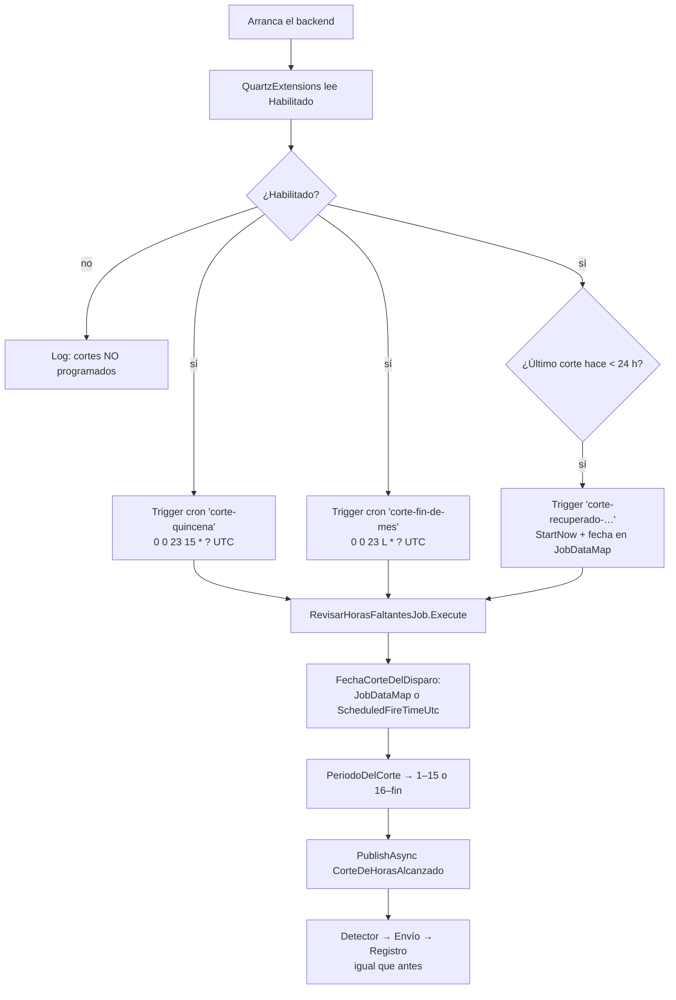

# Presentación - Cambios en Quartz (flujo 1)

Parte de [[00 - Índice Notificaciones]]. Mi parte → [[14 - Mi parte (Harold)]]. Detalle técnico → [[04 - Flujo 1 - Corte automático con Quartz]].

- **Commit:** `b2092f6` — "fix: problema con el trigger arreglado" (16/10/2026)
- **Rama:** `feature/notificaciones-limpia` (encima de `cc97a02` de Allan), ya en GitHub
- **Archivos:** `QuartzExtensions.cs`, `RevisarHorasFaltantesJob.cs`, `RevisarHorasFaltantesJobTests.cs` (+215 / −65)
- **Tests:** 75/75 de Notificaciones en verde

---

## 1. El problema (en una frase)

> El corte automático se disparaba **una sola vez**, en una fecha escrita a mano en `appsettings.json`. Para cada quincena había que **editar la configuración y redesplegar**; si nadie lo hacía, el corte siguiente **no se ejecutaba** y solo quedaba un warning en el log.

## 2. Antes vs. después

| | **Antes** | **Ahora** |
|---|---|---|
| Cuándo dispara | 1 vez, en `NotificacionHoras:FechaCorte` | **Cada mes**: día **15** y **último día**, 18:00 Ecuador |
| Trigger de Quartz | `StartAt(FechaCorte)` + `WithRepeatCount(0)` | 2 triggers **cron** + 1 de recuperación |
| Período (inicio/fin) | Se leía de `appsettings.json` | Se **calcula** con la fecha del corte |
| Siguiente quincena | Editar config + redeploy | Nada, es automático |
| Backend apagado a la hora del corte | `FireNow` si arrancaba dentro de 24 h | Igual: trigger de **recuperación** si pasó < 24 h |
| Config usada | `Habilitado`, `InicioPeriodo`, `FinPeriodo`, `FechaCorte` | Solo `Habilitado` |
| Tests del job | 2 | 18 casos |

## 3. Cómo funcionaba ANTES (por si lo preguntan)

### `QuartzExtensions` (antes)
1. Leía `NotificacionHoras` del `appsettings`.
2. `ValidarCorte(...)` → no programaba si: `Habilitado = false`, faltaban fechas, `Inicio > Fin`, o `FechaCorte` pasó hace más de 24 h.
3. Si era válido, creaba **un** trigger:
   ```csharp
   q.AddTrigger(t => t.ForJob(jobKey)
       .WithIdentity($"corte-{FechaCorte:yyyyMMddHHmm}")
       .StartAt(opciones.FechaCorte)                      // en esa fecha
       .WithSimpleSchedule(s => s
           .WithRepeatCount(0)                            // una sola vez
           .WithMisfireInstruction(SimpleTriggerMisfireInstruction.FireNow)));
   ```
4. Log: "Corte de horas programado para …" o "NO programado: \<motivo\>".

### `RevisarHorasFaltantesJob` (antes)
1. `[DisallowConcurrentExecution]` → nunca dos ejecuciones a la vez.
2. Constructor: `IEventBus`, `IOptions<NotificacionHorasOptions>`, `ILogger`.
3. `Execute`: si `Habilitado = false` → log y termina.
4. `foreach (var corte in ObtenerCortesPendientes())` → `PublishAsync(corte)` + log.
5. `ObtenerCortesPendientes()` → `yield return new CorteDeHorasAlcanzado(InicioPeriodo, FinPeriodo, FechaCorte)` **de la configuración**. El `IEnumerable` estaba pensado para el flujo 3 (varios cortes de una tabla).

## 4. Cómo funciona AHORA, paso a paso



### `QuartzExtensions.AddNotificacionesQuartz` (ahora)
1. Lee `NotificacionHoras` → solo usa `Habilitado`.
2. Calcula `ultimoCorte = RevisarHorasFaltantesJob.UltimoCorte(ahora)`.
3. Si está habilitado **y** `ahora − ultimoCorte < 24 h` → hay un corte para recuperar.
4. Registra el job (`StoreDurably`).
5. Si está habilitado, registra **dos triggers cron** en UTC con misfire `FireAndProceed`:
   - `corte-quincena` → `0 0 23 15 * ?`
   - `corte-fin-de-mes` → `0 0 23 L * ?`
6. Si hay corte para recuperar → trigger `corte-recuperado-yyyyMMddHHmm`, `StartNow()`, una vez, con `fechaCorte` en el `JobDataMap`.
7. Log al arrancar: "Cortes de horas programados… Próximo corte: …" (+ "se ejecuta ahora…" si recupera).

### `RevisarHorasFaltantesJob` (ahora)
| Función | Qué hace |
|---|---|
| `Execute(context)` | Si `Habilitado = false` → log y fin. Si no → `PublicarCorteAsync(FechaCorteDelDisparo(context))` |
| `FechaCorteDelDisparo` | Fecha del `JobDataMap` (recuperación) o `ScheduledFireTimeUtc` (cron) |
| `PublicarCorteAsync(fechaCorte)` | `PeriodoDelCorte` → publica `CorteDeHorasAlcanzado(inicio, fin, fechaCorte en −05:00)` + log |
| `PeriodoDelCorte` | Pasa la fecha a hora Ecuador → `CalculadorHorasFaltantes.PeriodoEnCurso` |
| `UltimoCorte(ahora)` | El corte más reciente ≤ ahora (fin del mes anterior, 15 o fin de este mes) |
| `ProximoCorte(ahora)` | El siguiente corte (solo para el log) |

## 5. Las 4 decisiones clave (y por qué)

1. **Cron en UTC (23:00) y no "18:00 America/Guayaquil".**
   Ecuador es siempre UTC−5 (sin horario de verano), así que 23:00 UTC = 18:00 Ecuador todo el año. La imagen **Alpine** del contenedor no trae la base de zonas horarias, y buscar `America/Guayaquil` fallaría. Así **no hubo que tocar Dokploy ni el `containerfile`**.
2. **`L` en el cron.** Significa "último día del mes": cubre meses de 28, 29, 30 y 31 días sin lógica extra.
3. **`ScheduledFireTimeUtc` y no `DateTime.Now`.**
   La `FechaCorte` es la "llave" del control de duplicados (`notificacion_envio`). Con la hora **programada**, un mismo corte siempre tiene la misma fecha aunque se ejecute dos veces → no se reenvían correos.
4. **Trigger de recuperación (< 24 h).**
   Quartz guarda la programación **en memoria**: si el backend está apagado a las 18:00, al arrancar no sabría que se perdió el corte. Mantiene el mismo comportamiento que el `FireNow` de antes.

## 6. Qué NO cambió

- Detector, envío, registro, bus de eventos y tablas: **igual**.
- El evento `CorteDeHorasAlcanzado` tiene **los mismos campos**.
- Los feriados se siguen descontando en el **cálculo de horas** (`CalculoHorasPeriodo`), no en el trigger.
- El flujo manual (líder) **no usa** Quartz.
- `appsettings.json` **no se tocó**: `InicioPeriodo`, `FinPeriodo` y `FechaCorte` quedan pero ya no se usan.

## 7. Tests (18 casos del job)

- Deshabilitado → no publica.
- Corte del 15 → período 1–15. Corte del 31 (23:00 UTC) → 16–31.
- Último día real: febrero 28, febrero 29 (bisiesto), abril 30.
- `UltimoCorte` (5 casos, incluido el cambio de año) y `ProximoCorte` (3 casos).
- Los cron, evaluados con `CronExpression` real de Quartz, caen el 15 y el último día a las 23:00 UTC.

## 8. Lo que puede fallar o queda pendiente

| Punto | Explicación |
|---|---|
| Prod envía **sola** cada corte | `Habilitado = true` en el `appsettings` base → acordarlo con el equipo |
| Credenciales SMTP en prod | Si faltan las variables `EmailSettings__…` en Dokploy, todo queda `Fallido` |
| Reinicio cerca de un corte | La recuperación vuelve a ejecutar el corte; los `Enviado` se saltan, pero un `Fallido` previo choca con el **índice único** (coordinar con Roberto) |
| Varias réplicas | Cada réplica dispara el corte → posibles correos dobles |
| Apagado > 24 h | Ese corte se pierde (lo resolvería el JobStore persistente en Postgres) |
| Corte en fin de semana o feriado | Se dispara igual (como antes); moverlo es el **flujo 3** |
| Probar en local < 24 h tras un corte | Se dispara la recuperación y se envían correos (dev → MailDev) |

## 9. Preguntas probables y respuestas

- **¿Y los feriados?** → Se descuentan al calcular las horas (tabla `TblTimeReportFeriados`). Ni el trigger viejo ni el nuevo movían la fecha del corte.
- **¿Por qué no se leen las fechas del `appsettings`?** → Porque obligaban a redesplegar cada quincena. El período se deduce de la fecha: si dispara el 15 es 1–15; si dispara el último día es 16–fin.
- **¿Se puede duplicar un correo?** → No en una sola réplica: misma `FechaCorte` + revisión de `notificacion_envio` antes de enviar.
- **¿Hubo que tocar Dokploy?** → No. Mismo contenedor, mismas variables, misma base de datos.
- **¿Qué pasa si se cae el servidor a las 18:00?** → Si vuelve dentro de 24 h, ejecuta el corte al arrancar.
- **¿Cómo lo desactivo?** → `NotificacionHoras:Habilitado = false` (o la variable `NotificacionHoras__Habilitado=false`).
- **¿Cómo sé que quedó programado?** → Log al arrancar: "Cortes de horas programados… Próximo corte: 2026-10-31 18:00".
- **¿Y el flujo 3?** → Solo cambiaría de dónde sale la fecha del corte (tabla `notificacion_fecha_corte`); el resto del job queda igual.

## 10. Guion de 1 minuto

> "El flujo 1 avisaba de las horas faltantes con un trigger de Quartz que se disparaba **una sola vez**, en una fecha fija del `appsettings`. Cada quincena había que cambiar la fecha y redesplegar, y si se olvidaba, el corte no salía.
> Lo cambié por **dos triggers cron** que se repiten solos: el **día 15** y el **último día de cada mes** a las 18:00 de Ecuador. El job ya no lee el período de la configuración: lo **calcula** a partir de la fecha del corte.
> Usé la **hora programada** del disparo como fecha del corte, para que el control de duplicados siga funcionando, y dejé un **disparo de recuperación** por si el servidor estaba apagado a esa hora.
> No cambió nada del detector, del envío ni del registro, no hubo que tocar Dokploy, y quedó cubierto con **18 casos de test**."
