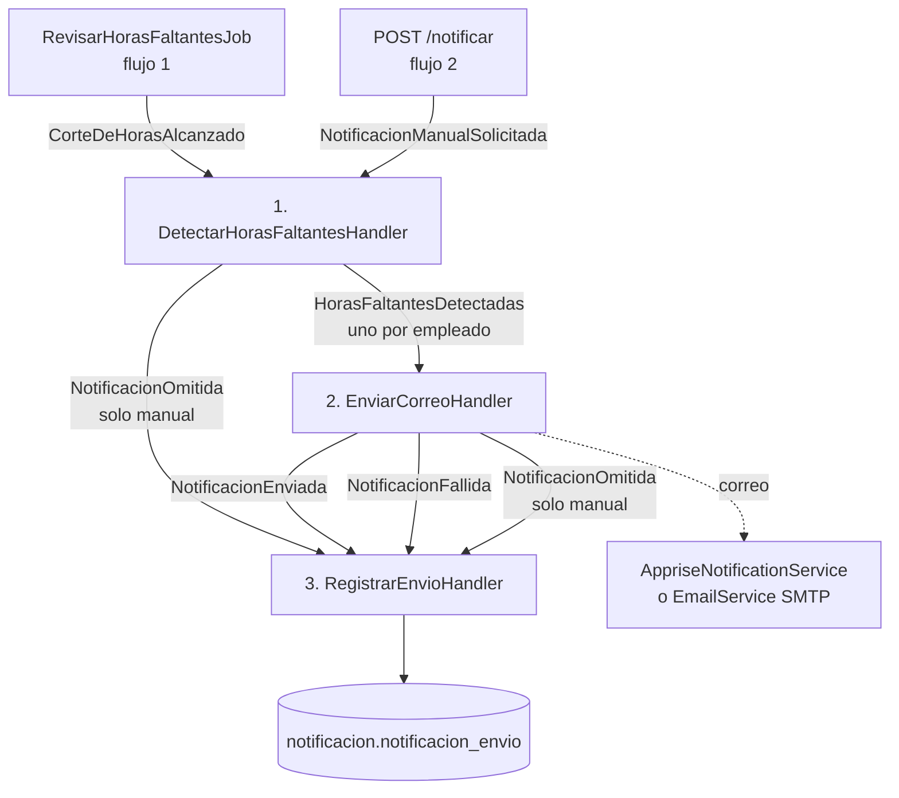

# Handlers de notificaciones, paso a paso

Parte de [[00 - Índice Notificaciones]]. Estado del código al **16/10/2026**: rama `feature/notificaciones-limpia`, commit `b2092f6`, que ya incluye los cambios de Allan (`cc97a02`).

Carpeta: `tmr-backend/Features/Notificaciones/Application/Handlers/`

## La cadena completa

**Cómo llega cada evento a su handler:** el productor llama a `IEventBus.PublishAsync(evento)`. El `EventBus` lo guarda en `evento_outbox` como `Pendiente` y pone el Id en un `Channel`. El `EventDispatcher` (en segundo plano) lo lee, reconstruye el objeto desde el JSON, pide al contenedor DI los `IEventHandler<T>` registrados y llama a `HandleAsync`. Si el handler lanza una excepción, reintenta cada 30 s, hasta 5 veces. Ver [[02 - Bus de eventos y Outbox]].

**Registro de handlers** (`NotificacionesModule.cs`):

| Evento | Handler |
|---|---|
| `CorteDeHorasAlcanzado` | `DetectarHorasFaltantesHandler` |
| `NotificacionManualSolicitada` | `DetectarHorasFaltantesHandler` |
| `HorasFaltantesDetectadas` | `EnviarCorreoHandler` |
| `NotificacionEnviada` | `RegistrarEnvioHandler` |
| `NotificacionFallida` | `RegistrarEnvioHandler` |
| `NotificacionOmitida` | `RegistrarEnvioHandler` |

Todos son **scoped**: el dispatcher crea un scope nuevo por evento, con su propio `DbContext`.

---

## 1. `DetectarHorasFaltantesHandler` (dueño: Allan)

**Rol:** recibe el "disparador" (el corte o la solicitud del líder), calcula **quién debe horas** y publica **un aviso por empleado**.

### Qué consume

| Tipo | Qué | Para qué |
|---|---|---|
| Constructor | `IConsultaHorasFaltantes` | Calcular quién debe horas y consultar avisos previos |
| Constructor | `IEventBus` | Publicar `HorasFaltantesDetectadas` y `NotificacionOmitida` |
| Constructor | `IOptions<NotificacionHorasOptions>` | `UmbralNotificacionManual` |
| Constructor | `ILogger` | Logs |
| Estático | `CalculoHorasPeriodo.HoyEcuador()` | "Hoy" en Ecuador (UTC−5) |
| Escucha | `CorteDeHorasAlcanzado`, `NotificacionManualSolicitada` | |
| Publica | `HorasFaltantesDetectadas`, `NotificacionOmitida` | |
| Tablas (vía consulta) | empleados, actividades, feriados, contratos, `notificacion_envio` | Solo lectura |

### `HandleAsync(CorteDeHorasAlcanzado)` — flujo 1

1. `CalcularAsync(inicio, fin, null)` → **todos** los empleados activos que deben horas en el período.
2. `NotificadosEnCorteAsync(fechaCorte)` → Ids que ya tienen un aviso **Automático + Enviado** en ese corte.
3. Por cada empleado con déficit:
   - si ya fue notificado en el corte, o no tiene correo (`TieneEmail` deja un warning) → lo salta;
   - si no → publica `HorasFaltantesDetectadas(id, nombre, email, horas, inicio, fin, Origen = Automatico, FechaCorte, IdUsuarioEjecutor = null)`.
4. Log: "Corte …: N con horas faltantes, M ya notificados, K avisos publicados".

> En el flujo automático **no** se publican `Omitido`.

### `HandleAsync(NotificacionManualSolicitada)` — flujo 2

1. Quita los ids repetidos. Si no queda ninguno, termina.
2. `finPeriodo = FinManualEfectivo(fin, HoyEcuador())` → como máximo **ayer**.
3. `CalcularAsync(inicio, finPeriodo, ids)` → los que deben horas, de **esos** ids.
4. `UltimosAvisosManualesAsync(ids con déficit)` → fecha del último aviso **Manual + Enviado** de cada uno.
5. Los ids pedidos que **no** deben horas → `NotificacionOmitida("No tiene horas pendientes en el período")`.
6. Por cada empleado con déficit:
   - `DentroDelUmbral(...)` → `Omitida("Ya recibió un aviso manual hace menos de N h")`;
   - sin correo → `Omitida("No tiene correo registrado")`;
   - si no → `HorasFaltantesDetectadas(..., Origen = Manual, FechaCorte = null, IdUsuarioEjecutor)`.
7. Log: "Aviso manual del usuario …: N solicitados, M con horas faltantes, K publicados".

### Funciones auxiliares

| Función | Qué hace |
|---|---|
| `FinManualEfectivo(fin, hoy)` *(pública, pura)* | `min(fin, hoy − 1)`: el día de hoy no se cuenta porque todavía no termina |
| `DentroDelUmbral(ultimo, ahora, umbral)` *(pública, pura)* | `true` si hay aviso previo, el umbral es > 0 y pasó **menos** que el umbral |
| `TieneEmail(empleado)` | `false` + warning si el correo está vacío |
| `PublicarOmitidaAsync(...)` | Atajo para publicar `NotificacionOmitida` |

### Clases que usa por dentro

**`ConsultaHorasFaltantes`** (`Application/Queries/`, consume `ApplicationDbContext` y `CalculadorHorasFaltantes`):

| Método | Paso a paso |
|---|---|
| `CalcularAsync(inicio, fin, ids?)` | 1) empleados activos (todos o los ids) con Persona y TipoContrato → 2) feriados activos del período → 3) actividades activas del período, agrupadas por empleado → 4) jornadas (historial de contratos) → 5) `Calcular` por empleado → 6) se queda con los que `DebeHoras` → correo = `Emailcorporativo` o `Persona.Email` |
| `NotificadosEnCorteAsync(fechaCorte)` | Ids con `Automatico` + `Enviado` + esa `FechaCorte` (en UTC) |
| `UltimosAvisosManualesAsync(ids)` | `MAX(FechaEnvio)` de `Manual` + `Enviado`, agrupado por empleado |
| `ObtenerPendientesAsync()` | Para `GET /pendientes`: período en curso hasta ayer + último aviso manual |

**`CalculadorHorasFaltantes` → `CalculoHorasPeriodo.Calcular`** (regla compartida con Seguimiento):
1. Recorta el período a la fecha de ingreso y salida del empleado, y nunca pasa de hoy.
2. Días laborables = de lunes a viernes, sin feriados.
3. Jornada del día = 8 h, o 6 h si es pasante (`PAS`), según el contrato vigente ese día.
4. Horas faltantes = `max(0, esperadas − registradas)`. Las horas extra compensan.

Detalle: [[06 - Cálculo de horas faltantes]].

---

## 2. `EnviarCorreoHandler` (dueño: Harold — yo)

**Rol:** por cada empleado que debe horas, decide si **corresponde enviar**, arma el correo, lo **envía** y publica el **resultado**.

### Qué consume

| Tipo | Qué | Para qué |
|---|---|---|
| Constructor | `ApplicationDbContext` | Leer `notificacion_envio` (anti-duplicados) |
| Constructor | `IEmailService` | Envío por **SMTP** (MailKit) |
| Constructor | `IAppriseNotificationService?` (opcional) | Envío por **Apprise**. Es `null` si no está registrado |
| Constructor | `IEventBus` | Publicar el resultado |
| Constructor | `IOptions<NotificacionHorasOptions>` | `UmbralNotificacionManual` |
| Constructor | `IConfiguration` | `EmailSettings:FrontendUrl`, `EmailSettings:OverrideEmailRecipient` |
| Constructor | `ILogger` | Logs |
| Escucha | `HorasFaltantesDetectadas` | |
| Publica | `NotificacionEnviada`, `NotificacionFallida`, `NotificacionOmitida` (solo manual) | |
| Tabla | `notificacion_envio` | Solo lectura |

### `HandleAsync(HorasFaltantesDetectadas)` paso a paso

1. `ahora = UtcNow`: es la fecha que se registra como `FechaEnvio`.
2. **¿Sin correo?** → `NotificacionFallida("Empleado sin correo registrado")` y termina.
3. **¿Automático sin `FechaCorte`?** → `NotificacionFallida("Evento automático sin FechaCorte")` y termina.
4. **`DebeEnviarAsync`** → si devuelve `false`:
   - Manual → `NotificacionOmitida("Ya recibió un aviso manual hace menos de N h")`;
   - Automático → no registra nada (es un duplicado evitado).
5. **`ConstruirCorreo`** → `(asunto, html)`.
6. **Envío** dentro de un `try`:
   - **Apprise** (si está registrado): si existe `OverrideEmailRecipient`, cambia el destinatario y antepone `[PRUEBA para: real@…]` al asunto → `SendEmailAsync(destinatario, asunto, html)`.
   - **SMTP** (si no): `IEmailService.SendEmailAsync(email, asunto, html)`. La redirección de pruebas la hace el propio `EmailService`.
7. **Si hay excepción** → log de error + `NotificacionFallida(ex.Message)` y termina. **No se relanza**: si se relanzara, el dispatcher reintentaría el evento y saldrían correos o registros dobles.
8. **Si salió bien** → log + `NotificacionEnviada(…, FechaEnvio = ahora)`.

### Funciones auxiliares

| Función | Qué hace |
|---|---|
| `DebeEnviarAsync` | Lee las filas `Enviado` del **mismo empleado y mismo origen**. Automático: ¿hay alguna con esta `FechaCorte` (UTC)? Manual: `FechaEnvio` más reciente. Luego llama a `DebeEnviar` |
| `DebeEnviar` *(internal static, pura)* | Automático → `!yaEnviadoEnCorte`. Manual → nunca avisado **o** `ahora − último ≥ umbral` |
| `ConstruirCorreo` | Nombre con `HtmlEncode`, horas `0.##` en `es-EC`, fechas `dd/MM/yyyy`, botón a `{FrontendUrl}/time-report/actividades`. Texto manual: "Tu líder técnico te recuerda…". Texto automático: "Se realizó el {DescribirCorte}…" |
| `DescribirCorte` | 1–15 → "cierre de quincena"; termina el último día → "cierre de fin de mes"; otro → "cierre del período" |
| `PublicarFallidaAsync` | Atajo para publicar `NotificacionFallida` |

### Clases que usa por dentro

**`AppriseNotificationService.SendEmailAsync`** (`Infrastructure/Apprise/`, consume `HttpClient` y `IOptions<AppriseOptions>`):
1. Sin `ApiUrl` → excepción.
2. `BuildUrls(destinatario)` → reemplaza `{recipient}` en cada `UrlTemplate`. Sin plantillas → excepción "no tiene destinos configurados".
3. JSON: `{ urls: "a,b", title, body, type: "info", format: "html" }`.
4. `POST {ApiUrl}/notify` (+ Basic Auth si hay `Username`).
5. Respuesta que no es 2xx → `HttpRequestException` con el detalle.
   Solo se registra en DI si `Apprise:Enabled = true` **y** hay `ApiUrl`. Ver [[08 - Apprise]].

**`EmailService.SendEmailAsync`** (`Infrastructure/Shared/`, consume `IConfiguration` → `EmailSettings`):
1. Aplica `OverrideEmailRecipient` si existe.
2. Arma un `MimeMessage` con el HTML y **adjunta el logo** (`cid:logo_isc`).
3. Se conecta por SMTP: 465 → SSL; 587 → StartTLS.
4. Se autentica, envía y se desconecta. Si algo falla, **relanza** la excepción → el handler la convierte en `Fallida`.

---

## 3. `RegistrarEnvioHandler` (dueño: Roberto; Allan agregó `Omitido`)

**Rol:** guardar **una fila por cada resultado** en `notificacion.notificacion_envio`. Es el historial, la base del control de duplicados y lo que lee `GET /estado`.

### Qué consume

| Tipo | Qué | Para qué |
|---|---|---|
| Constructor | `ApplicationDbContext` | Insertar en `NotificacionesEnvio` |
| Constructor | `ILogger` | Logs |
| Escucha | `NotificacionEnviada`, `NotificacionFallida`, `NotificacionOmitida` | |
| Publica | — | Es el **final** de la cadena |
| Tabla | `notificacion_envio` | Escritura |

### Los 3 `HandleAsync`

| Evento | `Estado` | `HorasFaltantes` | `FechaCorte` | `DetalleError` | Log |
|---|---|---|---|---|---|
| `NotificacionEnviada` | `Enviado` | las del evento | la del evento (UTC) o null | `null` | Information |
| `NotificacionFallida` | `Fallido` | las del evento | la del evento (UTC) o null | mensaje del error | **Warning** |
| `NotificacionOmitida` | `Omitido` | `0` | `null` | motivo | Information |

Pasos en cada uno:
1. Crea un `NotificacionEnvio` con `IdEmpleado`, período, `Origen`, `Estado`, `IdUsuarioEjecutor` y `FechaEnvio` (convertida a UTC: Npgsql solo acepta UTC en `timestamptz`).
2. `_db.NotificacionesEnvio.Add(envio)`.
3. `SaveChangesAsync`.
4. Log.

> [!warning] Si el `SaveChanges` falla
> Por ejemplo, por el **índice único** de los automáticos: el dispatcher reintenta el evento (hasta 5 veces) y luego lo marca `Fallido` en el Outbox. Ver [[15 - Riesgos y pendientes]] #1.

---

## Resumen: quién lee y quién escribe `notificacion_envio`

| Quién | Lee / escribe | Qué filas |
|---|---|---|
| `RegistrarEnvioHandler` | ✍️ escribe | todas |
| `ConsultaHorasFaltantes.NotificadosEnCorteAsync` | 👁️ lee | Automático + Enviado de un corte |
| `ConsultaHorasFaltantes.UltimosAvisosManualesAsync` | 👁️ lee | Manual + Enviado |
| `EnviarCorreoHandler.DebeEnviarAsync` | 👁️ lee | mismo empleado + origen + Enviado |
| `GET /api/notificaciones/estado` | 👁️ lee | Manual del usuario actual desde `desdeMs` (cualquier estado) |

## Ejemplo completo (flujo 2, un empleado)

1. El líder hace clic en 🔔 para Juan → `POST /notificar` → `202`.
2. **Detector:** Juan debe 16 h, no tiene avisos previos y tiene correo → `HorasFaltantesDetectadas(Manual)`.
3. **Envío:** `DebeEnviar = true` → arma el correo → Apprise lo envía → `NotificacionEnviada`.
4. **Registro:** fila `Manual | Enviado | 16.00 | null | líder`.
5. El front consulta `GET /estado` → `Enviado` → toast ✅.
6. Si el líder vuelve a hacer clic 1 h después (umbral 24 h): el **detector** publica `Omitida("Ya recibió un aviso manual…")` → fila `Omitido` → toast ⚠️ con el motivo.
