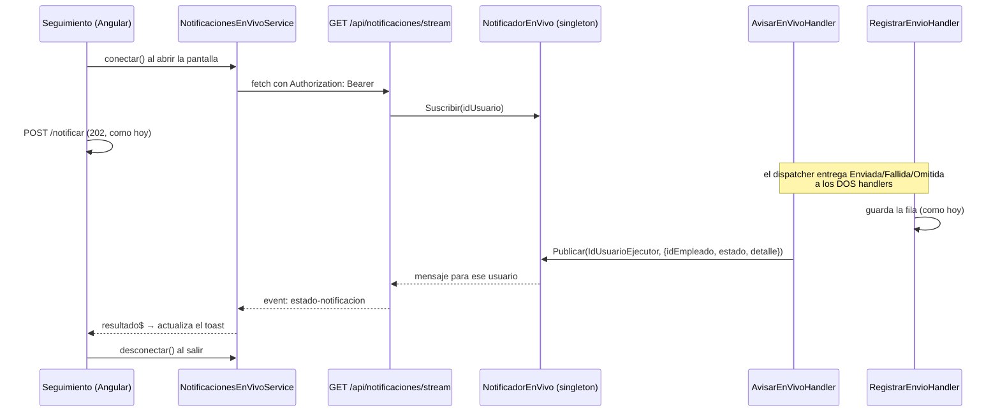

# SSE - Cómo se aplicaría

Parte de [[00 - Índice Notificaciones]]. Comparación con WebSockets y SignalR → [[20 - WebSockets y SignalR - Alternativa]].

> [!info] Estado: **propuesta, no implementada** (16/10/2026)
> Nos pidieron agregar notificaciones "en vivo". Esta nota explica cómo se haría con **SSE**, qué se tocaría y qué hay que confirmar antes. No se cambió código.

## 1. Qué es SSE

**Server-Sent Events**: el navegador abre **una** petición HTTP que queda **abierta**, y el servidor manda mensajes por ella cuando pasa algo. Es en **un solo sentido** (servidor → navegador).

Analogía: una **radio**. El servidor transmite y el navegador escucha.

Formato de lo que viaja (texto plano, `Content-Type: text/event-stream`):
```
event: estado-notificacion
data: {"idEmpleado":7,"estado":"Enviado","detalle":null}

: ping
```

## 2. Para qué lo usaríamos

| Uso | Hoy | Con SSE |
|---|---|---|
| **Resultado del aviso manual en Seguimiento** *(principal)* | El front pregunta a `GET /estado` cada 2 s, hasta 10 veces (~20 s) | El backend avisa **en cuanto** se registra Enviado / Fallido / Omitido |
| Campana del navbar *(opcional)* | Solo se actualiza al cargar o al abrir la campana | Se actualiza sola |
| Progreso de un corte *(futuro)* | — | "Procesando 40 de 120…" |

Ventajas: el toast se actualiza al instante, no hay límite de 20 s (si el dispatcher reintenta, el aviso llega igual) y hay menos peticiones al servidor.

## 3. Cómo funcionaría



## 4. Qué se tocaría

### Backend (`tmr-backend`)

| # | Archivo | Nuevo o modificado | Qué |
|---|---|---|---|
| 1 | `Features/Notificaciones/Infrastructure/EnVivo/INotificadorEnVivo.cs` | 🆕 | Interfaz: `Suscribir(idUsuario, ct)` → `IAsyncEnumerable<mensaje>`, `Publicar(idUsuario, mensaje)` |
| 2 | `Features/Notificaciones/Infrastructure/EnVivo/NotificadorEnVivo.cs` | 🆕 | **Singleton** en memoria: un `Channel` por conexión abierta, agrupado por usuario. Al cerrarse la conexión, se da de baja |
| 3 | `Features/Notificaciones/Application/Handlers/AvisarEnVivoHandler.cs` | 🆕 | Escucha `NotificacionEnviada`, `NotificacionFallida` y `NotificacionOmitida`; si tienen `IdUsuarioEjecutor` (avisos manuales), llama a `Publicar` |
| 4 | `Features/Notificaciones/NotificacionesModule.cs` → `AddNotificacionesModule` | ✏️ | + `AddSingleton<INotificadorEnVivo, NotificadorEnVivo>()` y + 3 `AddScoped<IEventHandler<…>, AvisarEnVivoHandler>()` |
| 5 | `Features/Notificaciones/Presentation/Endpoint/NotificacionesEndpoints.cs` → `MapNotificacionesEndpoints` | ✏️ | + `GET /api/notificaciones/stream` con `RequireAuthorization("NOTIFICACIONES_EJECUTAR")`. Usa `ICurrentUserService.UserId` y `TypedResults.ServerSentEvents(...)` (.NET 10), y manda un "ping" cada ~20 s |

**¿Por qué un handler nuevo?** El `EventDispatcher` entrega cada evento a **todos** sus handlers. Así `RegistrarEnvioHandler` (de Roberto) no se toca: uno guarda y el otro avisa.

**No se toca:** `Program.cs`, los 3 handlers actuales, el bus de eventos, Quartz, la base de datos ni la compresión (`text/event-stream` no está en los tipos que se comprimen).

### Frontend (`tmr-frontend/src/app`)

| # | Archivo | Nuevo o modificado | Qué |
|---|---|---|---|
| 1 | `package.json` | ✏️ | + `@microsoft/fetch-event-source` |
| 2 | `shared/services/notificaciones-en-vivo.service.ts` | 🆕 | `conectar()`, `resultado$` (`Observable<EstadoEmpleado>`) y `desconectar()`. Toma el token de `core/services/auth.service.ts → getToken()` y reconecta solo |
| 3 | `features/time-report/seguimiento/seguimiento.ts` (`SeguimientoComponent`) | ✏️ | Ver tabla de abajo |

Cambios en `seguimiento.ts`:

| Lugar | Cambio |
|---|---|
| `implements AfterViewInit` | + `OnDestroy` |
| `ngAfterViewInit` / constructor | `enVivo.conectar()` |
| `ngOnDestroy` *(nuevo)* | `enVivo.desconectar()` |
| `notificarColaborador` | Después del `POST /notificar`, espera el primer mensaje de `resultado$` para ese `idEmpleado`. El `switch` del toast **queda igual** |
| `esperarResultadoNotificacion` | **Se queda como respaldo**: si no llega nada por SSE en X segundos o la conexión está caída, consulta `GET /estado` como hoy |

**No se toca:** `notificaciones.service.ts` (`notificar`, `getEstado`), `notificacion-toast.service.ts`, el HTML de Seguimiento, los interceptores ni el navbar (salvo que se quiera la campana en vivo).

### Resumen

| | Nuevos | Modificados |
|---|---|---|
| Backend | 3 | 2 |
| Frontend | 1 + 1 dependencia | 1 |

## 5. Decisiones importantes

1. **Autenticación con `fetch-event-source`, no con `EventSource`.**
   El `EventSource` nativo **no puede mandar headers**, y el proyecto autentica con `Authorization: Bearer` (`token.interceptor.ts`). Mandar el token en la URL (`?access_token=`) funciona, pero el token queda en los logs del proxy. Como `fetch-event-source` **no pasa** por los interceptores de Angular, el token se toma de `AuthService.getToken()`.
2. **`GET /estado` se mantiene como respaldo.** Si la conexión se corta, se reconecta, o hay más de una réplica, el resultado igual se puede consultar.
3. **Solo recibe el resultado quien pidió el aviso:** `IdUsuarioEjecutor` del evento.
4. **Ping cada ~20 s**, para que el proxy no corte la conexión por inactividad.
5. **Nombre "en vivo":** describe lo que hace y no la tecnología. Va en español, como el resto del proyecto, y sigue siendo válido si mañana se cambia a SignalR.

## 6. Qué hay que confirmar antes

### Con el encargado de Dokploy
1. **¿Cuántas réplicas tiene el backend?** Con una, funciona tal cual. Con varias, el aviso puede generarse en una réplica y el navegador estar conectado a otra → no llega (el respaldo `/estado` lo cubre).
2. **¿El proxy (Traefik u otro) hace *buffering*?** Si lo hace, los mensajes llegan tarde o todos juntos.
3. **¿Qué timeout de inactividad tiene el proxy?** Con ese dato se define cada cuánto mandar el ping.
4. **¿HTTPS con HTTP/2?** Con HTTP/1.1 cada pestaña ocupa una de las pocas conexiones por dominio.
5. **¿Hay CDN, WAF o Cloudflare delante?** *(CloudBeaver no cuenta: es un cliente de base de datos, ver [[11 - Base de datos]].)*

### Con QA o el líder técnico
1. ¿SSE reemplaza el polling o lo complementa? *(Recomendado: complementa.)*
2. ¿Cuánto espera el toast antes de decir "sigue en cola"?
3. ¿Qué mostrar si se corta la conexión?
4. ¿Solo el líder que pidió el aviso, o también otros líderes y administradores?
5. ¿La campana del colaborador también en vivo?
6. Casos de prueba: envío lento, token vencido, usuario sin permiso, varios avisos seguidos, reinicio del backend con la pantalla abierta, dos pestañas abiertas.

### Con el equipo
- **Quién lo hace**, porque se tocan archivos de **Jonathan** (`NotificacionesEndpoints`, Seguimiento), **Allan** (toast y `/estado`) y **Milena** (`NotificacionesModule`).
- **En qué rama:** `feature/notificaciones-limpia` (back) y `feature/notificaciones` (front), o una rama nueva para SSE.

## 7. Lo que puede fallar

| Riesgo | Mitigación |
|---|---|
| Varias réplicas → el aviso no llega | Respaldo `GET /estado`; a futuro, Redis pub/sub o `LISTEN/NOTIFY` de Postgres |
| Proxy con *buffering* o timeout corto | Ping periódico + configuración del proxy |
| Token vencido con la conexión abierta | Al reconectar, usar el token renovado de `AuthService` |
| Reinicio del backend | El front reconecta solo; `/estado` recupera lo que se perdió |
| Muchas pestañas abiertas | HTTP/2; conectar solo en Seguimiento |

## 8. Cómo verificarlo

1. Abrir Seguimiento → en DevTools, pestaña **Network**, debe verse `stream` abierta, de tipo `eventsource` o `fetch`, con pings cada ~20 s.
2. Notificar a alguien → el toast cambia **sin** peticiones a `/estado`.
3. En CloudBeaver, la fila de `notificacion_envio` debe coincidir con lo que mostró el toast. Ver [[11 - Base de datos]].
