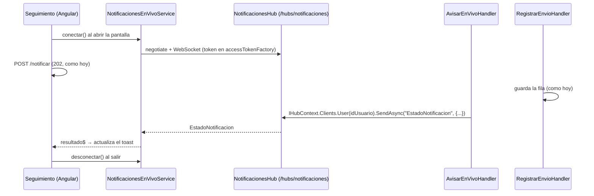

# WebSockets y SignalR - Alternativa

Parte de [[00 - Índice Notificaciones]]. Plan principal con SSE → [[19 - SSE - Cómo se aplicaría]].

> [!info] Estado: **propuesta, no implementada** (16/10/2026)
> Quien pidió las notificaciones "en vivo" mencionó WebSockets. Esta nota explica qué cambia si se hace con WebSockets, o más bien con **SignalR**, que es como se hace en .NET.

## 1. Las 3 opciones en simple

| | **SSE** | **WebSockets** | **SignalR** |
|---|---|---|---|
| Qué es | Petición HTTP que queda abierta; el servidor manda mensajes | Canal permanente donde **los dos** hablan | Librería de Microsoft que **usa WebSockets** y, si no puede, cae a SSE o *long polling* |
| Sentido | Servidor → navegador | Servidor ↔ navegador | Servidor ↔ navegador |
| Analogía | 📻 Una radio | 📞 Una llamada | 📞 Una llamada con respaldo |
| En .NET 10 | `TypedResults.ServerSentEvents` | A mano (bajo nivel) | `AddSignalR()` + un *Hub* |
| En Angular | `@microsoft/fetch-event-source` | `WebSocket` nativo | `@microsoft/signalr` |
| Varias réplicas | A mano | A mano | Solución oficial (Redis *backplane*) |
| Reconexión | La lib la hace | A mano | Incluida (`withAutomaticReconnect`) |
| Complejidad | Baja | Media–alta | Media |

> [!tip] En .NET, "WebSockets" casi siempre significa SignalR
> Casi nadie usa WebSockets "a pelo" en ASP.NET: hay que manejar la conexión, los mensajes, la reconexión y los usuarios a mano. SignalR hace todo eso.

## 2. ¿Cuándo conviene cada una?

- **SSE** → si solo hay que **recibir** avisos (el resultado del correo), con **una réplica**. Es nuestro caso actual.
- **SignalR** → si piensan **crecer**:
  - la campana en vivo para todos los usuarios;
  - **varias réplicas** en Dokploy;
  - que el navegador también **mande** cosas por el mismo canal (por ejemplo, "marcar como leída");
  - otras funciones en tiempo real en el TMR.
- **WebSockets a mano** → no se recomienda. Es más trabajo y no aporta nada frente a SignalR.

**Pregunta clave para quien lo pidió:** *"¿El navegador solo tiene que **recibir** avisos, o también tiene que **enviar** cosas por ese canal? ¿Solo Seguimiento o toda la app? ¿Una o varias réplicas?"*

## 3. Cómo funcionaría con SignalR

La idea es **la misma** que con SSE: un handler nuevo avisa al líder cuando se registra el resultado. Solo cambia el "transporte".

## 4. Qué se tocaría con SignalR

### Backend (`tmr-backend`)

| # | Archivo | Nuevo o modificado | Qué |
|---|---|---|---|
| 1 | `Features/Notificaciones/Infrastructure/EnVivo/NotificacionesHub.cs` | 🆕 | `class NotificacionesHub : Hub` con `[Authorize(Policy = "NOTIFICACIONES_EJECUTAR")]`. Puede estar vacío: el servidor envía y el cliente no llama a métodos |
| 2 | `Features/Notificaciones/Infrastructure/EnVivo/UsuarioPorSubProvider.cs` | 🆕 | `IUserIdProvider` que devuelve el claim **`sub`**. Por defecto SignalR usa `ClaimTypes.NameIdentifier`, pero el proyecto usa `MapInboundClaims = false`, y el id del usuario está en `sub` (igual que en `CurrentUserService`) |
| 3 | `Features/Notificaciones/Application/Handlers/AvisarEnVivoHandler.cs` | 🆕 | Igual que en SSE, pero usa `IHubContext<NotificacionesHub>` → `Clients.User(id).SendAsync("EstadoNotificacion", {...})` |
| 4 | `Features/Notificaciones/NotificacionesModule.cs` → `AddNotificacionesModule` | ✏️ | + `services.AddSignalR()`, + `AddSingleton<IUserIdProvider, UsuarioPorSubProvider>()`, + los 3 `AddScoped<IEventHandler<…>, AvisarEnVivoHandler>()` |
| 5 | `Program.cs` | ✏️ | **(a)** `app.MapHub<NotificacionesHub>("/hubs/notificaciones")`. **(b)** En `AddJwtBearer` → `JwtBearerEvents.OnMessageReceived`: si la ruta empieza con `/hubs`, leer el token de `access_token` del query string. El navegador no puede mandar headers en WebSockets |

**Diferencias con SSE en el backend:**
- **Sí se toca `Program.cs`** (archivo de Milena), por el `MapHub` y la lectura del token.
- No hace falta `NotificadorEnVivo` propio: SignalR ya maneja las conexiones por usuario.
- El token viaja en la URL **solo** para `/hubs/...`. Hay que pedir que el proxy no lo guarde en los logs.
- CORS ya tiene `AllowCredentials()` y `WithOrigins(...)`, que es lo que SignalR necesita.

### Frontend (`tmr-frontend/src/app`)

| # | Archivo | Nuevo o modificado | Qué |
|---|---|---|---|
| 1 | `package.json` | ✏️ | + `@microsoft/signalr` |
| 2 | `shared/services/notificaciones-en-vivo.service.ts` | 🆕 | `HubConnectionBuilder().withUrl(".../hubs/notificaciones", { accessTokenFactory: () => auth.getToken() }).withAutomaticReconnect()`. `conectar()`, `resultado$` (escucha `"EstadoNotificacion"`) y `desconectar()` |
| 3 | `features/time-report/seguimiento/seguimiento.ts` | ✏️ | **Igual que con SSE:** conectar al entrar, desconectar al salir, `notificarColaborador` espera `resultado$`, y `esperarResultadoNotificacion` como respaldo |

> [!note] El servicio se llama igual en los dos casos
> Como el nombre es "en vivo" y no "SSE", Seguimiento **no cambia** si se pasa de SSE a SignalR: solo cambia lo de adentro del servicio.

### Resumen comparado

| | SSE | SignalR |
|---|---|---|
| Backend nuevos | `INotificadorEnVivo`, `NotificadorEnVivo`, `AvisarEnVivoHandler` | `NotificacionesHub`, `UsuarioPorSubProvider`, `AvisarEnVivoHandler` |
| Backend modificados | `NotificacionesModule`, `NotificacionesEndpoints` | `NotificacionesModule`, **`Program.cs`** |
| Endpoint | `GET /api/notificaciones/stream` | `/hubs/notificaciones` |
| Token | Header `Bearer` | `access_token` en la URL (solo hubs) |
| Frontend | `fetch-event-source` + servicio + `seguimiento.ts` | `@microsoft/signalr` + servicio + `seguimiento.ts` |
| Varias réplicas | Respaldo `/estado` (o pub/sub a mano) | `AddStackExchangeRedis()` (*backplane*) |

## 5. Qué hay que confirmar con Dokploy (además de lo de SSE)

1. **¿El proxy permite WebSockets** (el *upgrade* de HTTP a WebSocket)? Traefik lo permite por defecto, pero conviene confirmarlo.
2. **¿Timeout de conexiones largas?** SignalR manda su propio *keep-alive* cada 15 s.
3. **¿Varias réplicas?** Si las hay, hace falta **Redis** como *backplane*, o *sticky sessions* (que cada navegador vuelva siempre a la misma réplica).
4. **¿El proxy registra las URLs completas en los logs?** Con WebSockets, el token va en la URL.

## 6. Recomendación

- **Si es solo el resultado del aviso en Seguimiento, con una réplica → SSE** ([[19 - SSE - Cómo se aplicaría]]).
- **Si mencionan "WebSockets", "bidireccional", "toda la app" o "varias instancias" → SignalR**, con esta nota como plan.
- En los dos casos se **mantiene `GET /estado` como respaldo** y la pantalla de Seguimiento cambia lo mismo.
